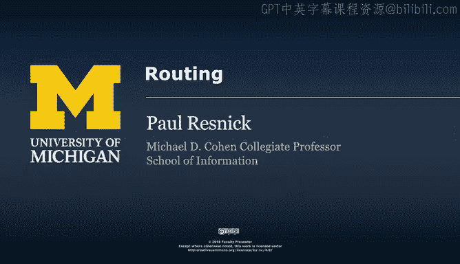
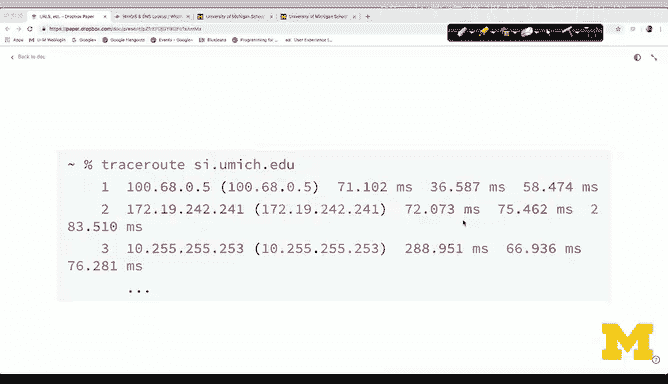

# 密歇根大学《Python3编程（课程3、4、5）》｜Python 3 Programming（Python for everyone进阶）（中英字幕） - P35：34_04_03_路由机制.zh_en - GPT中英字幕课程资源 - BV1gj41177yd

Welcome back。Let's talk about how data gets from one computer to another on the Internet。

 When your browser talks to some remote server， say w W W dot S I doum。edduu。

It establishes a connection， and then it sends some data。Pieces of text or other formatted data。

 and each of those pieces of content gets chopped up。Into a bunch of packets。

Each of those small packets gets sent out onto this big routing system that consists of a whole bunch of routers。

 routers are just computers whose sole job is to receive these data packets and pass them on。

And each packet will go along， goes from one router to the next。

Each of those routers has a big look up table that says， if this。

Packet that I've received is destined for。Some particular address。 What's the next。Hop。

 what's the next router I should send it to？And magically。

 all of these routers have managed to coordinate their routing tables so that when a packet gets sent here。

It eventually makes its way to the destination。It's a rather remarkable system that there are trillions of these packets getting routed around and they all mostly manage to get to their destination。

 occasionallyccaion things go wrong and packets don't make it。Here's the first few lines。

Of a trace route that I did， This is something that gives some diagnostics about if I'm trying to send data packets from my computer to。

SI。ummiidduu， what happens to them？And the first line is telling me， where does that packet go first。

 Well， first， it goes to。A computer that has the address， 100。68 0。5。

And it took 71 milliseconds to get it there。In fact， when I run this trace route program。

 it does this three times， and so one time took 71 milliseconds， the next time it took somewhat less。

 the third time， somewhere in the middle at 58。4 milliseconds。The second line is saying。

 where does a data packet go if it's eventually trying to get to S。untmed at Eduu。

 where does it go next？Well， it went from a computer at address 100。68。0。5。To a computer at 172。19。

242。 241。And we can see this is called two hops。The first hop went 100 at 68。

 the second hop to 1 hundred and 72 dot 19。The third hop was another router at 10 dot 255 do 255 do 253。

 and so on。 I haven't shown you all the way。 But after 8 or 10 hops。

The packets eventually get to S I。mi D。 and typically to go two hops。

 it takes a little longer than to go one hop。So that gives you a little sense of what's going on behind the scenes。

 we're not going to have to deal with all of this technical detail。

 I just wanted to give you a sense of what's happening when one computer is talking to another。

So that's the basics of internet routing how one computer can send data to another computer by way of intermediate routers。

We'll see you next time。