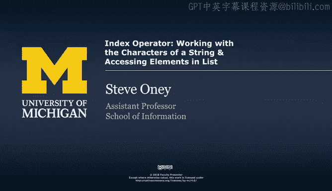
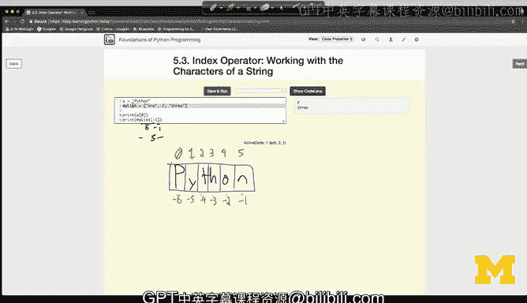

# 密歇根大学《Python3编程（课程1、2）》｜Python 3 Programming（Python for everyone进阶）（中英字幕） - P35：35_02_05_索引运算符.zh_en - GPT中英字幕课程资源 - BV1CM411Z72u

Welcome back。Now remember that sequences like strings， lists， or tuples are ordered collections。

 meaning that they have a first item， a second item， a third item， and so on。Now。

 often it can be useful to actually ask what is that first item or second item。

Indexing allows us to access a specific element of a sequence。

So let's suppose that I have the sequence S， which is a string， again， a sequence of characters。

 Now when I print out S， then I get Python。Suppose that rather than getting the whole string。

 I only cared about the first character。In order to do that， then I would index on S。

In order to index， then I would say S， and then I would say in square brackets。

 the actual index that I want。So if I wanted the first character of v。

 I would actually say index 0 because Python is what's called zero indexed and what that means is that if I have a string like s。

Which is P， Y， T， H。Oh， and。Then Python， because this is a sequence。

 every character is almost in a little bin。And the first character has index 0。

 The second character has index 1。 The third character has index 2，3，4， and so on。

So you might be wondering why almost every programming language， including Python is0 indexed。

 where this first index is 0。 So the creator of Python explained this。

 He said to anyone who prefers one based indexing， you're the same people who screwed up the calendar starting at year 1 in calling the 1900s to the 20th century and arguing that the year 2001 ought to be the start of the next millennium。

 Haven't you done enough damage。So he said this in jest。

 but there is a reason that most programming languages are0 indexed。

 It can actually be somewhat convenient once you get used to it。So indexing works on strings。

 lists and tuples， so let's suppose that I have a list， my list。

And i set my list to be a list with three items one。Qiu。3。So again， if i print out my list。

As a whole， then I get the complete list。If I only cared about the second item in my list。

 then I would say my list and then open square brackets。In close square brackets。

 in between the square brackets， I would say the index that I want。

 So if I cared about the second item， then I would say index 1 because in zero indexed the languages。

 that's the second item。so when i print out my list sub one then that gives me two。

If I print out my list sub2， then that gives me three if I print out my list sub zero。

And that gives me。So another useful thing to do on sequences is to be able to ask what's the length of the sequence。

 in other words， how many characters are in this string， how many items are in this list。

And in order to do that， we have a function called L。Len takes in a sequence like S or my list。

And the value of this overall expression， this called a lens is going to be how many characters or items are in that sequence。

So for example， if I print out。The length of S。i s print la of as。

Then I get the number of characters in S， which is going to give me6 because I have six characters in this string S。

If I print out the length of my list。then i get three because i have three items in my list。

One thing to note here is that even though the first and third item happen to be strings。

 then my list itself only has three items。 The first item being a string。

 The second item being an integer and the third item being its string。 So its length is 3。

So sometimes it can also be useful to be able to get the last item of a sequence as opposed to the first item。

So again， if we wanted to print the first item， I would say S。Sub 0。If I want to get the last item。

 I would say print S sub。And then I can write the length of S。

But then I actually have to subtract one from that because s is zero indexed。So if I run this。

 then I see that S printing out s sub 0 gives me the first character of s， which is a capital P。

 and printing out s suble of s minus1 gives me the last character of S， which is an n。So again。

 just to illustrate why that is then i'm going to write out the indices of s。

So the first character is item zero。 Second character is item one。 Third character is item 2，3。

4 and 5。And so what that means is that theres a total of one，2，3，4，5，6 items。And so the length of S。

 this part of the expression， has value 6。But if I actually asked for S sub6。

 then it would be looking for a character that S doesn't have again， because S is0 indexed。

 I need to subtract one from 6。To get 5。Now， it is really common to ask for the last item or the second to last item。

 So Python also includes， in addition to these positive indices 1，2，3，4，5 and 0， of course。

 it also includes negative indices that count backwards from the end of the sequence。

 so I can ask for S sub negative 1， or negative 2， negative 3， negative 4。Negative5 or negative6。

So if I replace this call。To print out the last character of s by printing out s sub length of s minus1。

 just to say print out s sub negative 1， then I get the exact same result。

If I print out S sub negative 3。Then that's going to be the third to last character in this case， H。

 which I can see when I run my code。If I print out S sub negativeative2， then I get O and so on。

And of course， this negative indexing also works for lists just as well as it works for strings。

So if I print out my list sub negative 1， then I'm going to get the string three because that's the last item of this list。

 my list。Until next time。

