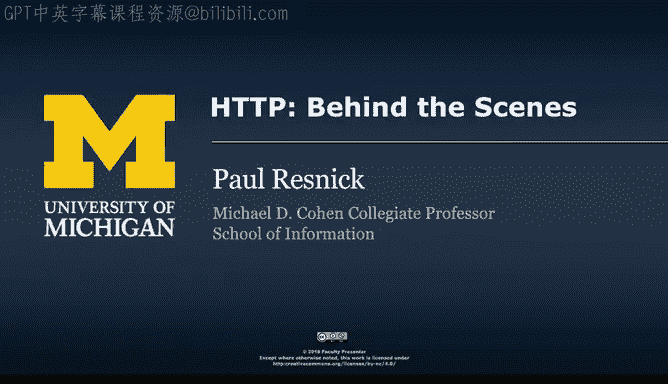
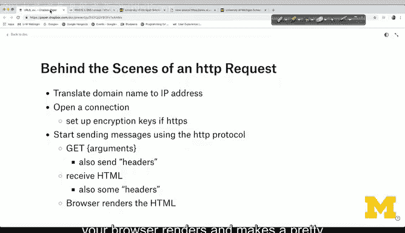

# 密歇根大学《Python3编程（课程3、4、5）》｜Python 3 Programming（Python for everyone进阶）（中英字幕） - P36：35_04_04_HTTP协议幕后原理.zh_en - GPT中英字幕课程资源 - BV1gj41177yd

Welcome back。Let's talk about what happens behind the scenes when your browser fetches data from a remote server。

The particular way that we're going to be most interested in having one computer talk to another is using the HTTP protocol。

So that's when we have a URL that begins HTTP colon。Slash slash。Something like。Dub， duub， dub。

Dot S I， dot Uish。Thatt E。And maybe something after the slash。

The first thing that's going to happen is my computer is going to take this domain name www。s。umish。

edu， convert it into an IP address。As I illustrated a minute ago。

Then my computer makes a connection to the remote computer。If I were using HtTPS。

 that's the secure version。Then the first thing that my computer would do was send some information back and forth to the S@ummiduu server that would establish encryption keys so that all of the rest of the communication would be encrypted and nobody who intercepted that communication would be able to figure out what we were saying to each other。

After that， setup has happened。Now， my browser will start to send messages。

 and it'll actually send text。 It'll send the word G， E T， get。And then， it'll send。

Whatever arguments were after the slash。So it'll say what path we're looking for。

It'll also send some headers saying things like， hey。

 I'm a Chrome browser or I'm an internet Explorr browser。The current time is。Certain time。

 it'll give a timet and a few other headers。We will then receive back from that server。

Some response headers， those response headers will say things like， I'm sending you HTML。

And the current timestamp is such and such， and there are a few others。

 I'm going to show you this in a minute。And then most importantly。

 as I had you Mreaddu is going to send me some H M L。That HTML。

 my browser is going to take and turn into what we are used to seeing in a browser， a web page。

 so the browser renders that HTML。Let's take a look and see what this looks like for the Umied IDDDU website。

Here I have a web page open in my browser。The URL is H TTPS colon slash s www。s。um。duu。

And you can see that it's all pretty on the screen。But what's really happening in the background。

 What's happening in the background， I'm using the Chrome debugger tool。

 and I've got it set up to show us。That when I made that request。My browser opened a connection。

 and the first thing it did was that it made a get request。

And this is the full URL that it asked for。 We can see all of the request headers。

So we asked for a get。We sent the path was backst， was just slash。

Because I didn't have anything after the slash。 If I had asked for a particular page。

 then we would see something more in the path down here。The scheme or protocol was HtTPS。

Then there's a whole bunch of other things that we won't go into。 The user agent was。

Compatible with all of these things， it's actually the Chrome browser that I'm using。

So these are all things that my browser sent to the server。

And the server responded by sending back a whole bunch of response headers。There's the timestamp。

Of when it sent it back。There's various things here， including can see。

A little information that the website is powered by PHP as its backend。

And the content type is text/ HTML in the UTF 8 encoding and so on so these are all things that my browser uses。

 and then the most important stuff that we get back was actually all of this HTML。

And all of this stuff got sent back。And the browser managed to parse all of this。 This is just text。

This text is not what's normally shown on the web page。

 what's shown on the webp page is this pretty thing。

And that's the browser rendering all of that HTML。If you don't know how to use the Chrome debugger。

 it can be。A little confusing， but if you just want to see what the HTML is for any page。

 you can do a right click。And you paid source。And see all of that stuff that got sent back。

From the server。So to summarize， when your browser fetches data from a remote web server。

 it makes a connection。It sends a few headers and asks for the path。

 the arguments that it would like to receive。 It gets back some headers。

 and especially it gets back H T M L， which your browser renders and makes a pretty web page out of。

See you next time。