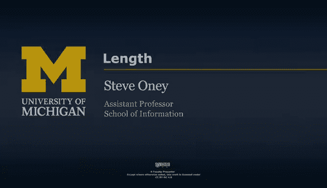
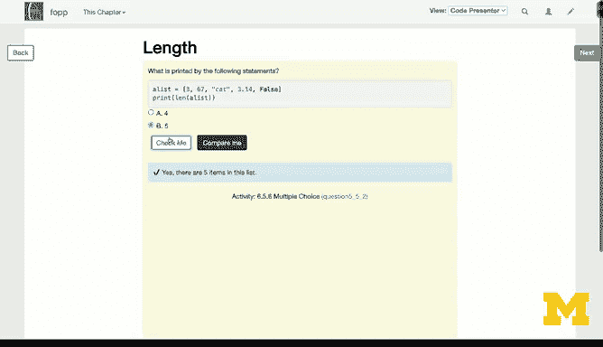

# 密歇根大学《Python3编程（课程1、2）》｜Python 3 Programming（Python for everyone进阶）（中英字幕） - P36：36_02_06_长度获取.zh_en - GPT中英字幕课程资源 - BV1CM411Z72u

The lens function， when applied to a sequence like a string or a list。

 gives the number of items in that sequence， so for example。

 here we have a string banana that's assigned to the variable fruit。And when we get the L of fruit。

If we run our code。Then we're going to get six as the line of fruit。

 and that's because this string has one， two， three， four， five， six characters。

So if we change our string to be X， Y，z。Then Le of fruit would instead be3。

So let's change fruit back。And。Again， when we're doing indexing。

 we might want to do something where we get the last item。Of a sequence。

 So we might be tempted to get the last character in fruit by saying something like。And see。

 so the last index， we might want to assign it to be Le of fruit。

And then if we want to get the last item， we can say last equals fruit。Subsz。

And we might want to print out last thinking that we're going to get a as the last character。

But if I actually run this code， then I get an index error saying that the string index sits out of range on line 3。

 and what this is saying is that when we ran this line of code。

Then we tried to get an item from our string that was outside of its range Well why did that happen Well。

 remember that L of fruit is going to be 1，2345，6， so Sz gets the value 6 because there are six characters。

But you should also remember that we're zero indexing。

 so what that means is that the first character is index 0， then 1，2，3，4，5。

 and so because we're zero indexed， the last character is actually at index 5。

 and not the length of our string which is6。So in order to actually get the last character。

 what we should do。Is we should say last equals。Fruit sub S Z。min-1。

So now Sz is the size of our string or the number of characters， which in this case is going to be 6。

 and then Sz minus1 is going to be the last index or in this case 5。

 which is what we want if we're zero indexed， and if we do this。

Then we can see that the last character is a。Now， typically if we were actually writing this in code。

 we wouldn't create a separate variable to keep track of the size。

 we would probably say something like last equals。Fruit sub， La of fruit。-1。

Or even better we would use negative indexing in this specific case。Now。

 let's suppose that instead of getting the last character。

 we wanted to get the middle character of a string。

 so let's assign fruit to be something else like grape。

And let's suppose that we wanted to know what the middle character of this fruit was。

 so in this case， it would be a because a is right in the middle。

If we wanted to do something like that， what we could do is here we would want mid char。

What we could do is we could get L of fruit。And you might be tempted to divide length of fruit by two。

 but the problem with this is that it would give us a float， which is not appropriate for indexing。

Instead， we can use truncated division to say Le of fruit。

And then cut off the remainder when it divides by 2 and this gives us an integer。

 so it takes the line of fruit divides by 2 and you can think of it as cutting off whatever comes after the decimal point here。

So if we do this here， then we get that the middle character of our fruit is a。

The lens function also works on lists in addition to strings， so for example。

 here we have a list named a list， and this list has three items。

 the first item just so happens to be a string， but that's still one item and then the second item is afloat and the third item is an integer。

Now， when we print outL of a list。And let me comment out line 3 here。

One important thing to note when we print out L of A list is that we're printing out the length of the top level list。

 so in other words， it doesn't matter how many characters are in this string。

 this string is just one item in A list， so no matter how many characters are in that first string。

 the length of A list is going to be three。If we wanted to get the length of this string rather than the length of the surrounding list。

 then we could print out something like。Len of a list sub0 because the value of this expression。

 a list sub0。Is going to be whatever the first item an A list is。

 so in this case it's going to be this string。So when we print out L of a list sub0ro。

Then we're going to get the length of the string， which in this case， is going to be 5。

 or if I added more。Os is going to be longer。Let's do some multiple choice questions。First。

 what is printed by the following statements， So here we assign s to be this string Python rocks。

 and we print out this expression land of s。So when we run this code。

The value of this expression is going to be the number of characters in S。

 so in this case it's going to be 1，2，3，4，5，6，7，89，10，1112。

 so I would expect the correct answer to be B12。Next question。

 what is printed by the following statements， So here we assign a list to be this list。

And we print out the L of A list。So in other words， how many items are in a list。 So again。

 we can count， you can say。1，2，3。Again， this string is just one item。4，5。

 And so we expect the correct answer to be 5。That's all for now， until next time。

