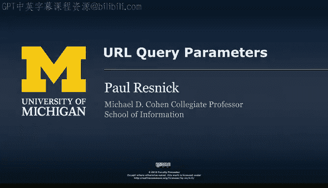
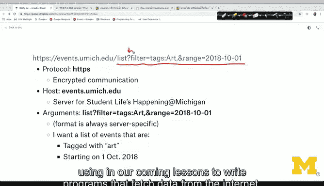

# 密歇根大学《Python3编程（课程3、4、5）》｜Python 3 Programming（Python for everyone进阶）（中英字幕） - P37：36_04_05_URL查询参数.zh_en - GPT中英字幕课程资源 - BV1gj41177yd

Welcome back。Let's talk about a particular URL structure that's very common。

We're going to talk about what happens after the slash。

And a very common format is to have some path name。In this case， just slash list。

And then we have the character。Question mark。And after the question mark， we get。Qury parameters。

So as before， we have a protocol。HttPS。We have a host， in this case。

 events that you missed I D to you。And then we have the arguments， everything after the slash。Now。

 any web server gets to decide what format of arguments it's willing to accept。

 But this is a very common one where you'll have some path name and then question mark。

 and then these query parameters。 and these query parameters are very often formatted in these。

Key equals value。Key equals value。 So we have two of these keys。One key is called filter。

And the other one is called range。The value of filter is tags。Colin art。Kma。

And the range has the value 2018 1001。1 of October 2018。

The server is going to interpret this request as a request to search on the server to find out those。

Events that are happening on 2018 or beginning 2018 October 1t。

And that somehow are tagged with the word art。So if we visit that URL。

The web server is interpreting the request as a query。

And it is returning information just about artistic activities that are happening around campus。

Starting on October 1t。And you can see some of the。Interesting artistic things that are happening。

 especially。In the university hospitals， but also elsewhere around campus。So this URL structure。

Where we have as arguments。A path， and then a question mark and key equals value pairs。

 This is a very common URL pattern， and one that we'll be using in our coming lessons to write programs that fetch data from the Internet。

We'll see you next time。