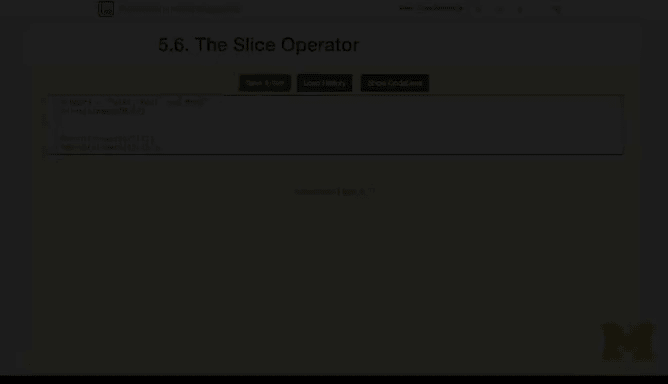
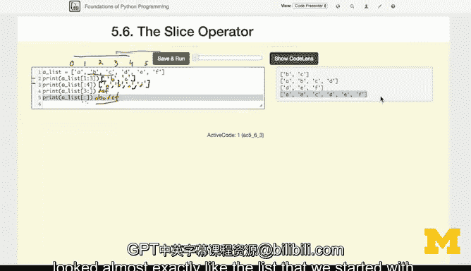

# 密歇根大学《Python3编程（课程1、2）》｜Python 3 Programming（Python for everyone进阶）（中英字幕） - P37：37_02_07_切片运算符.zh_en - GPT中英字幕课程资源 - BV1CM411Z72u

So we've already covered indexing， which is getting a specific item out of a sequence of items。

 whether it be a string list or tuple。Slicing is a related concept。

 whereas indexing gets one particular item， slicing gets a subset or sub sequenceequences of item in the sequence。

The way that we actually specify that we want to slice is werite something that looks something like indexing。

 so we say the name of the sequence in this case， suppose that we have a sequence singers。

Whose value is set to the string， Peter， Paul and Mary。And then after that。

 we have open square braces， just like we do for indexing， and then we specify an index。

But unlike in indexing， we have this colon and this colon is what distinguishes indexing or getting one particular item with slicing。

 which is getting a subset of the items。So the syntax for slicing is we say the sequence name。

 so I'll just call my sequence S。And then just like in indexing。We have open square braces。

And then after that， we say where to start。And then we have a colon。Again。

 that's what distinguishes slicing versus indexing。And then after the colon， we say where to end。

So in the case of this expression， we're saying that we're slicing on the string singers。

And we say that we're starting at index zero， so that means at the very beginning。

And we go through to index 5。And for context， index 5 is this comma。In index 0。Is the capital P。

So when I run this code。Then I see that when I print out Ss subs0 to5。Then what I get is just Peter。

And one thing to note with slicing is that you include the start index。

 but you don't include the end index。So let me actually just draw this string out on the screen。

 so we have singers equals the string Peter。Tma space， Paul。Comma space and space， Mary。

Now I'm just going to focus on the first portion of this。In Python， because this is a string。

We split every character into a different item。So item zero。Is the capital P item one is lowercase E。

 this is 2，3。4。😔，5， and so on。Okay。So one way to remember that we include the start index。

 but not the end index is to think of it this way。 so rather than these indices being on the actual squares。

 think of the index as being on the line， so think of0。As belonging to this line。

 one belongs to this line。2 belongs to this line，3 to this line。4。5， and then this line。Would be6。

So when we specify the start， we say start at that index or that line。

 so if I specify a start as index 0， then we say start here。

And if I specify the end as being index 5， then we say end at this line。

And the end result of this is that we get what's in between those two lines， in this case。

 we just get Peter。Let's try this out with a few more examples。

So now rather than printing out singers sub 0 to 5， I'm going to print out singers sub 7 to 11。Now。

 just to draw out what that looks like， again， remember singerings is Peter。Comama space， Paul。

Coma space and。Space， Mary。And every character is at a different index。Including the spaces。

And the commas。Okay。So when we say 7 through 11， again。

 think of the indices as being along these lines， so 0 is the first line，1，2，3，4，5。6，7。

7 here is our start index， and then we go through 8，9，10，11。And 11 here is our end index。

 And so when we slice from 7 through 11， then that's slicing from this line。To this line。

And when I run my code， I should expect to see Paul printed out。Okay。

 and then you can probably guess what the next line is going to print out。

 but let's actually draw it out。So。We have index12，13，14，15，16。1718，1920。

And this last line is going to be index 21。And so what that means is that when we slice from index 17。

 which is right here。To index 21， which is right here。Then we should expect to print out。

 You guessed it， Mary。We can also slice from the beginning or to the end of a string。

So here we have a string， fruit equals banana。And let's actually draw this out。So we have B。A， N， A。

 N A。 if we draw the separate indices。 So again， for slicing。

 I find it useful to put the indices on the lines between items， so。IItem0 is B。

 so I'm just going to draw the zero to represent this line， one to represent that line， 2，3，4，5。

 and we don't have an item6， but I could write6 here。

So let's suppose that we don't want to actually have to specify a start index。

 We want to say I want everything up until index 3。

Then I can actually omit a start index before the colon in the slicing operation。

So if I print out fruit sub blank to3， then that's going to give me BAN because Python is going to assume that because I didn't put anything here that I want to start at the beginning of the sequence。

Same with if I want to get everything after index3。

 so whereas when I said fruit sub colon3 that gave me everything before。Now。

 if I wanted to get everything after。Then， I could instead put。Fruit sub3， colon。

And what that's going to do is it's going to say start at index 3。 So again， right here。

And then because I don't have anything after the slicing operator。

 then Python' is going to assume that I want the rest of the sequence from there and the rest of the sequence starting from index 3 is A and A。

So when I run my code。They can see that Python prints out AN。Okay。

 let's do a little bit more at slicing。So remember that sequences include strings and lists。

 slicing on the list works on the same way as slicing on the string。So here we have a list， a list。

 and I'm not going to draw the full index diagram instead I'm just going to write the indices right in line in the code。

So let's think about what happens when we run line too。When we run line2。

 we're printing out a list sub 1， Col 3。So in our sequence， we have index one right here。

And we're printing out that through index 3。 And so what I would expect here is to print out。

This subsequentequence。And when we slice on a list， then we get a list as a result。

So the result of this should be a list that has items B。And。Xi。

When we print out a list sub nothing Col for。Then， we see that。4，5。

When we print out a list from the beginning to4， as we do here on line 3。

 then we should include everything from the beginning of the list a list up until。Index 4。

 and so I'm going to expect this to be A BC D。So， a。Bi。Xidi。When we print out a list sub3 colon。

 then I expect that to start at index 3， so right here and print out everything from there。

So that should be DEF， and I'm not going to write out the full array。

 I'm just going to write out D EF。On line 5， we have an expression that might look a little bit weird to us right now。

 so we have this operation that doesn't specify either a start nor an end。And when Python sees that。

 then it assumes that you want to start at the beginning of the list。

So it assumes that this is the beginning of the list。

 and then it assumes that you want to end at the end of the list。

So the end result of this expression is actually going to be something that looks a lot like the original list。

A， B， C， D， E， F。As we'll talk about later when we talk about mutation。

 it's actually a copy of the original list， which is significant for a few reasons。

 but we'll get back into that。The important thing to know now is that if we don't specify anything here。

 then we get something that looks a lot like the original list back。

So let's run our code just to be sure that our high hypotheses were correct。Okay。

 so the first item line two printed out b c just as we expected。Line 3 printed out A，B C， D。

 just like we expected。Line4 printed out D E F。In line 5。

 printed out something that looked almost exactly like the list that we started with。

