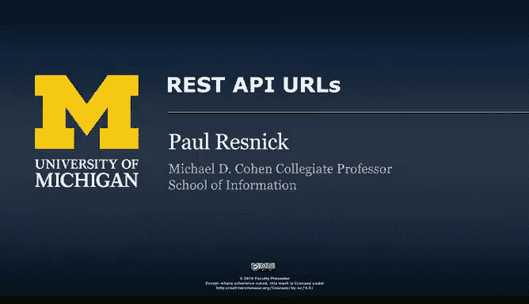
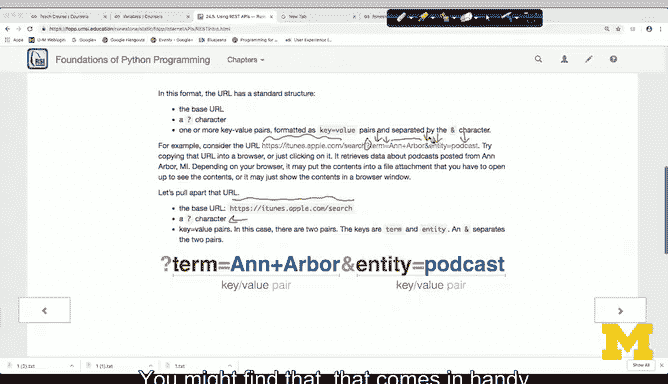

# 密歇根大学《Python3编程（课程3、4、5）》｜Python 3 Programming（Python for everyone进阶）（中英字幕） - P38：37_04_06_REST API URL设计.zh_en - GPT中英字幕课程资源 - BV1gj41177yd

Welcome back。A request to an API is made by visiting a URL。

Some APIs use a different part of the HTTP protocol called the post mechanismchan。

 in which case not all of the request is encoded right into the URL。

 but we're going to focus only on the simplest mechanism the HTTP get request where the entire request is encoded in the URL。

So let's look at the structure of a typical URL that's encoding a request for data from a rest API。

 in this case from the iTunes API operated by Apple。

It lets you do a search on the contents of iTunes for songs and podcasts and videos and the like。

I'm just going to copy this URL。We've got the full URL right here。

 and I've got it copied into a new tab。 It's， it really is a URL that you could visit。

And depending on your computer， it might show up。 The contents might show up on the page。

 or they might show up。As a file that got downloaded。Here it Gu was a file， and here's the text。

 you can see it。You can see that what we get back is a bunch of text that looks suspiciously like a Python dictionary。

It's actually text in JSON format， as we've seen before。

 that can be easily converted into a Python dictionary。Using the JsonN dot load S function。

So that's the data we get back when we visit that URL。

But let's break down that structure a little bit。There was a first part of it。

Which will call the base URL。The domain name and the first part of the path up through the slash search。

Then we've got the question mark character。And then we have these key equals value pairs。

 So one key is the word term。Here's the value。 And plus arbor。

And then there's another key entity with the value podcast。

And these key value pairs are key equals value。 There's always an equal sign between the key and the value。

And between the pairars， there is an ampersand。That's the basic structure of a request to arrest API。

 where all the information about the request is encoded right in the URL。In our case。

 we had to encode in the URL that we were making a request to the iTune server。

That's where you see itTunes。apple。com。We encoded that we wanted to search for something。

 That's the slash search part。That we wanted to search for Ann Arbor term equals an plus Arbor。

And that we wanted only podcasts， not books or songs。 That's the entity equals podcast part。

Because all the information about the request is encoded right in the URL。

 It's relatively easy to debug rest API requests。Becauseuse you can always open up the URL in a separate browser window like I did and immediately see what the site returns。

You might find that that comes in handy for debugging。I'll see you next time。

