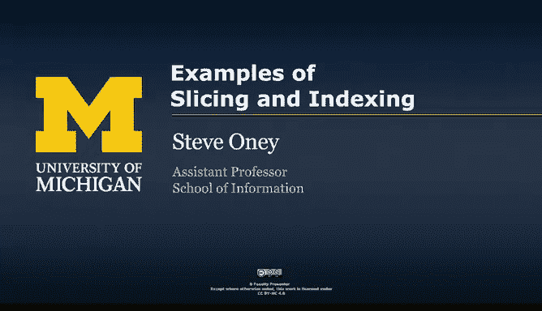
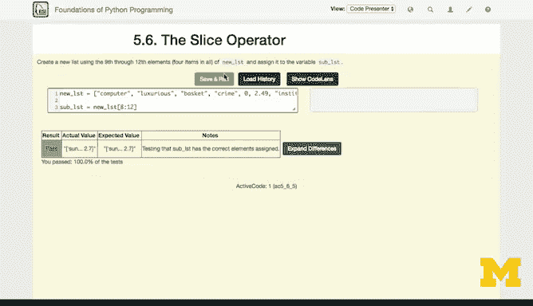
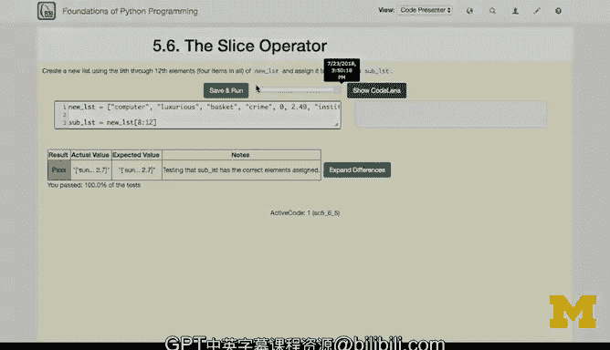

# 密歇根大学《Python3编程（课程1、2）》｜Python 3 Programming（Python for everyone进阶）（中英字幕） - P38：38_02_08_切片与索引示例.zh_en - GPT中英字幕课程资源 - BV1CM411Z72u

So let's go over some of the things that we've learned so far。

So remember that slicing and indexing works with tuples， just like it works with strings。

 lists or other kinds of sequences， so here we have a tuple Julia with a few items， some strings。

 some integers。In On line too， we print out Julia Subtu。If we want to determine what that prints out。

 we first need to determine what kind of operation this is。

 so we see that we're saying Julia' sub and so that should tell us that we're either indexing or slicing。

I don't see a colon here。 So that should tell me that this is indexing。

And so when I print out Julia sub2， that's going to print out the third item。 Again。

 the third item because we're zero indexed。 So the third item is。This is0， this is 1， this is 2。

 and so this should be 1967。Then we print out Julia sub 2 through 6。

 And so in order to determine what that prints out。

 I'm going to write the indices on the edges of the items。six。And so2 through 6 is going to be。Qiu。

Through 6。And so that should be everything from 1967。Through actress。

And that's what this line should print out。When we print out the length of Julia。

 the next's going to ask how many items are there。 So I see there is 0，1，2。3。4。5。6。

 don't get fooled by the comma here。 It's actually part of the string。

 not part of the tuple definition。 And so that's going to say that there are 1，2，3，4，5，6，7 items。

 If the last index is 6， then because there's a 0 here， then that means that the length is 7。

And then here we have a complicated concatenation operation， so first we take Julia sub。

From the beginning through item3。 And so that's going to be Julia Roberts， 1967。

So let me write that out。Zhuya。😔，Roberts。1967。And then we concatenate to that the string， eatat。

 pray love in 2010。 So eat。Py。😔，Love。😔，And 2010。And then we add Julia from index 5 on。

 So that's going to be everything from actress on。 So that's actress。And Atlanta。Georgia。

If I just add commas between these。And this gives us a tupleback。

So this is what I expect to print when we run this code。 Let's test our hypotheses。Okay。

 so I see that line2 does indeed print out 1967。Line 3 does， in fact。

 print out everything from 1967 through actress。Line 5 does， in fact， print out 7。And line 8 does。

 in fact， print out this list that we specified。So let's go over some questions related to slicing and indexing。

So first， if we ask what's printed out by the following statement？So the string S is Python rocks。

And we print out S from index 3 to 8。And so in order to determine what actually gets printed out。

 then I'm going to first find out where index 3 is， so this is 0，1，2，3。

And so what that means is that because we include index3， I'm going to draw a line right here。

And then we print out that through eight。4。😔，5，6，7，8。But we don't include index 8。

Because we move kind of all of these dots to the left and so what that means is that we're going to get everything from here to here。

 so we should get HON space R or item C。Okay， next question。

So here we have a list that has a mix of some integers。Some strings。

In some actual other lists as items。And so what we're asking is what's printed by the following statement。

 so we create this list and we print out a list sub4 colon。So in order to figure that out。

 then I'm going to first find index 4。 So we have 0，1，2，3，4。 So index 4。

Contains this empty list and because we don't have anything after the colon。

 then we're saying we want everything from index 4 on and so we can draw kind of a line here and we know that it's going to contain everything from this empty list。

To 3。14 to false。And so I expect that answer to BA。

And so we can see that answer A here was the correct answer。

So now we have a question asking us to create a new list using the  ninthth through 12 items。

 so four items in all of new list and assign it to the variable sublist。

So the first thing I'm going to do in order to answer this question is I'm going to say sublist。

Equals。And then I know I'm going to be slicing on new list。

 so I'm going to say sublist equals new list。Sub。So if we want the ninth item。

 then we actually have to use index 8， so I'm going to say index 8。 and because I want a subset。

 then I want to slice so I use the colon and I went through the 12 item。So if we include index 8，9。

1011。Then that's going to give us four items。So what I want to say is I went through but not including index 12 because that's actually the 13th item because again。

 Python is zero indexed。So if I say sublist equals new list from indices 8 through 12 and run it。

Then I get the correct answer。That's all for now， until next time。

