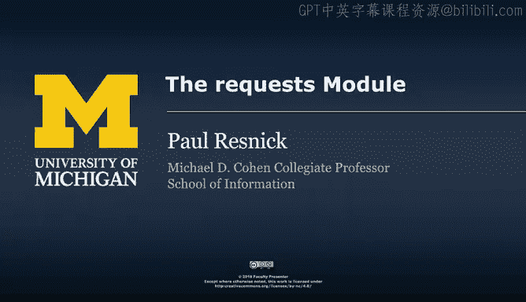
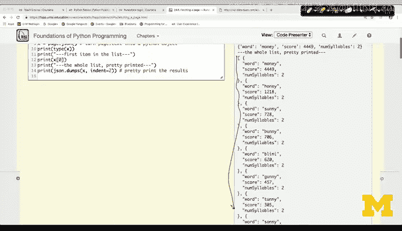

# 密歇根大学《Python3编程（课程3、4、5）》｜Python 3 Programming（Python for everyone进阶）（中英字幕） - P39：38_04_07_requests模块.zh_en - GPT中英字幕课程资源 - BV1gj41177yd

Welcome back。The request module provides a function get that lets your Python program fetch the contents of a web page。

On line 1， I've imported the request module。 and on line 4。

 I'm invoking the get function from the request module。

You pass into URL and you get it back a response object that includes the text。

 the source of the page that lives at that URL。In the runestone environment， we've。

 we've implemented a very limited version of the request module。

The response object that you get back only has some of the attributes that you would have in a full Python implementation。

And our request module will only work for fetching from some sites。In particular。

 you can't use it to fetch regular HTML pages like you misseded at Eduu。

And the reason is that there are security considerations built into most web browsers called crossite scripting restrictions。

But there are exceptions to those restrictions for websites that are meant to provide data。

 basically for APIs。So we'll illustrate how to use request。get。

So we'll illustrate how to use request。get with one of those APIs。First。

 let's see in a browser what's available at this Data Mu API。Here is the full URL r l。H T T P， S。

 API I dot data a dot com slash words question mark Relry equals funny。 I' have copied that URL。

Into another browser tab。 let's see what we get back。We get。In Json format， a list of dictionaries。

 Each of the dictionaries tells us one word。Like money or honey or sunny or bunny。

 All words that rhyme with funny。 So this is a search we've done for words that rhyme。With funny。Now。

 let's see how we can fetch that same data in our Python program。Basically， I just import requests。

 that's the request module and makes it available。Online 4， I'm invoking request。 yet。

Pasing in that whole URL。When I get back as a response object， I've saved that in the variable page。

And the type of page is we're going to find out it's a response object。

 and we're going to be able to ask for various attributes。

The text attribute will give us the contents。All of those all of those words like money and Sunny。

So let's run this and see what we get。You can see that， when we print out。The type。

It's a response object。If we asked to print out the first 150 characters of the text。We see that it。

Word， money and。Were it honey and so on。In that Json format。I can ask to print the URL。

That's where the data was fetched from。 In our case。

 it's not very interesting as it's exactly the URL we passed in。

 but we're going to see a little later。That the request do get function can construct a more complicated URL on our behalf。

 And then it's nice to be able to see what it constructed for us。

There is a method for that response object， called thatt Json。

And you can tell it's a method We have to invoke it with the open close parentheses。

 It takes the contents of the text。That's that stuff。And it just passes it through Json D Lodes。

 This is just a shorthand for saying。Jayson。Dot loads。Of page do text。That'll take this text string。

And turn it into a Python object。 In our case， a list of dictionaries。

I've asked what the type is and it's a list。If I ask for the very first item in that list。

 it's a dictionary。And if I want to see the whole thing。

 I can dump it back to a string with the indent equals2 parameter to make it print。

 nice and pretty for us。You can see。That had pretty printed it for us。All down here。Now。

 in a full implementation of Python， the response object would have some other useful attributes besides just dot text and dot URL。

In the textbook， we go into some of those extra attributes。

 but I'm not going to cover them in these videos。You've now seen the basics of the request module。

 You pass in a URL。 You get back a response object。With that response object。

 you can ask for its dot text attribute or you can call it do Json method to have the text contents turned into a Python list or dictionary。

There's a more advanced use of the request module where it helps you construct the URL out of parts。

 and you'll see that in a future lesson。So long for now， see you next time。

