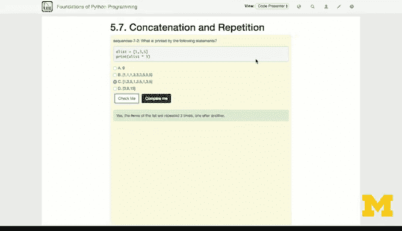

# 密歇根大学《Python3编程（课程1、2）》｜Python 3 Programming（Python for everyone进阶）（中英字幕） - P39：39_02_09_连接与重复操作.zh_en - GPT中英字幕课程资源 - BV1CM411Z72u

So far we've created sequences like lists， strings， and tuples， just by declaring literals。

 just like on line one， how we declare this list fruit。

Another way to create them is through concatetnation and repetition。

Concatenate takes two sequences and adds them together to form one long sequence。

 so here on line3 we say print out the value of this sequence with two items  one and2。

Concateated with this other sequence with two other items，3 and4。Now。

 the result of this overall expression。Is going to be a new list that has all of those items kind of squish together。

 So it's going to be a new list with items 1，2，3，4。So let's run。

And we can see that our new list just has items 1，2，3， and 4。So that's concatenation。

We can also take an existing list like fruit and concatenate it with a list that we create on the fly。

 like right here。So here we have a list of strings in fruit， so we have apple， orange， banana。

 and cherry。In here， we take that list and concatenate it with another list with numbers 6，7，8 and9。

And when we do that， then we're going to get apple， orange， banana， cherry， 6，7，8，9。

Let's run to be sure。And you can see that these two lists were concatenated。

In addition to concatetnation， we can also do repetition or repeating a list any number of times。

And whereas concatenation uses the additioner plus operator。

 repetition uses the star or multiplication operator。So if we have this list that has one item。

 that item being the integer0。And we say repeat this item four times by saying the list and then multiply it by4。

 then we get a new list that repeats the contents of this list four times。

 so we should get a list that has0， four times， and you see that's exactly what we get。

If this list had more than one item in it， so let's suppose this list had0 and1 as items。

 then both of those items get repeated four times as well。So you can see our new list has 0，1，0，1，01。

And just like before we can actually mix up different types so we can say something like print out fruit。

Plus， the list one。And multiply that four times。 And so that's going to take apple， orange。

 banana cherry， and then add one to that list。 So apple orange banana cherry 1。

And it's going to repeat that four times。So you see apple， orange， banana， cherry，1， apple， orange。

 banana， cherry，1， and so on。So one thing to note about concatenation and repetition is that they follow the exact same order of operations as addition multiplication and subtraction。

And so here we put parentheses to say that we want to do the concatenation before we do the repetition。

If we had actually left out the parentheses， then we would get。The list fruit。Plus。

 the list one repeated four times。So we would get an entirely different result。

So let's go through this in code lens。So suppose that we create that same list that we created last time。

 so we have fruit as a list， apple， orange， banana， cherry。If I step forward。

And you'll see that fruit here gets assigned to a list with item 0， item 1，2，3。

And then if I create a new list of numbers， so those numbers being six and seven。

Then we create a new list in the global frame， so we say。

Numb list is assigned to a list with 6 and 7 in it。Now， if I create another new list in this time。

 I'll just call it new list and say that it's the concatenation of fruit and numb list。

What you'll see is that we create a third list， and that third list contains some elements from fruit。

In some elements， from numbless。So we're not affecting either fruit or numb list in any way。

 we're just creating a new list that actually has both of their elements concatenated together。

If I create a fourth list of zeros to say zero repeated four times。

 then you can see that that's a fourth item。In our global frame。

So let's answer some questions about concatenation and repetition。So this question asks。

 what's printed by the following statements， so we create a list a list with three items，  one，3。

 and5， and B list with another three items，  two，4， and 6。

And we print out the value of a list plus B list what do we get so it can be tempting to say 12。

3456 because that's what's natural to us， but because a list is13 and5。

 all of those items come before the items of B list which are2。

4 and6 so the result that we get from a list plus B list is 13，5。And then2，4，6。

 so the order is the elements of a list in order， and then the elements of B list in order。

And so that means that the answer is going to be C。Let's do another one。So in this question。

 we create a list a list and send it to a list with three items，1，3 and5。

 and then we print out the value of that repeated three times。

And so what we should get is this repeated three times， so 13，5，1，3，5，135。

 a list that has nine items， and that's going to be answer C。

That's all for concatenation and repetition。 See you next time。

