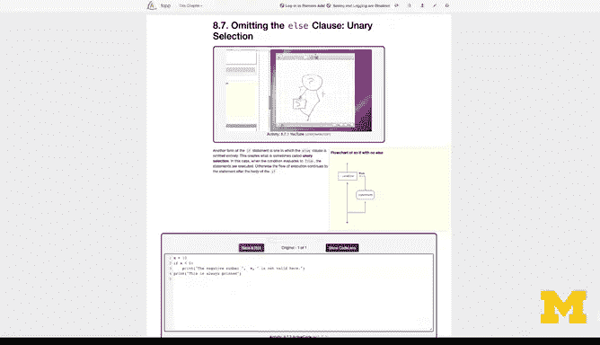

# 密歇根大学《Python3编程（课程1、2）》｜Python 3 Programming（Python for everyone进阶）（中英字幕） - P3：03_01_04_如何使用交互式教材.zh_en - GPT中英字幕课程资源 - BV1CM411Z72u

Hi， everyone。I'm excited to show you some useful features of the free interactive textbook that will be available to you as part of this specialization。

Content in the first four courses all track pretty closely to the textbook content。

 so whichever course you're starting with， you'll want to go through this video to see the important interactive features。

You can skip it if you've already seen it in a previous course。

The Runestone interactive textbook environment is the brainchild of my friend Brad Miller。

I have made a few contributions to both the software environment and especially the textbook over the past four years。

 but Brad deserves almost all the credit。Let's take a look。

Each time you visit the Runone Stone textbook， you'll do so from a Coursera page like this one that links to a specific page in the textbook。

在这。Click the check mark。And then launch the app。It takes me to a textbook page like this one。

And I'm automatically logged in， it figured out who I was because I came from Coursera。

In the textbook， you'll find。Text。And images， diagrams。

But you'll also find some interactive elements。For example。

 here's what we call an active code window。It' got some code in it。And I can click saveve and run。

It'll run and print something out over here in an output window。I can change that code。

And I can run it。And all of your code versions， when you save and run them will be saved。

 I have this little scrubber here。And I can move it and I can see all of my old versions。

And they're not just saved while this page is open。 they're saved permanently， for example。

 let's reload this page。When the page loads we're back to the original window contents。

But I can click load history。And then I get the scrubber and it shows me my last code run。

Now if I rerun。A previous version。It won't。 It won't show in the scrubber as being the latest version。

That if I change it。Set of 17 a， do 18。Now it becomes the latest version in the history。

Shewin Code lens is a really useful feature of active code Windows。

 This is an amazing tool developed by Philip Ge， a professor at UC San Diego。😊。

It lets you step through the execution of a program one line at a time。

 I can click forward and it'll just show me what happens after one line is executed in the next and the next can print out just the first message and so on。

That's not such a big deal now。But it'll be really useful for you when you start to do more complicated programs with conditional execution and iteration and defining your own functions。

Part of our educational philosophy in this specialization is to reveal all the magic we want to give you a way to reason about how your programs are executing because that's the foundation for being able to debug your code through understanding rather than through trial and error。

Code Duns really helps with that。Now sometimes these code lens。

Examples are built right into the textbook。But。You can always get to code lenss by hitting。

The show code lens or hide code lens for any active code。

So here are some that are built in to that textbook page。There are also other interactive features。

 here's a multiple choice question。You can。Answer those and get immediate feedback by clicking on Check Me。

I've actually already answered this one， but suppose I said Thursday。

As the thing that would print out here， because day is set to Thursday。

 I click check me and it gives me some feedback。It's true。 Thursday is the value of day。

But it gets overwritten later。So the correct answer is 19。At the bottom of the page。

There's a button you can click to markup page is complete。

That will mark the page with a special color in the book's table of contents。

 but otherwise it has no effect。Feel free to click if you want the table of contents to track your progress or you can ignore this button。

In Coursera we'll generally provide you with links to particular pages。

And so you can just read that one page。But if you want to。

 you can navigate through the textbook once you're on the Runestone site and we have these forward and back buttons this goes to the next page in the book。

Back to the previous page。If you click on the textbook title， as I showed you a second ago。

 you'll get to a table of contents that's very detailed with every single page and sometimes subsections within the pages。

Finally， there's a search option。So I can search for。Variable。

And it'll tell me lots of pages in the textbook where the word variable shows up。

There's also an index。I want了。Look for various things and I can and click on them and it'll take me。

To where where they are in the textbook。The Rune Stone textbook also includes a practice feature。

There are two ways to get to it from Coursera， you can open the practice activity that's repeated in many places throughout。

Here I'm in one。Can I launch it？And I get to the practice tool。

The other option is that from within any Runestone textbook page。

You'll be able to click on practice and you can get to the practice tool that way。

The practice tool representss to you questions from pages that you've previously opened。

When you're here in the practice Pat， you get to answer the question again。If you get it right。

 Bstone will remember that and it won't ask you about that same topic again for a little while。

If you get it wrong， then it might ask you again tomorrow。So if I scroll down。

 I can see when it's going to ask me about different topics again。

Since I haven't opened very many pages in the book， it only has a few topics for me to practice。

And since I haven't answered questions on these topics very much。

 it's ready to ask me about them all pretty soon， like it can to ask me about the length of sequences tomorrow in one day。

 also about variables and variable names and keywords。

 it's going to be five days before it asks me about updating variables。And the things down here。

It's ready to ask me about today。In fact， the very first question the one's going to show me up top is about。

2。15， chapter 2， section 15 on input。After you've practiced a topic a few times。

 you'll see a longer and longer interval until it gets asked about again， for example。

Once before I correctly answered this question and now is asking it to me again today。

You don't know much Python yet， so not let's just assume you。Know this stuff and we answer it。Yes。

 I got it right。And I say， done ask me another question。

It asks another question but I can scroll down and see that input is going to be asked again in six days。

When they ask me about this again in six days， if I get it right again。

 there'll be an even longer interval before it asks me about that topic again。

This practice tool is the brainchild of my doctoral student， Iman Yazare。

We made it available to students in our on campus classes。

 and those students who used it more did a lot better on the course exams than those who didn't。

It was a pretty striking result for me because I'd been monitoring for several years to see whether just spending more time in the textbook had a similar effect on student performance。

 and it didn't。Using the practice tool really made a difference for students。

 so now in my on campus classes， use of this practice tool is required and earns a few points towards the final grade。

We even have a system where they earn points for the number of days that they use it rather than the number of questions。

 that's why you see something at the top of the page saying something about you've earned three points out of a possible 50 for three days。

Of using this practice tool。For the Coursera courses， it's not required。

 but based on the results I've seen with our on campus students。

 I strongly encourage you to use it a little every day。I think you'll also find it rewarding。

Our on campus students love the fireworks that they get。

So here I'm going to answer my five questions for today。they got to do four more。And a list。

Doesn't just have to have integers。So that was wrong， let's get it， right？

And what's going to print here， the fourth character is an H。And here I am on my last question。

So now I've correctly answered my last question， going to claim my completion point。Itys to hold on。

And。It tells me。I've done well， you might have noticed those fireworks if you don't get enough。

 you can just click and you can get some more。To celebrate your completion of the practice。

You get the fireworks after correctly answering five questions for the day。

But you don't have to stop there。You can keep answering any more questions that are scheduled。

 so I actually have three more questions that are ready for me to do today and I could do those。

For those of you who are taking this course for a certificate。

 you'll also see links to graded assignments， usually at the end of each lesson or set of lessons。

In the first four courses， the assessments and projects are in the Runestone textbook and they're all auto graded there。

 you'll only be able to see these in Coursera if you're paying to take the course for a certificate。

 if you're not paying， you can find similar questions in the end of chapter assessment pages in the Runestone textbook。

So let's follow the link。For this first assessment。And this assessment just has two questions。

I've actually already answered one of them correctly before。That was a multiple choice question。

 and they want me to write some code。The answer to this one is Grello World。

I'll save and run it and I get some immediate feedback。

 there's an automatic test in here and it' telling me。

That that I got the right output if I said hello word instead。I would get。

Heed back saying that I had failed。And would actually， when I tell it to grade me。

 it'll use the best answer I've ever given， so if I ever manage to pass the test I will pass this。

We've set out the assessments so that you have to get usually that you have to get 100% in order to pass the assessment。

 but you can keep trying and keep getting feedback until you get that 100% we've done that because。

We think it's really important to master the early material because things keep building on each other。

So I click grade me。And it comes back， you can see now that it's updated the score to1 instead of0。

 I've gotten a total of two out of two for this assessment。

And if I go back to this page on Coursera and I refresh it。It'll tell me instead of trying again。

 it's going to tell me that I've passed。Past with 100%。One other thing about the textbook。

 many of the textbook pages include videos at the top。

 Some are really cool animations that Steve only created。😊。

Some are narrated animations that folks at Google Education created， guided by Brad Miller。

 And I recommend watching both of those。 They're really good。Some， however。

 are just explanations of the textbook content， and some of those are recorded with low video resolution。

 I recommend skipping those instead watch our narrations of the textbook content here on Coursera。

That's the Runonestone environment。It's been a labor of love for all of us who've worked on it as an open source project over the last few years。

 especially Brad Miller， who started the project， I hope you'll find it really helpful to you as you master the fundamentals of Python。

I usually end my on camera segments with a little joke， so here's a bit of humorous advice。

 procrastinate today， always today， don't put it off until tomorrow。Okay。

 then don't listen to my advice， don't procrastinate today。

 go get started with the first lesson in this course。I'll see you next time。

