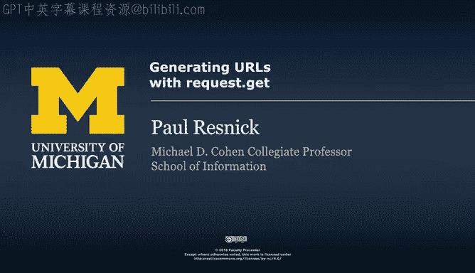
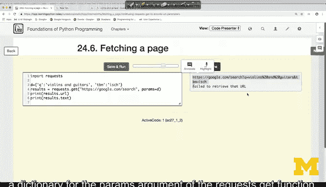

# 密歇根大学《Python3编程（课程3、4、5）》｜Python 3 Programming（Python for everyone进阶）（中英字幕） - P40：39_04_08_使用requests.get生成URL.zh_en - GPT中英字幕课程资源 - BV1gj41177yd

Welcome back。There's a lot of information to encode into a URL。 When you make a rest API request。

 you have to put the equal signs in the right place and the Amperspers hand。

And it turns out that if you have any special characters that have meaning as part of URLs like a colon。

 you have to substitute some other character sequences for them instead。

It can get a little complicated。But the request module makes it easy for you。

Here we see commented out。The URL that we've used before to find out from the Data Muse API。

 words that rhyme with funnyny。You can make that URL by hand。But instead of doing it all by hand。

 we can just provide some extra information to the request module。

 we can give just the base part of the URL。And then have it automatically make。The last part for us。

 we pass in a dictionary。Called Caval pairs。 And in that dictionary， there's just one。

Pair the railrye and funny。And the request module will automatically turn that into what we need。

So let's try running that。And sure enough， we get back the same same result we would have gotten。

If we had just done the full URL on our own and you can also see。That we。

Got the same URL generated for us by the request get。So we passed in a base part。And。😔。

A parameterss dictionary。And it constructed this URL for us。And that， of course， is the same URL。

That we， that we used before when we made the whole URL on our own， But it made it for us。

 and it automatically stuck the equal sign in there。 The reason we're getting this， of course。

 is that we've printed it out。The do URL attribute of the response object we get back from calling request。

 get。Now， this particular URL actually isn't that complicated。

 and maybe it would have been just as easy to do it like we did on line 3， just making the whole URL。

But sometimes we get even more complicated URLs that have to be created。

And then you really do want to rely on the request that get function to do it for you。

So that's the one that I've。Loaded it up already。Got it in my execution history。Here it is。

So now I'm going to make a dictionary that has two key value pairs associated with Q。

 We get violins and guitars associated with TM， we have。IS S EH stands for image search。

And now I send that same。I send that parameter dictionary in as a value when I call request that yet。

And I print out the results， I print out the text。So let's see what happens when I run that。

And it tells us。That we。Got a URL。 It begins with Google dot com slash search with a question mark。

 and then it's got。Q equals violins and guitars， and TBM equals ISCH。

But it's done some nice stuff for us， because it replaced。The space with a per 2 0。

And it automatically put an ampersand between the first parameter Q and the second parameter TM。

And it put equal signs wherever they were needed。So you could have done that by hand。

 but you start to make mistakes when you try to make complicated URLs like that。

Now the other thing to notice is I asked to print the results text。

 and I get something saying that it failed to retrieve that URL。

The reason for that is that in this browser we can only make requests to certain websites。

 there is all kinds of crossite scripting security measures that make it so that we can only use the request module in the browser to make requests to certain websites that are set up basically to be APIs。

Then I can take this URL。I got a little more than I wanted， but I'm going to copy that。

Into a new tab。And we'll see that it's a real URL。F， which I didn't want from the next line。

And when I query for that URL， it turns out that's。A search query to Google。

Where Q equals violin and guitars is making us do a search for violins and guitars。

 and the T BM equals ISCH means go to the tab for images。

As opposed to the shopping or the videos tab。 and we can see a search result。

 So this is just a URL where we've encoded some query parameters， and we can generate that URL。

 as we did here by calling request do get and passing in a parameters dictionary。

You saw some substitutions， percent 20 for space and so on。There are quite a few of them。

 and you really don't want to know the complete set of substitutions that are required to turn your query values into something that fits inside the URL。

 So just pass the key value pairs as a dictionary for the Params argument of the request get function。

 and all will be well。

See you next time。