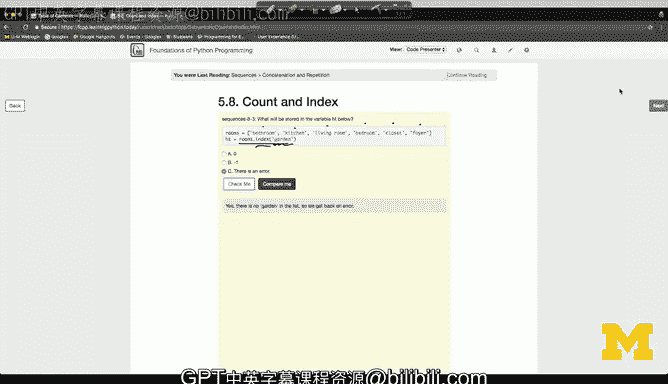

# 密歇根大学《Python3编程（课程1、2）》｜Python 3 Programming（Python for everyone进阶）（中英字幕） - P40：40_02_10_计数与索引定位.zh_en - GPT中英字幕课程资源 - BV1CM411Z72u

Most sequences have a few useful methods that you can do on any sequence。

The way to call that method is to save the sequence name and then the method name。

So I'm going to go over two methods on sequences， count in index。So suppose that we have a a string。

 and we want to find out how many times a given character or a given sequence of characters appears in the string A。

The way that we would do that is using the count method。

And the way to call count is we say the name of the sequence， whether it is ci string。

 integer or tuple that we want to count on。 So here。We want to do count on a， so I say a。

And then the dot or period。And then the method name that we want to call that count。Open parentheses。

And in the case of count， we pass in a string， which is the sequence of characters that we actually want to count。

 So on line 2， we're counting the number of characters E in a。

And then we close parentheses in order to finish that method call。

One thing to note here is that count is case sensitive。

 meaning that we don't count capital E if there were any capital E in a。

 we would only count lower cases。So here， when we say print out a dot count E。

 then we look for the number of E's that are in the string A。 So in this case， we should get1。Qu。3。4。

5。In addition to counting individual characters， we can also count substrs。

 So here we're counting the number of times the substring H A appears。 So we should get one。Qiu。

So let's run our code just to double check。So we can see that we get five Es and two times that H A appears in this string a。

Just like strings， count also works on lists。 So here we have a list Z that has 1，2，3，4，5，6，7，8，9。

10 items。So， online to。If I comment out the rest of these lines on line two。

 we're finding out how many times does the string 4 appear as an item in Z。

One thing to note here is that the string4。Is an entirely different thing than the integer for。

 which we have here， here and here。And so when we say print out z do count the string 4。

 then we're going to actually get0 because no item in Z is the string 4。

If we instead counted for the integer 4， then we would get what we might expect。 so we would get 1，2。

3 because there are three integers4 in our list C。So if I hit save and run again。

Then I'll see that I get three when I print out Z do count the integer for。

Here's something that's a bit trickier。 So let's suppose that I say Z dot count this string A。Now。

 we can see that in our list Z， the letter A appears a few times， so in the first item of Z。

 a appears in atoms， and then it also appears in atoms in the last item。

 so we might almost expect the result to be2。But if we actually run our code。

 then we'll see the result as 0。 Now， why is that。Well， when we call Z dot count the character A。

 what we're looking for are items in Z where the item itself is the string A。

So the fact that a just happens to be a character in this larger string doesn't matter to Python。

 what Python would care about is is the value actually the string A。So if I had one item here。

 that was the string A。tThen I would get count one。

But because this instead is the string atoms then I get zero when I look for the number of a's。

On line 5， we do Z dot count electron。 And when I look， I see that there is one。2 electrons in z。

 And so I should expect line 5 to print out 2。Now， let's go on to another useful method named index。

Index finds where an item is In the case of index， it searches for the first time that a given string or item appears。

 So let's suppose that on line 1， we're creating this string。

 pullll out your music and dancing can begin。 and On line 2， we create this list that has 1，2，3，4，5。

6，7，8，9，10 items。Now， when we print out the value of music do index of M。

Then we're printing out the first or left most index where lower case M appears。

 So if I comment out the rest of these lines。And only print out the value of music that index of M。

 Then we should get the index of the first M。 And just to find out where that is。

 we should get it at 0，1，2，3，4，5，6，7，8，9，10，11，1213。14。 So this M。

 which is the first term leftmost M that appears， is at index 14。

 And what that means is that the value of this overall expression。

 music dot index of M is going to be 14。Let's run our code and make sure that that's the case。

So we see that we get 14。On line 5， we print out the value of music dot index of your。

 And so what this is going to do is it's going to search for the first time that this substring yourre appears and it's going to print out the index where it starts。

 So we should expect that to be 0，1，2，3，4，5，6，7，8，9。So when we run this， then we get 9 as the result。

 because your starts at index 9。Now， index works with lists as well as it does with strings。

So if we print out bio dot index of metaarsal， then we get the first index where metaarsal appears。

 So here on bio， that should be index 0。Even though this appears multiple times at index 0 and1。

 index always gives us the first or leftmost index where it appears。So9，7 should print out0。

On line 8， we print out bio do index of an empty list。

 This is going to search for the first empty list in this list bio。 So the index should be 0，1，2。

 and we find it at 3。 So when we run this， we should expect 3。Then finally on line nine。

 we print out bio index of 43。 so that's going to be012 three four，56。Now。

 one thing to note for index is that if something is actually not in the sequence。

 then we get a runtime error。 So if we create this list seasons and set its values to be winter。

 spring， summer and fall， and then we search for autumn。

 note that autumn is not in here because we instead wrote fall。

 So if we print out seasons do index of autumn， then we're going to get a runtime error。

 and that runtime error is going to point out that the item that we searched for in this case。

 autumn was not in our list seasons。😊，Okay， so let's answer some questions about count in index。

So this question asks what will be stored in the variable T Y below。 So we say T Y is Q U。

 which is the string， that index of W E。 So this is searching for the first time that we find the string W E。

 So that's going to give us 0，1，2，3，4，5。 again， when we search for a substr。

 we search for where it starts。 And so that's going to give us 5。Next。

What will be exord in the variable T Y now， So we say T Y is the string Q U that count of we。

 So here we're searching for how many times does this substr we appear in this string Q U And so we see we right here at the start of welcome here at the start of week。

And we might think that we actually see it here。But if you look closely。

 this is actually a capital W and not a lowercase W。 Now， remember that Python is k sensitive。

 So capital W is a completely different thing than a lowercase W。

 And so Python isn't actually going to count this。 And so Python isn't actually going to count this we because it contains a capital W。

 And so the end result here is that we get 2。So here we're asked。

 won't we be stored in the variable H T below。 So we have rooms set to a list with 1，2，3，4，5，6 items。

 and we ask for rooms do index of garden。So we're going to search for is garden in this list rooms。

 And so we see it's not here， nor here， nor here， nor here， nor here， nor here。

 And garden isn't anywhere in this list。 And remember that when we try to do index on something that's actually not in the list。

 then we get an error。 So the answer here should be an error。That's all for now， until next time。

