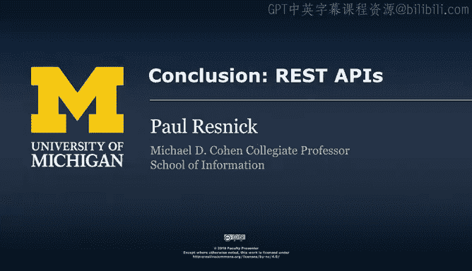

# 密歇根大学《Python3编程（课程3、4、5）》｜Python 3 Programming（Python for everyone进阶）（中英字幕） - P41：40_04_09_REST API总结.zh_en - GPT中英字幕课程资源 - BV1gj41177yd

Welcome back。At this point， you should be able to parse a URL into its component parts。

 The protocol like H T T P or H T T P， S。 The host， typically a domain name and the path。

And you should be able to use the Python request module to fetch the contents of a URL。

And when you fetch a web page， the server response where a response code is one of the HtTP headers。

200 means that it was able to respond successfully。40，4 means file not found。 That is。

 the server doesn't recognize the path that you asked for。

401 means that you are not authorized to access that content。

 and 301 means the content has moved to a different URL。

Here's a couple amusing stories about other error codes。First， theres error 451。

 unavailable for legal reasons。It's intended to be used when resource access is denied for legal reasons。

 like censorship or government mandated blocked access。It's， of course， a reference to the novel。

 Fahrenheit 4，51。Where books are， where books are outlawed and they're burnt。

 paper auto ignites at around 451 degrees Fren。Second。

 perhaps you've heard of the Internet of things where cars and toasters and refrigerators are all getting connected to the Internet。

Well on April 1，1998， as an April Fools prank， Larryrry Micinter published a document describing the H TC PCP。

 the Hypertext coffee pot control protocol。It's for computer programs to control。

 monitor and diagnose coffee pots。 You can send headers specifying whether the coffee should include milk and cream。

 and so on。Among other amusing elements of this document， it defines an error status code 4，1，8。

 I'm a teapot for when you've connected by mistake to a teapot instead of a coffee pot。

The document notes that the resulting entity body， the text that gets sent back may be short and stout。

I kid you not。 You can do a search for RF 2，3，2，4， and you'll find the whole document。

I'll see you next time。