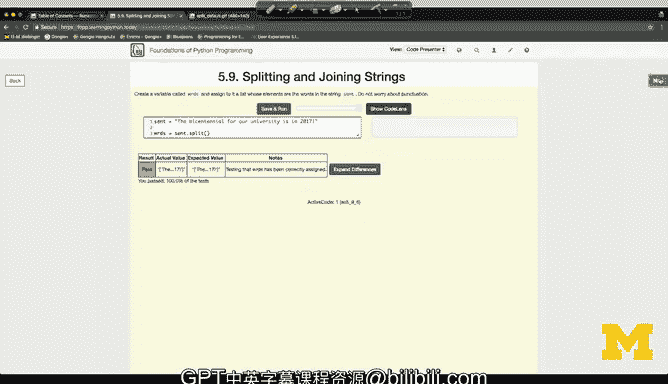

# 密歇根大学《Python3编程（课程1、2）》｜Python 3 Programming（Python for everyone进阶）（中英字幕） - P41：41_02_11_分割与合并方法.zh_en - GPT中英字幕课程资源 - BV1CM411Z72u

Split and join our two other useful methods on strings in lists。

So split takes a string and turns it into a list of substrs of that string。

 So let's suppose that we have a string leaders in best。So here we have a string litter。

 and let's suppose that we call dot split。And that string。

What dot split does if we call it with nothing as an argument。

 it first looks for all the spaces in this string。 So here it finds a space。

 and here it finds its place。And it kind of cuts the string along those spaces。

 So what it does is it turns this。 what was one string into three different strings。

 and it divides them along the spaces。So the end result of this expression is going to be a list。

Where the first item is leaders。The second item is and。And the third item is best。

One thing to note here is that split actually does get rid of the spaces in between all of these。

 So this is leaders with no space afterwards in no space before or after and or before and after best。

So split essentially takes a string and splits it up into different words if it's called with no arguments。

So let's try this out in code。So suppose that we have this string song equals the rain in Spain。

And we say words equal song do split。Then when we call song do split。

 the value of this expression is going to split song。Along every space。

 And so we're going to get a new list that has four items， the， and then rain。Yin。Spain， dot， dot。

 dot。So when we print out words， then we should get a four item list。Now。

 we can also call that split with an argument to specify what we want to split along。

So let's suppose that we actually called dot split with the argument E。

Whatever argument we pass in here， in this case， E specifies what we actually want to split along。

So here， if we say we want to split along every E， if we split the string leaders and best。

 then that's like crossing through every E that's in the string。

And then the result is that we get a list where the first item is L。 The second item is AD D。

 The third item is Rs and and so on。So let's try that out in code。 So here we have the same song。

 So the rain in Spain。And let's suppose that we say song dot split AI。So when we do that。

 then we're going to search for every AI。So we find this AI。And then， this AI。

In what we should get back is the list with three items。The space are。En space， I N， space。

 and so on。And you see that that's exactly what we get。Now， the opposite of split。

 which kind of splits a string along lines， is join。

 Join takes a list of strings and joins it into one long string。

So split is like chopping with a knife and join is like joining it back together with glue。So。

 if we say。I want to use this as the glue to join the items in this list。

 What we get as the value of this overall expression is every item in this list。

 leaders and best kind of glued back together with this string。

 So we get leaders slash and slash best。😊，So let's try that out in code。

So here we have a list of words red， blue and green。And we specify a variable glue。

 And this variable glue is what's going to come in between these items when we call dot join。

 So if we say glue dot join words and assign that to S， then when we print out S。

 then we should expect to see red， semicolon， blue， semicolon， green。So let's test that out。

 I'm just going to comment out the rest of this code。

So you can see that what we got was the semicolon gluing back together the items in words。

But one thing to note is that calling dot join doesn't affect the value of the list itself。

 So if we print out words after having called glue dot join words。

 then we still get out a list that has three items， red， blue and green。Of course。

 we can also use a multi character string to actually join the words together。

 So if I use three stars to join words， and I get red， star， star star， blue， star star star green。

And I can even use an empty string to glue back the words together。

 So if I use an empty string that join words， then I get red， blue， green， all concatenated together。

So let's go through some problems。 So this question asks us to create a variable output that's assigned to a list whose elements are the words in string1。

 So in other words， we want to split up string one into individual words。So i want to assign output。

Equal to S R 1 dot split。And if I call that split with no arguments， then it splits it along spaces。

This question asks us to create a variable called words and assign it to a list whose elements are the words in the string sent。

 And it tells us not to worry about punctuation。 And so I'm going to do something very similar here。

 I'm going to say words。Equals sent dot split。 again。

 no arguments in dot split because we want to split it along the spaces。

And now words is set to a list of words in sentence。

So split and join our functions that we'll keep coming back to throughout this course。

 and they'll end up being enormously useful。That's all for now， until next time。

