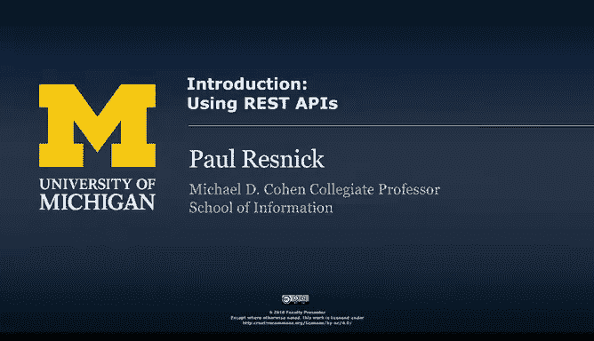

# 密歇根大学《Python3编程（课程3、4、5）》｜Python 3 Programming（Python for everyone进阶）（中英字幕） - P42：41_04_01_REST API应用简介.zh_en - GPT中英字幕课程资源 - BV1gj41177yd

Welcome back。This lesson takes us deep into using RE APIs。First。

 we'll see how to use the request module to generate long URLs with query parameters and automatically substitute for text characters that aren't permitted in Us。

Next， I'll show you what to look for in the documentation for arrest API。 Third。

 I'll give you some hints for debugging requests when they don't work right the first time。

And will conclude by introducing the caching pattern。

 It's especially useful when using the request module so that you don't run into rate limits or problems of servers being inaccessible from the。

 from the Runestone textbook。At the end of this lesson。

 you should be able to read the documentation for arrest API。

Extract the key information you need to use the request module to interact with it。

Debug your ins of request do get。And understand how our request with caching module works。

Bye for now， I'll see you at the end。