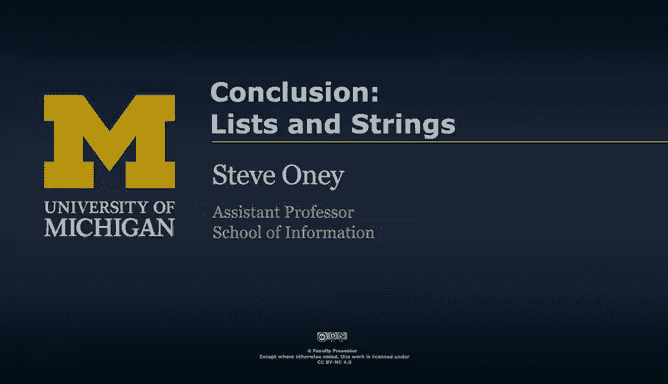

# 密歇根大学《Python3编程（课程1、2）》｜Python 3 Programming（Python for everyone进阶）（中英字幕） - P42：42_02_12_列表与字符串总结.zh_en - GPT中英字幕课程资源 - BV1CM411Z72u

You're really making good progress sequences like lists and strings really raise the ceiling on what we're able to do as Python programmers since they represent many of the kinds of data that we'll want to use in our programs。

 so let's conclude this lesson with the joke that's relevant to zero based indexing。

You've probably heard why6 was afraid of 7 because 789。

 but do you know why after0 and3 played a match to figure out which number was the greatest。

 they gave prizes to both three and zero？Because0， one，2。See you next lesson。

