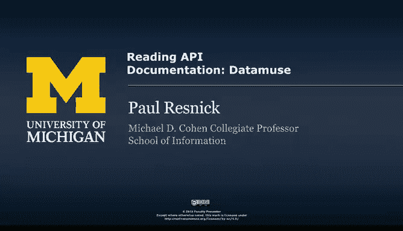
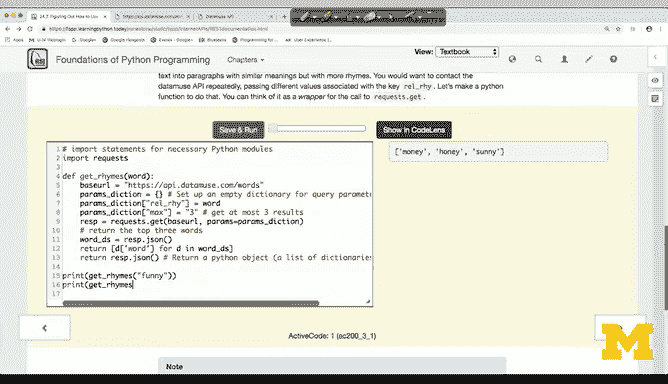

# 密歇根大学《Python3编程（课程3、4、5）》｜Python 3 Programming（Python for everyone进阶）（中英字幕） - P43：42_04_02_阅读API文档-Datamuse案例.zh_en - GPT中英字幕课程资源 - BV1gj41177yd

Welcome back。Remember this URL that we used before to find out what words rhyme with funny。

And it's got。The base part。And then a question mark， and then key equals value。Well。

 how did we know what to put into that base part。And how do we know to use REL underscore RHY in order to ask for things that rhyme？

The answer is。You use the documentation for the API。

So let's take a look at the documentation of that API。And we'll see， you know。

 they have lots lots of things in here。So in this documentation。They tell us。

That the main URL is going be API。 datams com。And then they tell us some things that might go after that。

 You might have slash words， question mark something。

Or we'll see a little later on that there's some other things。

 there's one other endpoint besides words， so we'll describe slash words as being one end point and then the things after the question mark as being query parameters。

So you can ask for M and give a value ringing in the ears。So in their documentation。

 they tell you if you want to find out words with a meaning that's similar to ringing in the ears。

You would give the query over on the right hand side。

And we can scroll down and see some other things that you can do， lots of opportunities。

 lots of different things you can do。 And here's that。Ralrye that I found。

 That's for words that rhyme with forgetful。Now， they've started by giving us a bunch of examples。

 But then down below， they'll give you even more detail。So they're saying。

You can access most things at datams。com/ wordss， so that's going to end up being our base URL。

 and then we have to figure out what are we going to put into that Params dictionary。

And we can use the examples above。Or we can try to look at some of the things below that are giving more detailed information so we can have the key。

 the M L。We could have a key S L for sounds like。Or there's a whole set of R E L underscore things。

 There's R E L underscore J J A。Or REL underscore TRG， or REL underscore RHY for rhymes width。

So that's how I figured out what some of the possible keys could be in my Paras dictionary。

 and then for the value。I really got it from my examples where I said， oh， well。

 the value is just the word that I'm trying to pass as an input。

 I'm trying to get things that rhyme with forgetful or things that rhyme with funny。

So that's telling me what kind of queries I can give to this rest API， and at the bottom。

 they'll tell me a little bit more。About interpreting the results。

So I've passed over the other endpoint slash SUG。And I found something about what the responses will look like。

 and it's going to be a list。 That's what the square brackets tell me。

And they tell me it's always going to be in the JSON format， which you've been seeing already。

And it's a list of dictionaries。 Each dictionary is selling us information about one of the words that。

Is related to our query， if our query was for words at rhyme with funny。

 then we would get each word that is a good rhyme for funny would have one dictionary in this list。

So this is a relatively simple API and the documentation is pretty clear you can figure out pretty well how to use it。

😊，The other thing I want to show you with this API is just。A nice practice。

 if you know you're going to make a bunch of calls to this API to get a bunch of rhyming words。

 maybe you're using this as an aid to your next RA hit， you might make a lot of calls to get rhymes。

And so I've defined a little function here that I can call multiple times so I can。

Call get rhymes on a word and I'll get back a list of some other words。So with funny。

 I'm getting back three things and I can get rhymes on something else。

They want to get。Rymes with dash， I get cash flash and crash。Now how did I implement this get rhymes？

Well get rhmes is going to take as an input。A word like funny or dash。

 So that's going to be bound to my word parameter。And it's going to return a list of three rhyming words。

 But you saw that what we actually get back is not a list of words。

 It's a list of dictionaries with information。 Each dictionary has information about one rhyming word。

So the base URL is always the same。And in my， I'm going to create a blank parameters dictionary。

 and then I'm going to fill in。Relrye should equal word， and max should be3。

So we're asking it to only give us three results back。And then I call request。

ge passing in that prams dictionary。I get a response object。

I turned that into a Python object by calling the Json method on it。

And now I'm going to use the list comprehension which you learned about recently。

We're iterating through。Each of the list of dictionaries。And for each of those dictionaries。

 we're just extracting the word。So， that produces。I'll list like this。

 and then I'm just returning it。I just noticed that on line 13。

 I have another return statement where it's returning something different。But of course。

 once we execute the return on line 12， we won't ever do line 13 that's left over from a previous version I was trying to do of this where instead of extracting just the words I was returning the whole dictionaries。

In fact， you might be instructive to look at that。Let's comment out line 12 and see what happens if we return the dictionaries rather than extracting just the words from those dictionaries。

So now we get a list of the three dictionaries instead of just getting money， honey and sunny。

 or're getting this whole dictionary。Instead of just the word money。

So this is the kind of thing that's pretty helpful。 if you know that you're going。Do the same thing。

 Make a bunch of requests to the same API just passing a little different parameter each time might want to make a little function out of it like I did here on lines 4 through 13。

That's an introduction to reading the documentation for arrest API and also to making a function to repeatedly make similar kinds of requests to a single API。

We'll see you next time。