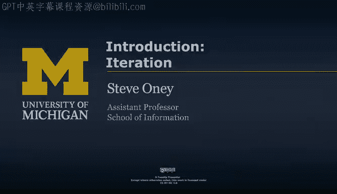

# 密歇根大学《Python3编程（课程1、2）》｜Python 3 Programming（Python for everyone进阶）（中英字幕） - P43：43_02_01_迭代导论.zh_en - GPT中英字幕课程资源 - BV1CM411Z72u

Last lesson we covered sequences like lists and strings In this lesson。

 we're going to learn how to do a little bit more with sequences by iterating over them with loops。

 When we iterate over a sequence， we can perform some action for every item in that sequence whereas indexing allowed us to get one particular item from a sequence iteration instead allows us to perform some action for every item in that sequence。

 For example， we might take the sum of a list of numbers by looping through and adding every number together。

By the end of this lesson， you'll know how to iterate three sequences using four loops。

 and you'll also learn about the accumulator pattern。

 which is a pattern or technique that can be adapted to solve many kinds of problems。

 see you at the end。