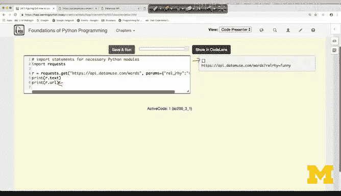

# 密歇根大学《Python3编程（课程3、4、5）》｜Python 3 Programming（Python for everyone进阶）（中英字幕） - P44：43_04_03_调试requests.get调用.zh_en - GPT中英字幕课程资源 - BV1gj41177yd

Welcome back， let's talk about debugging for a minute。If your call to request。

get doesn't bring back the results you're expecting， you'll have to do a little debugging。

The process is a little different in the Runonestone textbook than it is in a full Python environment。

 because the errors we get back from the request module are a little different。

In the textbook environment。Request that yet will always return a response object so you can print it out and you'll find out。

One of two things that went wrong。So here's an example where something's going to go wrong。

 I'm making a call to request I get， again trying to get。Things that rhyme with funny。

It looks like I mostly have it， right。I'm going to pass in a value for parameterss。

 but when I run it。It's not going to give me what I was expecting。 It's not going to give me。

Money and sunny and so on。Instead， when I print out the text， it says HTMLMM body。

 H1 and valid request and。When I try to print the URL attribute。

 it says it couldn't generate a valid URL。 When that happens。

 there's really only one reason which is that you didn't pass in a good value for the PRms argument。

Either you didn't pass in a dictionary or one of the keys or values wasn't a string。

 so just start by looking at what you passed in there if it's in a variable。

P out the value of that variable here。 I have a literal。 I put the value in directly。

 and I see it's got Rrye and it's got funny sort of what I was expecting， but oops。

It's not a dictionary。 I made it be a list， instead。

And so that's your number one error is going to be that you pass in something other than a dictionary。

 if you pass in a list， it's going to fail。So if it's going to be a dictionary and I want the key to be RELrye and the value to be funny。

 I use a colon to separate them。And now， when I run it， I should。Get， yes， money and honey and so on。

Now， the other thing that could go wrong， if I pass in a dictionary。But。I pass in a number。

 instead of a string。I may also get an error from that。

So that's the two things you should look for if it's saying that it couldn't generate a valid URL。

 and either you're not passing in a dictionary or one of the values or keys in the dictionary is not a string。

Now， the other kind of error that you can get is when it is able to create a URL。

 but when it goes to try to ask for some data at that URL， it doesn't get back what you are hoping。

 So suppose I forgot the underscore。Now I'm asking for RELR。

 but it's not a parameter that the Data Muse API is ready to receive。So now， I get something。

Back where the text is just an empty list。It isn't those dictionaries that have money and so on。

So what should you do when you don't get the data back that you're expecting in thet text attribute。

 the answer is you should look at the URL attribute。And here I can see what URL I've gotten。

And really， the best strategy is to then start working in a browser because it kind of looks right。

 maybe it's not quite right。So I should go start a new browser tab。And sure enough。

 I'm just getting back this empty list。So now I might go to the Dataese documentation。

 I thought it was REL RHY。But I go and look。Sorry for the。The red that's still on here， I go find。

 Oh， it's Rel underscore R。 H Y。So I go and actually before I fixed it in my code。

 I would first try it here。In the browser because I can try lots of different things and really see exactly what's going on。

I yes。 that underscore is the thing that was wrong。So now I'm going to go and fix it。In the。

Dictionary that's being used to generate that URL。

I add the underscoreco back in and I get all the things I was expecting。

So that's a little bit about debugging。In a full Python environment。

 there is another failure mode where you get an error indicating that it wasn't able to get a response from the server。

 And then in that case， it doesn't generate a response object。

 so you can't ask for the dot URL attribute to figure out exactly what the full URL was。

That makes it a little harder， the textbook has a little code snippet that you can use to get the full URL to help with debugging。

 but that's only if you're running Python in your full environment if you're not running it in the browser。

So debugging when you're in the runeonestone environment， if it can't create a full URL。

 check to make sure that you're passing a dictionary with all strings。

And if it does create a full URL， paste that URL into a browser and keep making adjustments to that URL until you figure out what was wrong with it。

 then translate whatever changes you made back into your code。

 usually you'll be translating that into either some change in the base URL or to some change in the Paras dictionary。

See you next time。