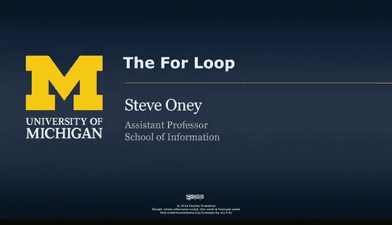
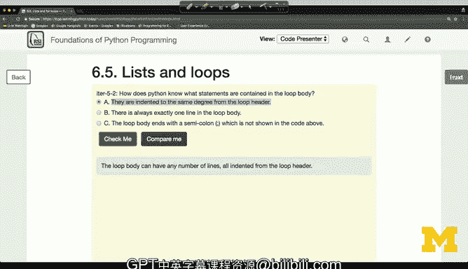

# 密歇根大学《Python3编程（课程1、2）》｜Python 3 Programming（Python for everyone进阶）（中英字幕） - P44：44_02_02_for循环详解.zh_en - GPT中英字幕课程资源 - BV1CM411Z72u

Welcome back。 So we've already covered sequences。 And in this lesson， we're going to cover iteration。

Iteration runs a piece of code for every item in a sequence， be it a string， list or tuple。

 In order to do iteration， we're going to use a for loop。

 which is the first of many control structures that we're going to see in this course。

So let's look at a for loop in action。In order to create a for loop that's going to iterate over a sequence。

 we start out by saying the keyword 4， which specifies that we want to create a for loop。

After the four， then we create something called a loop variable。

We could call our loop variable any valid variable name， but in the case of this for loop。

 we're calling our loop variable name。After we declare our loop variable， then we say in。

And after that， we specify what sequence we're actually iterating over。 So in this case。

 we're iterating over this list。Which has 1，2，3，4，5，6，7 items。

And what this for loop is going to do is it's first going to assign name to be the first item in this sequence。

 So Joe， and then it's going to assign name to be the second item。

 and then it's going to assign it to be the third item and so on。

 And after it assigns it to be any particular item in this sequence。

 Then we're going to run whatever is inside of the for loop。In this case。

 the only code that we have inside of this for loop is this print statement， which prints out high。

 and then whatever name our loop variable value is， please come to my party on Saturday。

So when we run this code。What we get。Is hi， Joe， please come to my party on Saturday。 And then hi。

 Amy， please come to my party on Saturday。 Hi， Brad， please come to my party on Saturday and so on。

So in general， what's happening here is that Python is running this code。

This print statement for every single item in this sequence。

And for every single item in the sequence， it's a firstrse design name to be that item。

 And then we're printing out high。 and then whatever that name is。

 please come to my party on Saturday。So for all seven items in this list， then we get。

7 print statements。So let's look at the same code inside of code lens。 So again。

 we're iterating over this list of names， and our loop variable is called name。So。

The first time that we run this code， you'll see that name gets assigned to the first item in our list。

 In this case， name gets assigned to Joe。And now， when we run this print statement to print out high name。

 Please come to my party on Saturday， Then we print out hi， Joehou。

 Please come to my party on Saturday。And then next。

 name gets reassigned to the second item in our list， so in our case it gets assigned to Amy。And now。

 when we print out high name， please come to my party on Saturday。 we get hi Amy。

 please come to my party on Saturday。Then name gets reassigned to the third item or brad。

 So now when we print out high name， please come to my party on Saturday， we get high bra。

 Please come to my party on Saturday。In this pattern repeats for every single item in the sequence that we're iterating over until we're done iterating over all of the items in which case our program is terminated。

So when we create a for loop， let's say abstractly。

 it looks like something on the left hand side here。 So we have some code that might come before。

 We have some code that might come after， and then we have our actual for loop。

We declare our four loop again， by saying four。And then， our loop variable。And then， we say in。

And then we say whatever sequence we're iterating over。And then inside of the for loop。

 we have what's called a code block。 so here the code block is represented in green。

The way that we say that this loop code block is inside of the for loop as opposed to outside of the for loop is through either tabs or spaces。

So we have to indent the loop code block to indicate that this code belongs to this loop。

So when we declare a for loop like this。Then this is equivalent to first assigning the loop variable in our case。

 X to the first item in the sequence， and then running the loop code block。

And then assigning our loop variable X to the second item in our sequence and then running the loop code block and so on and so forth。

 So assigning x to the third item， the fourth item。

 and so on until we finally assign our loop variable X to the last item and running the loop code block。

So one thing to note here is that the loop code block may or may not reference our loop variable。

 but if it does reference our loop variable， then that reference is going to change every single time。

So for example， in our previous code， we referenced our loop variable name inside of the code block in our loop。

 so that means that name is going to change for every single item in our list。

So in addition to iterating over lists， four loops allow you to iterate over any kind of sequence。

 including strings， lists and tuples。So let's go over an example of iterating over a string。

So here we're iterating over the string go spot go。And recalling our loop variable HR。

So what that means is that the first time this loop body runs。

Then HR is going to be assigned to the character capital G。 The second time that it runs。

 it's going to be assigned to the character lowercase O。 the third time that it runs。

 it's going to be assigned to a space character， and then capital S and so on。

And so what that means is that when we run our code。

Then when we're first going to print capital G and then lowercase O and space and so on for every character in this string。

 And because print prints out characters on a separate line。

 Then we get go spot go kind of printed out vertically。So let's go over a multiple choice question。

First， we assigned the string S to be Python rocks。And then we say for every character in s。

 So again， here our loop variable is C H and the thing that we're iterating over is s。

And our loop body consists of one print statement that prints out the string hello。

And the question asks， how many times is the word hello printed by the following statements？

So one thing that we know is that C， H is going to be assigned to the first character in S than the second character then third character and so on。

 And what that means is that this loop body is going to run once for every character in the string S。

 So in other words， this loop body is going to run however many times S is long。

 So if S were one character， then it would run  one time。 If S were two characters。

 it would run  two times。 So in order to find out how many times the word hello is printed out in this code。

 I'm going to find out what's the length of S。 And I find out that it's 1，2，3，4，5，6，7，8，9，10，11。

12 characters long。 which means that I should expect this code to run 12 times。So。Nextex word asked。

 how many times is the word hello printed out by the following statement。

So here we are assigning S to the same value， and we have the same loop variable C。Now。

 rather than iterating over the entirety of S， we're iterating over a slice of S。Specifically。

 we're iterating over S from indices 3 to 8。 So what that means is that we're iterating over S from 0。

1，2，3。From here，24，5，6，7，8。To hear。And so we should expect this to run one two three four five times。

Zu。We can see that。Because a five character of sequence is returned by the slice。

 then we run our four loop five times。So in this code example， we create a list that has four items。

 and we have a loop variable named a fruit， and we iterate over our four item list。

nNow when we print out the value of our loop variable a fruit then we should expect to get every item of our list printed out on a separate line。

4 loops also work， even if we don't care about the sequence that we're iterating over。

 So here we have an example that uses turtle。 And let's suppose that we want to draw a square with our turtle。

One way to draw a square is by going forward and then left four different times。

 So we first set up our turtle。And we call our turtle， Alex。And then we create a four loop。

 and we have our loop variable I， and we have the sequence that we're iterating over。

 which is a four items list。But here inside of our for loop。

 we're not referencing our loop variable at all。 Instead。

 we're taking advantage of the fact that we're repeating this code four times in order to form a square by going left and forward four times in a row。

It doesn't matter what we're actually repeating over if we're not referencing the loop variable。 So。

 for example， here we're looping over a list of strings that represent different colors。

 but we're still not referencing our loop variable a color in any of the code inside of our for loop。

So when we run our code， then we still get the same result， which is a square with four sides。

 and every side is still black。If we did want to reference our loop variable。

 then we might want to say something like this。 So here we're referencing our loop variable a color by assigning that color to our turtle Alex。

 So first， a color is assigned to yellow， then red， then purple， then blue。

And so the result here is that every side of our square ends up being a different color because we first go with。

Yellow， then red， then purple， then blue。So let's answer just a few more questions on four loops。

So here we have a list that has 1，2，3，4，5，6，7，8，9 items， and we're asked。

 how many times will the four loop iterate through the following statements。

 So because C H gets assigned to all nine items once。

 then we should expect this to execute nine times。So this question asks。

 how does Python know what statements are contained in a loop body？

So Python always checks the indentation of statements to check to see if it's in the loop body。

So we can have more than one line in the loop body。

 even though many of the examples that we went over only had one line。

 And the way that Python knows if something is in the loop body is if it's indented the same after we declare the for loop。

That's all for now， Until next time。

