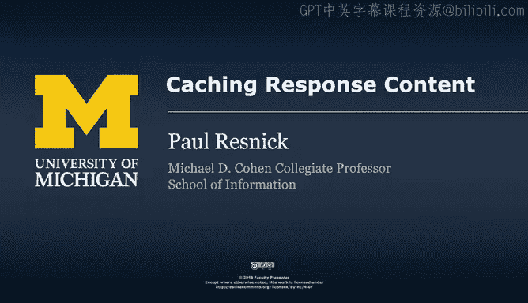
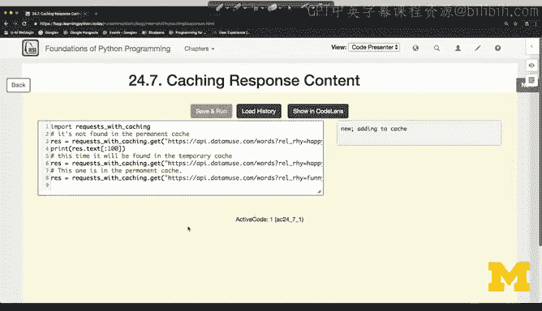

# 密歇根大学《Python3编程（课程3、4、5）》｜Python 3 Programming（Python for everyone进阶）（中英字幕） - P45：44_04_04_响应内容缓存.zh_en - GPT中英字幕课程资源 - BV1gj41177yd

Welcome back。I'm going to introduce you to a programming pattern called Caching。

We have some expensive， or maybe unreliable operation。We'll have a little function。

A an input produces an output。But it might take a long time to run it。 Each time we run it。

 we're going to take the results and we'll stick them into a cash。And that cash is gonna。

Save our previous。Results。You can think of it sort of like a squirrel's cash of nuts。It's spell CA。

CG。Pronounce cash。And it just associates some inputs with outputs。I'll call them keys， and。Results。

And now， the next time I was going to ask this expensive operation to do the very same operation that's been done before。

 I would first check。And see， hey， is this result already available to me in the cash， If it is。

 just send back the same result I would have gotten if I'd run that expensive operation。

But don't bother。 Just take the result from the cash。Now in our case。

 the expensive operation is request。get。It's expensive because it takes a little bit of time to go out over the internet to make a connection to another server。

 It's also a little unreliable。Sometimes you don't have a good internet connection。

 sometimes the server that you're connecting to doesn't respond in the way that it did yesterday。

In our textbook， there are some sites that have restrictions on crossite scripting。

 and some days it works to connect to them some days it doesn't。

There's another problem that sometimes when we call request。 get。

 we're doing some debugging and we run our code a bunch of times。

 and the site that we're talking to has a rate limit it says you can only make 15 calls every 15 minutes and you've run this more than 15 times in the last 15 minutes。

So these are all reasons why it's going to be a good idea to save our results when we run a request。

get， put them in a cache and get the results from the cache the next time rather than calling requestquest。

get again。So we've implemented this caching pattern in a module。 It's available only in the textbook。

 and it's called。As you might guess， requests with caching。So in the code window here。

I've got an import statement。Import requests with caching。 and then。

Request with caching is available to us， and we are going to call the method get。

This get method in request with caching is going to return exactly the same result。

A response object just like if I were to call request do get。

But the way it works is that it's going to first look in the cache and see if it can find the result there。

 if so， it'll give us the results from the cache。If it can't find it in the cash。

 it calls the real request that get。And it returns that。

 but it also saves the result in the cash so that the next time we'll get the result from the cash。

There's one little twist is that I've actually got in this request by caching module。

 We've implemented two caches。 There's stuff that we've provided as part of the textbook。

 and that goes into a permanent cash file。And then there's a temporary cache。

 You can sort of think of us having two caches， the permanent cash。

And then there's a temporary cache， maybe you can think of it as。The second little database。

And that's stuff that's saved between code runs while you're on the current page。

 but it disappears when you reload the page。So when you call requests with Caing dot get。

 it checks in both of the caches。 If it's found in either place。

 it returns that if it doesn't find it in either place， then it does call request do get。

 and it saves the result in this temporary page specific cache。

So let's see what happens when we run this code。So we have a cache file。

 a permanent cache file called datamcash。tex。And。Our first call。😔，To request with caching。

Doge asks for。The data use API。And it asks for words that rhyme with happy。And then， we can see。

The results。The request with Caing dot get tells us whether it found the result in the caches or whether it didn't。

 In this case， it didn't find it in the cash。 And so it says it adding it to the cash。That on line 4。

 Ive printed the first hundred characters。 and you can see the things。That are rhyming are snappy。

And nappy。And so on。On line 6。I'm making exactly the same。Request。

 I'm asking for the same word for words that rhyme with happy again and this time。

We're told that it found it in the page specific cash because it saved it from the first time that we made the call。

The last call that we make we're asking for a different word。

 Were asking for words that rhyme with funny。And we have a cash result in the permanent cash file for words that rhyme with funny。

 So had found that in the permanent cache。Now， if I were to run this whole thing again。

Now it's going to run where it already has。The page specific cache。 And by the way。

 you can see the results of that page specific cache。

 It's telling us it's stored in this data file called this page cache do text。

And it's the things that rhyme with happy， like snappy and snappy and scrappy。If I run this again。

Instead of showing。New here。 it's going to tell us that it found it in the cache。 So let's do that。

Take it a little while to run。S in efficienciesencies。

But we're going to see that new adding to cash is going to change。

Because it's going to find it in the cache。So now it says it found it in the page specific cache。

If I were to reload this whole page， which I'll， I'll do now。I'm going to clear my markings。

And I'm going to reload the page。Now， I've reloaded the page and that got rid of the page specific cache。

When I run this again。The first time it's going to have to。

Doer called the request I get and added to the cash。

That's the request with caching module that we've provided。

It's really easy to use you just import request with caching。

 and then you call requestquest with caching。 get the same way as you would call requestquest。 get。

And it just makes it so that when you make the same request multiple times。

 the additional times that you make the same request。You'll get data from the cache。

See you next time。