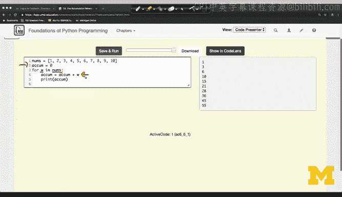

# 密歇根大学《Python3编程（课程1、2）》｜Python 3 Programming（Python for everyone进阶）（中英字幕） - P45：45_02_03_累加器模式.zh_en - GPT中英字幕课程资源 - BV1CM411Z72u

Welcome back。 The accumulator pattern is a common programming pattern where you iterate through the contents of a list。

 and you accumulate a single value。Such as the sum of all of the items in that list。

It always involves an accumulator variable。Which you'll have to initialize。 Usually。

 you'll set it to be 0 or。Some initial value that you're going to start with。

 And then you'll iterate。You'll have an iterator variable。That iterates through some sequence。

 and each time on each iteration， you'll update the accumulator variable。

When you've made it through the whole list。Updating the accumulator for each item in that list。

At the end。You're going to look at the accumulator variable， and it's going to have your total value。

So the code on lines 1 through 5 is doing that。 We have a sequence on line 1。

A cube is the name I've given to my accumulator variable， naturally enough。

And now I'm iterating through the sequence， nus。W is going to be my iterator variable。

A cubee was the name of my accumulator variable。 And then on line 5。

 I'm going to update the accumulator。For each item， I'm going to add。

That value to whatever is in the accumulator so far。At the end， I print it out。

And I should have the sum of all the values in the list。So let's just run that。

And we'll demonstrate that it really does produce the sum of the numbers 1 through 10。But now。

 let me show it to you in code lens。Though in code lens， we can see what's happening at each step。

I have a sequence。I set my accumulator variable to have an initial value of 0。

Then I start iterating through the sequence。W is bound to1。The first element of the list。

 And now I do an update。 a cube equals a cube plus W。So it used to have the value0。

And now it's going to have0 plus one。And were on to the next。Item in the list。 Now。

 W is going to be 2。And the accumulator is going to get updated this time to be 1 plus2。

So it's sort of keeping a running sum for us。Now， it's3。The next time， we'll add in three。

So it'll get to be 6。 we'll add in 4， and so it'll get to be 10。

Then we keep going and going and going。Till we get through all the items in the list， eventually。

 the accumulator has the running sum of all of the items in the list。And we can print it out。

So I'm going to hide code lens now。And give you a little challenge to predict what would we get if。

 instead of having on line 5 the print where it is， what if I indented it。

So that it's part of the for loop。So before I run this。

Why don't you try and make a prediction of what you think it'll do。Here we go。

So the difference is that now the print is happening inside the for loop。

 that means on each iteration， we're going to print the value of the accumulator， the running sum。

So after the first iteration。It had the value 1。Just0 plus one。 Then we added in2。

And we had three and we added in three and we got six and so on。

So that's the basics of the accumulator pattern。 You'll be seeing that a lot in this course。

You start with an accumulator value that gets initialized。To send value like 0。

You iterate through a sequence。And your iterator variable is used。

Each on each iteration to update the accumulator。You update the accumulator each time。

 and at the end， after you've gone through all of the items in the sequence， the accumulator value。

After you've gone through all the items in the sequence， the accumulator variable will have。

The accumulated value from the whole list， in this case， the sum of all of the items in the list。

We'll see you next time。