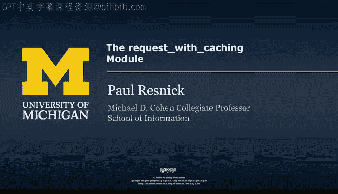
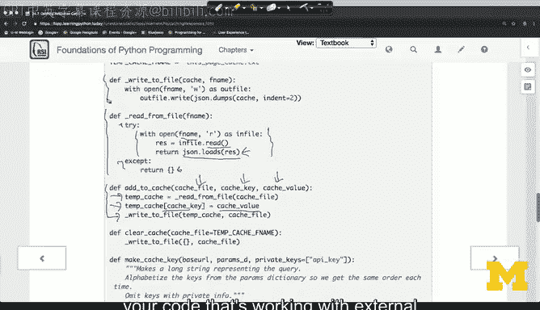

# 密歇根大学《Python3编程（课程3、4、5）》｜Python 3 Programming（Python for everyone进阶）（中英字幕） - P46：45_04_05_带缓存的requests模块.zh_en - GPT中英字幕课程资源 - BV1gj41177yd

Welcome back。 Let's take a look at the code for the request with caching module。

It's not very complicated， and it's pretty instructive。 Plus。

 it's good practice to read slightly longer code chunks and try to make sense of them。

Let's start here with the definition of the get function。

It takes the same parameters as request dot get a base URL R。And the optional parameterss dictionary。

 But it also has a few extra optional parameters， like private keys to ignore。

 We'll come back to those。In the previous video， I described conceptually how a cache works。So。

 we've got。And data store where we're going to store the results of our previous ins of request。 get。

But how we actually going to implement that in Python。

 The answer is we're going to do it as a dictionary。Where each key。

Will represent one invocation of request do yet。 The key hasu somehow。

Incode what the base URL and what the parameters were of that invocation of request I get。

 And then the results will be some。Some text that was what we got back from running request。get。So。

 in our code here。We're going。To compute a cache key， we're going to make this value K。

By calling a function， a little helper function that I'll show you in a minute， called make Caashki。

And it's going to take the base URL and the parametersms and turn it into a string。

We'll take a look at that make cache key function in a minute。

But just think of it for now is that it's producing some string。

That well use as a key in the cash dictionary。Now， the heart of this get function is this if LF else。

So we're going to check whether this cache key is in either of our two caches。

 the page specific cash。Or the permanent cash。So if it finds it in the temporary cache。

Let's say it's here。Then we're going to take these results， and return them。

So if we found them in temp cache， that is the cache key that we're looking for。Is in the temp cache。

 Then we go get the value associated with that cash key。 And that's what we're going to return。

And you may recall that we're trying to produce the same kind of object。That request I get produces。

 And that was a response object that has not only the text。But also the URL。Now。

 if we actually called request I get， this would be the URL that we fetched from the remote server。

 In this case， it's going to be the URL that we would have fetched。If we had actually gone。

To the remote server。 But instead， we'll produce that URL that we would have used if we had to go out to the remote server。

 So that was computed。Appear。Using another little helper function。

If it didn't find it in the temporary cache， it'll do the same thing。

 it'll check in the permanent cache， if it was in the permanent cache。Return the text and the URL。

 If it didn't find it in either of the two caches， then。We will actually call request。 get。

Passing the base URL in the parametersms， we will add those。

Whatever the result was gets added into the cash。And again。

 this is another helper function that we'll look at in minute called add to Ca。

So the basic structure is we calculate。What the cache key ought to be。

 And then we check in the two caches。 Is that key there。 Is it in either spot。

 If it's in either spot， we return the results from that cash dictionary。 And if it's not there。

 then we call request do get。 And we add it to the cache so that it will be there the next time。

And the only other little tricky part in here， I glossed over。

Is that we want these caches to live beyond the current run of the active code window。

And so to make it be a little more permanent， at least to live a little longer than the current run。

 we want to save it in a file。I've shown the cache as if it's just a dictionary， but actually。

 this dictionary we're going to store in a file。So we have to read this dictionary from a file。

 and I'll show you this underscore read from file as another little help or function。

So let's take a look at those helper functions now now that we understand the basic structure。

The first one is this。 make cash key。So it's taking the base URL and the pram dictionary。

And it has to make a string out of that request， a text string that we can use as a key in the cache dictionary。

Now， the URL itself， we could just make the full URL out of the space URL and the parameters dictionary。

But we're making something slightly different in our case。

 because there are some keys that we want to exclude。 In particular。

 there may be private data that's used for authentication。

And we'll see more about this when we get to the Flicker API。

The other thing that we want to do here is to make sure that we always get the parameters in the same order。

 If there is a couple of different parameters， remember。The dictionary， the prams D。

The keys could come out in any order。 And if one time we call it。

 we get the keys in one order and another time we get them in a different order。

 we might fail in our look up， trying to find something in the cache。

 So we've created a canonical order。We alphabetize the keys， by sorting them。

And the default order is to sort them in alphabetic order。Then we go through each of the keys。

 and we just create a little string that puts together the key and the value。

So we're getting all of the keys and values from Bramsty。

 and we're sticking to get them together into one giant string separated by underscore characters。

So what we're going to get is something that looks a lot like the full URL。

 but might be a little bit different。Let's look at the other helper functions。First。

 let's look at this。 Read from file。Basically， we're just taking the contents of a file and reading them into a Python dictionary。

 So most of the action is right here。 we open the file， and then we read it， and we call Json Lodess。

 which takes the text of the file and turns it into a Python object。In our case。

 it's going to be a dictionary。And I've wrapped this in something called try and accept。

 If you haven't seen that before， don't worry about it too much。 It's covered in the next course。

 in this specialization。It just lets the code fail gracefully。

So if it can't find this file or if it can't load it as JSON。

Then we'll just return an empty dictionary， so it'll fail gracefully。

So that's reading it from the file and turning it into a Python dictionary。

The other helper function is this addd to cache， so we've got some cache file name and we've got some new key and results that we want to save into the cache。

So we first read that dictionary using Read from file。We add a key to it。With。

The value that's been provided。And then we just write that back out to the file。And write to file。

 you can see up here is another helper function that just opens the file and writes the dictionary out。

So that's a simple caching pattern that we've implemented。

 It's a wrapper around the expensive and unreliable operation request get。

You can just call request with caching。ge and returns the same thing as request。

get if it has a saved previous version of the request it returns those contents， and if not。

 then it calls requestquest。ge。It's useful because it helps you avoid problems with rate limits when you're debugging your code that's working with external RE APIs。

I'll see you next time。