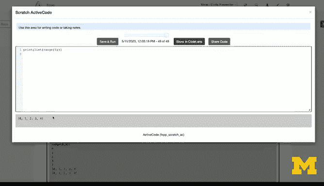
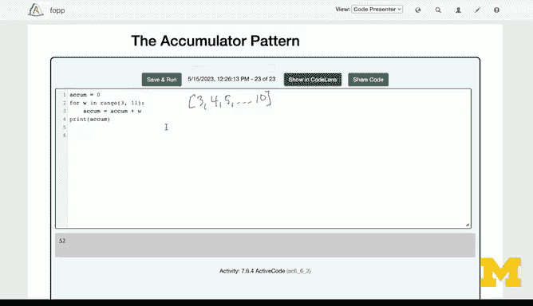

# 密歇根大学《Python3编程（课程1、2）》｜Python 3 Programming（Python for everyone进阶）（中英字幕） - P46：46_02_04_range函数.zh_en - GPT中英字幕课程资源 - BV1CM411Z72u

Welcome back。Previously， you've seen iterating over a sequence and doing something with each of the items。

 For example， here， we're iterating through all the numbers，0，1，2，3， and 4。

 and we're just printing each one of them out。But this thing of iterating through a sequence。

Of numbers that are。One after the other。There's an easier way than writing out all of those numbers。

 Python provides a function， called range。And you can say how many things you want。

 and it'll start at 0， and it'll produce that many things。

 The range of  five actually does exactly the same thing。It produces the numbers 0，1，2，3， and 4。

 If I said8， it'll produce。8 numbers， the numbers from 0 up until 7。Now， range is just a function。

It'll always produce a sequence。That sequence will have the same number。

Of items as the parameter that you passed in， so in this case8。And it will always start at zero。

 so it's going to go up to。But， not， including。Eight， so it's going to stop at 7。

There's actually some more advanced things where we can actually tell the range function to go。From。

1， up to 5。And then it starts at one。 It goes up to， but not including 5。

You can even do things like counting by two。Let's go to 10， counting by twos。So we get 1，3，5，7。

 and 9。But the most common thing is you'll just say， look， I want。8 numbers。

And it'll go from zero up until seven。Now， there's one subtlety to the range function is that the range function doesn't actually produce a list。

 It produces what's called an iterable， something that will generate the numbers from 0 up to some limit。

But it produces those numbers when we iterate through them in a for loopop。So if I ask to print。

Range of 5。 It doesn't print out the list 0，1，2，3，4 and says， instead， it tells me， hey。

 I've got this range object。In some contexts， you can use that range object as if it were a list。

 like you can iterate through it， you can do fourI and range of five。

There are some other context where it works pretty much how youd expect a list to work if you ever have something that's not working how you expect it to。

That's an iterable like this， you can convert it into a list by passing it to the list function that'll change it over。

So if you're ever finding that。Output of range isn't isn't to your liking and you want it to be a realist。

 you can just pass it to the list。

Let's see the range function in the context of the accumulator pattern Here。

 we're adding up the numbers from 0 through 10。Including 10， and we get a total of 55。

But I had to type out all these numbers by hand。Bell add more convenient。

To let the range function generated for me。This generates that same sequence of numbers， zero up to。

 but not including 11， so up through 10。And that gives me a total of 55。 And imagine that I。

 know was trying to do。30。Then it would be really painful to type out all those numbers and I'd probably make a mistake。

But it can generate that sequence for me just fine。The range function， also。Let's you。

 instead of just specifying the total number， the total count of how many things are going to be generated in the sequence。

 you can start。With a starting point， and go up to。Some ending point。

So this is just going to give us the numbers  one through 10 like we had before for a total of 55。

 and we can also start。Later， if we want。So that's going to generate。

A list like this that begins at 3。And goes up through。10。😔，Sapps just before 11。

That'll give us a sum that is。Similar to what we had before， but missing the one in a two。

 So it should end up being just。52。And sure enough， it is。

So this range function will show up as a handy utility for you。

Throughout the rest of your time as a Python programmer。I hope you enjoy it。We'll see you next time。

