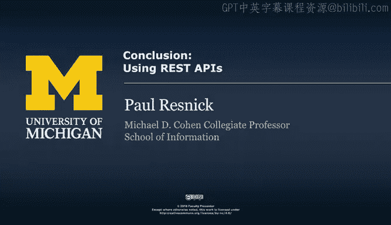

# 密歇根大学《Python3编程（课程3、4、5）》｜Python 3 Programming（Python for everyone进阶）（中英字幕） - P47：46_04_06_REST API应用总结.zh_en - GPT中英字幕课程资源 - BV1gj41177yd

Welcome back。At this point， you should be able to read API documentation in order to formulate and debug ins of the request that get function。

And you should be able to understand and appreciate the request with caching module。

And you may be wondering where I get all my corny jokes from。While。

 some of them are favorites I've accumulated over the years and retold probably too many times。And。

 of course， there's a rest API to search for these jokes at I can hasd joke dot com。

 That's has with a Z。😊，The base end point gives you a random dad joke。

 Here's what I got back the first time I invoked the API。

What do you call a crowd of chess players bragging about their winds in a hotel lobby。

Chestnuts boasting in an open foyer。That one's an old chestnut。Here's a more profound one。

 I got another time。What was a more important invention than the first telephone。The second one。

The API also lets you do searches When I ask for slash search question mark term equals hipster。

 I got back three。How much does a hipster weigh。An Instagram。

How many hipsters does it take to change a light bulb。Oh， it's a really obscure number。

 You've probably never heard of it。How did the hipster burn the roof of his mouth。

He ate the pizza before。 it was cool。Okay， okay， I can hear you groaning through the screen enough with the puns。

 I hear you。I'll give it a rest。See you next time。