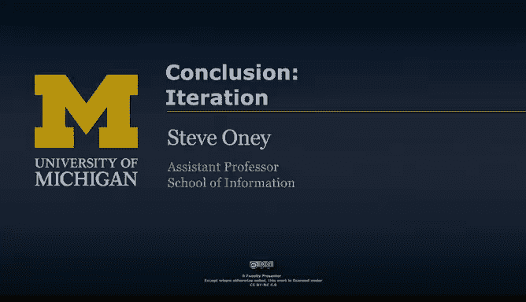

# 密歇根大学《Python3编程（课程1、2）》｜Python 3 Programming（Python for everyone进阶）（中英字幕） - P47：47_02_05_迭代总结.zh_en - GPT中英字幕课程资源 - BV1CM411Z72u

Great job so far。With four loops， we can write code that executes for every item in a sequence。

 which as you've seen and will continue to see， is important for a wide variety of problems。

 so let's conclude with the joke。But it actually helps to have a little bit more context for this joke。

 and I'll start by saying that although we encourage you to have descriptive names for your iterator variables。

 many programmers get a little bit lazy and use single letter variable names like IJ or X。And also。

 you might already know that working in teams is important for programmers。In fact。

 my team had a debate about the best name for an iterator variable earlier today。I won。

See you next lesson。