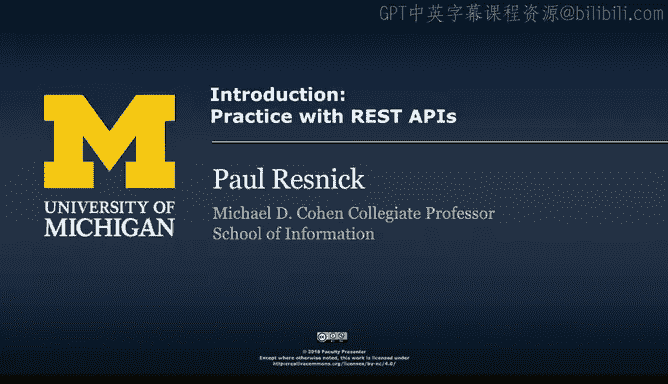

# 密歇根大学《Python3编程（课程3、4、5）》｜Python 3 Programming（Python for everyone进阶）（中英字幕） - P48：47_04_01_REST API实践简介.zh_en - GPT中英字幕课程资源 - BV1gj41177yd

Hi， welcome back。This lesson just gives you more practice at reading API documentation and constructing calls to request。

 get or request with Caching。 get。Along the way， we'll also learn about API keys。

 which are the simplest form of authentication that are sometimes required when your program tries to interact with the rest API。

There's no new learning objective for this lesson。 The goal is just to increase your fluency。

 So you'll be ready for the final project where you have to deci for the documentation for two different rest APIs and create a mash up that combines results from both of them。

So bye for now， I'll see you at the end。