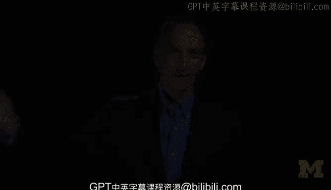
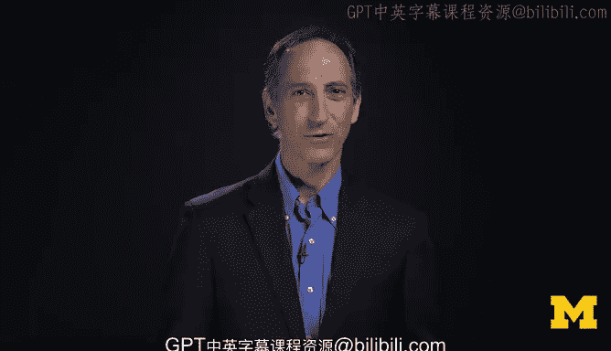

# 密歇根大学《Python3编程（课程1、2）》｜Python 3 Programming（Python for everyone进阶）（中英字幕） - P48：48_02_01_程序员之道导论.zh_en - GPT中英字幕课程资源 - BV1CM411Z72u

Welcome back。In this week's way of the programmer segment。

 we'll talk about some programming practices that will help you write for loops that do what you intended them to do。

In particular， we're going to talk about conventions for naming variables。These are just conventions。

 you can name your variables libertyer and Lib if you want。

But there are conventions like using plural nouns as names for sequences and singular nouns for iterator variables。

 if you follow these conventions， that'll make it easier for you to keep track of what your code is doing。

You'll also learn about putting print statements inside a for loop to give you diagnostic information about what's happened at each iteration。

And we'll also reinforce some of the vocabulary about iterables and iterator variables。

 consistent use of vocabulary can help you master the conceptual distinction。

I'll see you at the end for the joke of the week。

