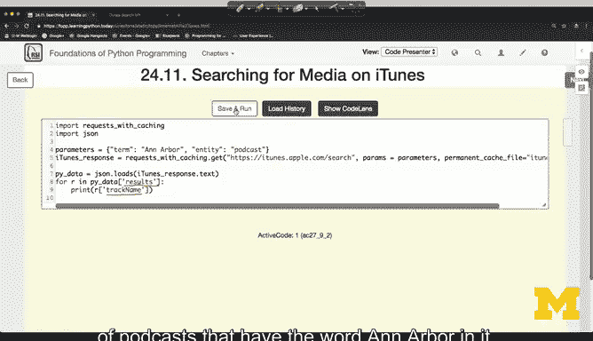

# 密歇根大学《Python3编程（课程3、4、5）》｜Python 3 Programming（Python for everyone进阶）（中英字幕） - P49：48_04_02_iTunes API应用.zh_en - GPT中英字幕课程资源 - BV1gj41177yd

Welcome back。Let's take a look at another RE API， iTunes。ITunes is Apple's media store。

 the rest API lets us make queries asking what's in the store。So this page is their documentation。

There's a base URL。Yeah。Andch goes up through search， so HttPS。Co// itTunes。apple。com/search。

And then as we've seen before， their query parameters。

 there's a question mark and then some key value pairs。

What are the keys and values that ITunes understands for those query parameters。 Let's scroll down。

 and we'll see。They've got a whole table of them， there's a bunch。

In the left column are the key names， things like term。Country。Media。Or entity。In the right column。

 there's some information about what are the allowable values。To the term。

 that's going to be what we're searching for。 And you can put any text string in there。But for media。

 there's only certain allowable values like movie or podcast or music。So in our URL。

 when we make a request to iTunes， we're going to have something like Media equals podcast。

The other two columns tell us whether。We are required to include this query parameter， yes。

 you have to include term and you have to include country， but the other ones are optional。

And then there's just description that gives you some hints about what you're getting。

So let's try to figure out what we would pass in for the Params dictionary when we make a call to request。

ge。I'm going to go back to Runonestone and we'll come back and look at this documentation as we need it。

In the textbook， we've got a couple exercises。Suppose we were trying to look for podcasts originating in Ann Arbor。

 and we're going to pass in a Param dictionary to request get。What value should we put here？

As the value associated with term， so this is the thing we're searching for。And so since we've said。

 we're looking for podcasts that mention Ann Arbor， me put Ann Arbor in here。checked me and it says。

 oh， don't forget the quotes， it needs to be a string。

We're going to be putting a value here and it's got to be a string。Let's put that value in quotes。

When it gets encoded into the U， it won't have the quotes around it。

 But in order to be of value in this Pams dictionary， it does need the quotes。And that's。All good。

So let's look at our next question。There's another parameter， if we're searching for podcasts。

We're going to have to。Give another query parameter whose value is going to be podcast。

 which query parameter is it？Well， you could try to guess。

Perhaps you remember from the documentation page， but let's。Go勒。

And it turns out we can say podcast for the query parametera media。

If we scroll down a little farther， turns out we also can say entity equals podcast if we say media equals podcast。

Then we'll be doing a little bit broader search。 We can do a slightly narrower search where we say entity equals podcast。

 and that will be limited to searching for Ann Arbor in the podcast title excluding。

Looking for it where Ann Arbor is part of the author。So we could say either media or entity。

 and we've actually set this up so that it'll accept either media and says， yes， you can use that。

That in our code below， we're going to use En。Entity is also okay。

So here's a request that we can make， we're using requests with caching rather than requests。

Just to make sure that if there's any problems getting to iTunes on a particular day。

 that it'll still work。Remember， requests with caching is only available in Runestone and in our Corursera Jupiter environment。

 If you try this code in your own Python environment， that module won't be available。

And we are passing in Term Ann Arbor and Enity podcast。It'll take us a minute。

 and we'll get a result。It found it in the permanent cash。 Now。

 we haven't chosen to do anything with this。But I could also， for example， print。

What the full URL was that was。Created。And that's this URL。Now because we used caching。

 it didn't actually go and make the request itTunes。apple。com。

 but this is the request it would have made。It got the saved results， the cash results。For that URL。

Now at this point， I've loaded the response text into a Python object。

 and I've saved that in the variable called P data。And at this point。

 we would have to go through our usual understand， extract。

 repeat process to pull out the data that we want from whatever is in pi data。

I'm going to skip ahead。Because I've already done that process of doing the understand， extract。

 and repeat， and this is what I got to。So I found that。The top level object was a dictionary。

 It had a key called results。And I have extracted the value associated with results。

And that value is a list。 It's a list of dictionaries， one dictionary for each podcast result。

 Each of those podcasts is a dictionary that has a key called track name。

 and I've extracted the track name。 So when I run this。

 I will get the names of podcasts that have the word ann arborum。

So it's telling us that it found it in permanent cache and then on each line we have one track name。

As you can see， there's one from the Ann Arbor District Library。

The award winning Ann Arbor District Library， I should say， we love our library in Ann Arbor。

And we love libraries in general at the School of Information。

And there's a bunch of podcasts from churches。You can see the Hars Mission， community Church。

 Grace Bible Church， and so on。And actually， there's a few more podcasts from the Ann Arbor District Library。

So that's an example of deciphering the iTunes API documentation and using it to construct RE API queries。

 we'll see you next time。