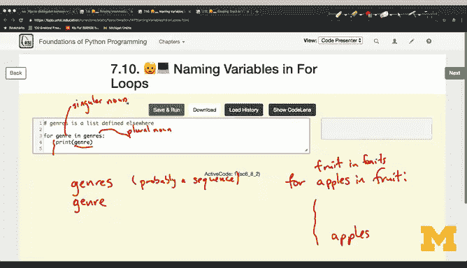

# 密歇根大学《Python3编程（课程1、2）》｜Python 3 Programming（Python for everyone进阶）（中英字幕） - P49：49_02_02_for循环变量命名规范.zh_en - GPT中英字幕课程资源 - BV1CM411Z72u

Welcome back for a little way of the programmer advice on naming the variables in your for loops。

So suppose that x was a variable who was bound to a list somewhere。

You might be tempted to write for y and x print y。The problem is。

If you haven't looked at this code in a while， an X was defined。Somewhere above this code。Like。

 what is x。You haven't given it a name that gives any suggestion that it's even a list。

 much less what it's a list of。And I have for y in x。 Also， I'm not with my code here。

 I'm not giving any hint as to what kinds of items are supposed to be in x。So this is， you know。

 if it's a very simple fore loop， you might be able to get away with this and still be able to understand what's going on。

 but it's really going to be helpful if you give more meaningful names。

And one bit of advice I have is to， whenever you're having a variable name that's going to refer to a list。

Give it a plural noun， as its name。And whenever you're going to have an iterator variable。

 give it a singular now。 So here's an example in my next。Code window。I have。A variable called genres。

Because it has a plural name with an ss on the end， I kind of expect it to be。G and lay a sequence。

Then I took my iterator variable。And I chose to make it be a singular noun。And moreover。

 it is a singular noun that sort of goes with the plural noun。

 So each item in a list called genres is going to be one genre。

And so then in my code inside the for loop， I'm going to refer to this singular variable genre。

And it's going to remind me that it's one item from the genres list。

This is a lot better than doing things like。And I sometimes do see students confuse themselves。

 They'll say for apples。Yin fruitru。And fruit， actually you look at their code and it's a list of the names of fruits。

And apples is。You know， the first string that's in that list。

 And so somehow they decided that they would name the variable name apples。

But this will be very confusing to read because you get four lines into the code and you see apples somewhere and you think。

 oh， apples must be a list of different kinds of apples or something like that。So don't do this。

For fruit。In fruits。That's fine。Zou。😔，For your sequence。Do a plural noun。For your iterator variable。

Do a singular noun。Follow that little convention and you'll save yourself a lot of confusions as you're coding。

See you next time。