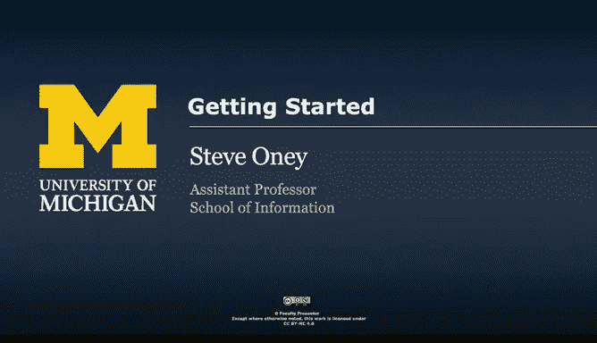
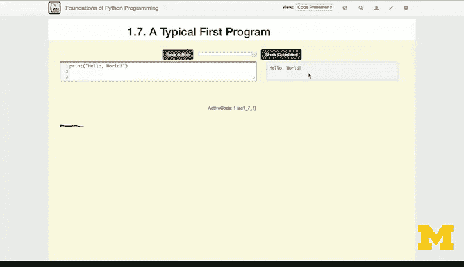

# 密歇根大学《Python3编程（课程1、2）》｜Python 3 Programming（Python for everyone进阶）（中英字幕） - P4：04_01_05_入门指南.zh_en - GPT中英字幕课程资源 - BV1CM411Z72u

In this course， you're going to learn to write computer programs in the Python programming language。

 but before we get into that， we need to know exactly what programming is。Fundamentally。

 programming is giving a list of instructions for a computer to follow。In the context of programming。

 these instructions are sometimes called algorithms。Now。

 computers are really good at following these instructions very reliably and very quickly。

 but not very creatively。And we can't just give computers instructions in English or any other natural language that we normally speak because natural language has ambiguity。

 Word or sentences can have multiple meanings which computers can't figure out。Instead。

 we need to give computers instructions in a programming language。

 which is a kind of language that computers can understand because they have a formal syntax or set of rules。

There are many programming languages that exist， including JavaScript， C++， Java， Haskell， and many。

 many more， but in this course we're going to learn to use the Python programming language。

The process of learning programming is more than just learning the rules of the Python programming language。

 it's also about how to break down and solve problems regardless of the programming language。

 and I like to think of programming as a translation process where the programmer translates their goals from natural language into a programming language。

For example， if I want to write my own version of the game Whe of fortune。

 then I need to translate the rules of the game into an unambiguous set of instructions written in the Python programming language that tell the computer how to run the game。

And as you become a programmer， you'll learn how to come up with strategies or algorithms for solving problems and how to translate these strategies into Python code that a computer can execute。

Now， all that said， the best way to learn programming is through practice， so let's get started。

In this course， you will be able to write Python codes right in your browser。

You'll see what are called active code windows that look like this in your textbook。Now。

 most programming courses start off with what's called a Hello World program or a program that prints out Hello world on the screen when you run it。

In Python， a programme to print hellello world looks like this。In order to actually run this code。

 we need to click the Save and Run button。When we do that。

 we'll see an output window show up to the right here。Now， to break down what all of this shows。

 we have our Python source code on the left。And we have our output on the right。Now。

 when we click Save and Run， what happens is that there's a hidden Python interpreter。

And it looks at what's in our source code。And print out whatever any relevant output is。

And remember that this source code is a set of instructions。 In this case。

 the source code is an instruction to print out whatever is in quotation marks here， in this case。

 hellello world。If we wanted to change the set of instructions。 so for example。

 I want to change it to print out hellello， Michigan。

Then I need to put it through the interpreter by clicking save and run again。And now when I do that。

 you'll see that my output changed from hello world to hello， Michigan。If I want to change it back。

Then I need to click save and run to change Michigan back to world。Now。

 the Python interpreter typically tries to run all of the source code that we put into our source code window。

 but sometimes it can be helpful to leave natural language notes or explanation for ourselves or for other programmers looking at the source code。

In order to do that， we have what are called comments。In Python。

 we write a comment by using the pound symbol and writing what we want after it。

When we write a comment， then Python ignores everything that comes after the pound symbol。

 meaning that we can write whatever we want here。And on the next line。

 Python will start running the code again。 So if we wanted to write a comment。

 we would need to add a upon symbol。In what comments do are they tell the Python interpreter to ignore these portions of the source code。

And only to run what's not commented。In our case， the only code that actually runs here is print hellello world。

Another thing that's worth noting is that the Python interpreter is not very forgiving。

 So recall that when you write source code， you're giving the computer a set of instructions。

 and these instructions need to be unambiguous。 They need to follow the rules of the Python programming language。

One of the rules of Python is that when we have an open parentheses。

 then we are going to need to have a close parentheses。So let's suppose that I forget that rule。

And I delete this close parentheses， and I try to run my program。

What happens is that I get what's called a syntax error。

A syntax error is Python saying that it doesn't understand the rules of what you wrote。

 so it doesn't try to actually execute what's in the source code window。In other words。

 a syntactic error or a syntax error is when you're not following the rules of the Python programming language。

 In this case， we're not following the rule that this open parenthesesis has to be followed by close parentheses。

Throughout this course we're going to run into syntax errors and other kinds of errors。

 including runtime errors and semantic errors。So when we get a syntax error。

 as we will many times throughout this course， we can fix it by editing the source code to obey the syntactic rules of the Python programming language in this case I'm going to add a close parentheses to match the opening parentheses that starts out here。

Now， when I click Save and Run again， then you'll see that the syntax error disappears and my program runs again。

With that， you're already on your way to becoming a programmer with more practice。

 you'll better understand how the Python interpreter works and will be able to write larger and more complex programs。

 See you next time。