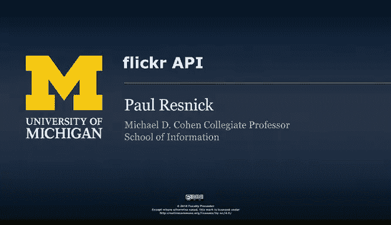
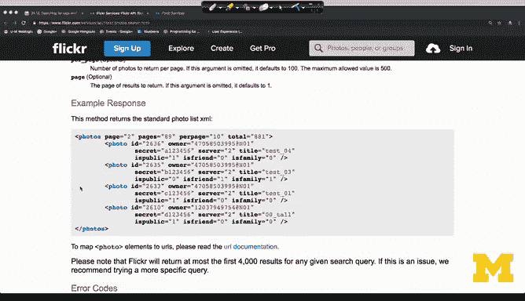
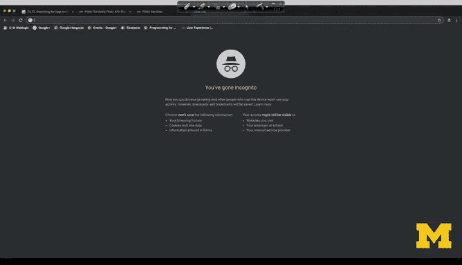
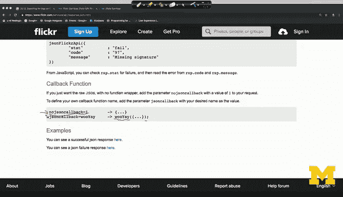
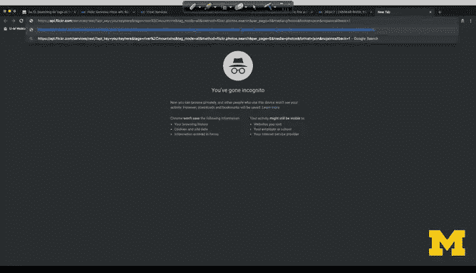
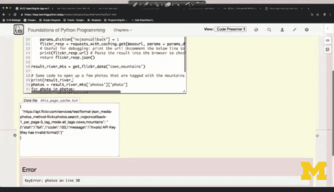
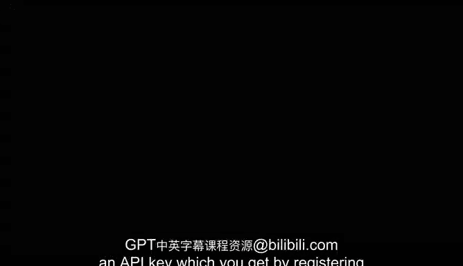

# 密歇根大学《Python3编程（课程3、4、5）》｜Python 3 Programming（Python for everyone进阶）（中英字幕） - P50：49_04_03_Flickr API应用.zh_en - GPT中英字幕课程资源 - BV1gj41177yd

Welcome back。Let's try querying another rest API。 this one from Flickr。

One of the first popular photo sharing sites， still used by a lot of excellent photographers。

 is run by Yahoo now。Here's the overview documentation page for the Flicker API。

 We're can use the photo searching endpoint。There are lots of other things you can do with the Flickor rest API。

 including posting photos and lots of other things。

We'll just look at searching because you can do that。

 even if you only like looking at photographs and you don't have a Flr account where you've uploaded photos。

So first， at the bottom of this page， notice that they give what they call an end point。

That's what we。We'll call the base URL。Everything after that is gonna to have question mark。

K equal value pairs。The next， notice that they。Have a required parameter called。The API key。

So one of these is going have to be API key。Equals something。

That's a developer specific key that you get from Flickr by signing up for it。

If you access one of our few cached queries， you actually won't need an API key。

 but if you want to run any other queries that we haven't put into a cache for you。

 you will need to get an API key from Flickr。A third thing to notice on this page is that they have another required。

Qury parameter called method。 So we're going to have to have something that says method。

Equals something。In our case， it's going to be something about search。

And we'll find that on a more specific documentation page。

So let's look at the documentation page for searching。I already have it loaded here。

We're going to have to say method。Equals flicker dot photos， dot search。

There are also a bunch of other keys that we can provide what they call arguments。

I'm just going to clear my marking here。And scroll down to show you that there's a lot of options or arguments。

And it just keeps going。These are all things that are going to affect what gets retrieved so we can ask for only things that are photos that are taken indoors or only photos that are taken outdoors。

We can provide a latitude and longitude， and it'll bring us back photos that are within some radius。

Of that location on earth。So there's a bunch of them here。

 We're not going to use them all in the examples that I show you。

 but we can come back to them whenever we need。 It's worth noting that。The API key is required。

I talked about that already。And then we're going to search for tags。So photos on Flickr。

 the photographer， when they upload them， they can give them tags like this is indoors or this is still life or this has mountains in it。

 or they can put a city name， any tag that they choose。

 So we're going to use that to search for photos of mountains and rivers。

And then there's this tag mode。 if you provide more than one。Tag。

That can either be treated as you want to search for photos that have one of those tags。

 That's the or combination， or that you want to search for photos that have all of those tags。

 That's the and combination。Now if I scroll all the way down。

 we'll see something about what the results look like。So here's an example response。

 And you'll notice that it doesn't look much like our。Favorite Json format。

 This is actually X M L format。So by default， Flr returns data not in the Json format， But an X M L。

 It's possible to parse X M L in Python。 It's not that difficult。

 but we're not going to go into that in this specialization。

 Most sites that provide X M L also have some way to ask for Json instead。

Fickcker does have a way to ask for Json Instead， They don't make it that easy to find out how。

I didn't find it anywhere on this page。

And I did do another Google search。And if I just search for。

Fickcker API， Json。The first response that comes up is a documentation page about how to get things in JSON format。

The trick is。And they show you somewhere here。And right here。

 send a parameter called format with a value of Json。 So we're going to have in our URL format。

Equals Json。There's one other little tricky thing。'Just going to get rid of those markings。

And we'll scroll down。 turns out the bottom of the page。 They have a little thing。

That says something about callback functions。Turns out we have to send no Json callback equals one。

It's a little more technical than we're ready for， but here's the basic idea without that。

 no JSsonN callback equals1， you would get JSON results。That are wrapped in。Basically。

 a JavaScript function in called a callback。So that wrapping is part of a standard called JON P。

In any case， what we need to do is we need to include no JSON callback equals1。

In order to just get pure JsonN without any extra characters around it。

So with that basics from the documentation， let's look at some code for making API requests。

As with the other APIs， we're going to use request with caching so that we can。

Avoid you having to actually get an API key from Flickr。

 you'll just get data from our cache where we won't check for needing an API key。

And just like we did for the Data Muse API。I have defined a function。 get Flickr data。

Will pass in as a parameter， this tag string。That's saying what tags we want to search for。

So when I call it on line 26， I'm going to pass in this comma separated list of tags， River。

 comma Mountains。Inside this， get Flicker data function。

You can see that I'm going to get set up to make a recall to the。Requests with cash and got get。

In order to set up for that， I set my base URL。 I make an empty parameters dictionary。

 and then I set a bunch of key value pairs。I'm going have API key equals。

Whatever I have for my flicker key。Which is just a variable up here。For the tags key。

 I'm going to set it to be River comma Mountains。Or whatever their current value of tag string is。

 whatever it's been passed into this function。For the tag mode， I'm going to say all。

 I want photos that have both river and mountains as a tag。The method is flickickered out photostos。

search。I only want to get five results back。 I would like only photos， not videos。

 and I want the format to be Json and no Json callback equals one。

 So that creates that whole dictionary。 I pass that in to my request do yet or request with caching do yet。

And I'm telling the request with caching to use the file called Flickerc dot text as its caching file。

So I get a response object back， and I'm just going to print the URL from that。

That's the URL that we would have gone to if we didn't find it in the cache。

And then we return a Python object。 We turn the text string into either a list or a dictionary by calling this do Json method。

So I'm going to invoke that on line 26 and then。Once I get the results back as a Python object。

 in this case， it's going to be a dictionary。 I have to go through my understand extract repeat process to figure out how to pull out the data that I want。

Again， Ive already done that。 So I'm not going to walk you through that process， but。

I've discovered that the result dictionary has a top level key called photos。

As the value associated with the photos's key， there's another dictionary。

 and that dictionary has a key called photo。I find that a little confusing。

 but that's the way the data comes back from Flickr。

The value associated with that photo key is a list。It's a list of dictionaries。

 one dictionary for each。Photograph。And the dictionary for one photograph has a key called owner。

And another key called I D。So for each of the photo dictionaries that's returned。

 I'm going to extract the owner and the photo I D。And I can stick those two values into a URL。

Because I've lookeded up what is the format that the clicker uses for making URLs to actually load a page。

With a single photo in it。 And I am just substituting owner and photo I D in to make this URL straight。

So if I run this， I'm going get a print out of 5。Different URLs。You can see the five URLs are here。

And above it， we got the URL。That we would have fetched if we hadn't found the result in the cash。

If this were a full Python environment， we would be able to import the web browser。Module。

 and we could call Web browser out open， which would make this URL open up。

Automatically in another tab， I don't have that option available to me。 So I'm just going。

 we printed it out。And I'll go and make a new tab。Weu。😔，Visit that URL。And there we have。

A photo that's tagged with mountains and river。 I can see the river。

 I'm not quite sure where the mountain is for this one。And we got some more， here's another one。

I put that URL in in， instead。Here's one that does have a river and a mountain。Now。

 notice that on line 23。I have the code printing out the URL。

That's the URL that we would have visited if we hadn't found it in the cache。And if I copy this。

I can go to a。Another tab。And。😔，See what I would get， if I actually。

Went to that URL for the API call。

And the answer is。I get a message saying we failed because it's an invalid API key。

So I didn't provide a valid API key， and so I can't actually make that query。

That's one of the advantages of getting the stuff from the cache is that we're not requiring you to have that API key。

Now， if I were to change this and instead of asking for， say river and mountains。

Ask for cows and mountains。I've tried this before and we tend to get。

Beautiful pictures from Switzerland and the Pyrenees in Europe。If I try to do this， it won't find it。

In that cache。 And so it will try to fetch it。 So it's new in adding it to the cache。

 Here's what the URL is。But。We get an error。And the error is on line 30。When we go to try to extract。

The photos and photo IDs。On line 30， we're finding that we get a key error。

In the dictionary of results， we don't have anything called photos。So， let's see。Let's see what the。

Result really was。

And。😔，It's going to be the same error message that we saw in the browser window。

We get the error message that it was an invalid API key。

So you can make this work if you sign up for an API key and put your API key on line 8。

 you would be able to make new queries with this code。We didn't show it here。

 but there are other operations with Flr that require user specific authentication。

 Like if you want to post photos to somebody's account。

Youd need to prove that you have permission from them。

Apis provide features for doing that kind of user authorization through a protocol called OOth。

But that's beyond the scope of this specialization。And once you've authorized。

 each request would get digitally signed。Python provides a module for doing that called requests with Owath。

 Again， it's beyond the scope of this specialization。The key takeaways from this lesson。1。

 sometimes you need to pass a lot of query parameters。 Take a look at lines 13 through 20。

Sometimes there are a lot of choices about what the query parameters are。

 Remember that long list in the documentation。Sometimes you have to specify that you want things in Json format because that might not be the default。

And sometimes you have to specify other idiosyncratic things like this no JSsonN callback equals one query parameter。

Finally， many sites require you to provide an API key which you get by registering with that site。

See you next time。

