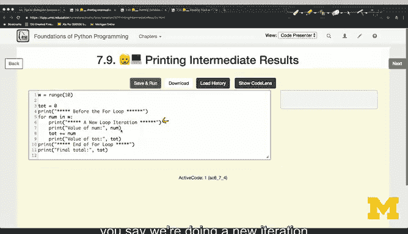

# 密歇根大学《Python3编程（课程1、2）》｜Python 3 Programming（Python for everyone进阶）（中英字幕） - P50：50_02_03_打印中间结果.zh_en - GPT中英字幕课程资源 - BV1CM411Z72u

Welcome back。I'm here with some way of the programmer tips。

On how to make it so that you can understand what's going on in your programs。Here。

 I've got some code for doing an accumulator pattern to add up all the numbers from 1 to 10。

But suppose you didn't recognize it as that。You could。Use code lens， if you were。

Have a small enough program like this one。 But it's good to start learning how to。

Add some print statements that will print out intermediate results。So suppose I run this。

 and I am surprised that I got 45 rather than 55。An。What should I do。And the answer is。

 I should start adding some print statements。So， here， I've added。Inside the forloop。

 something that Prince。The number。The current value of the iterator variable。

So what's the value of none on this iteration。So now I find out that at's 0 than one then two then three then 4。

 If I was thinking that range of 10 was going to give me the numbers from 1 to 10。

Adding this print statement on line 5 will give me a clue that actually。

 it's giving me the numbers from 0 to 9。Now suppose I'm still a little puzzled。

 Maybe I don't really understand what line 6 is doing with this toad plus equals numb。Here。

 I've added an extra print statement on line 8。To print tote。The value of the accumulator variable。

At the end of each iteration。So now we find that we get zero and zero。So， this is nu。Is 0。

 and tote is 0。Annan。😔，And to her both one。Thenum is too and tote。

Is 3 because we've added the previous total 1。Plus， the new number 2， and we get three。And so on。

So now I can start to understand that line7 is taking the old value of total。

Adding in the current value of nu。And writing that back into tote。

So we get the old value of total was one。The new value of nu is 2。

 and we write it back in into tote so that it's  three。 and on the next iteration。

 we'll have three in tote。Now I had to do a lot of writing stuff here to remind us of which variables were getting printed out。

 So when you're printing intermediate results， sometimes it's helpful to print out。You know。

 a little text saying what it is that you're printing。 And that's what I've done。In the next window。

So I've got a print statement on line4 saying， hey， we're before the for loop。Then on line six。

 we say we're doing a new iteration and the value of none is something。

You can see that with all of this diagnostics， it's much easier to read the output。

So instead of me having to write in numb and tote， we've got it all getting printed out already。

 The value of numb was 0 and the value of tote was 0。 Then they were both one。Then none was two。

 and told it was three。Because we added。The two。And the one。

We have a value of to is 3 and the value of ne is 3， so we add those two together to get 6。

6 and 4 makes 10 and so on。So it's helpful to add print statements。 If you just add one。

 you don't need to have all this diagnostic stuff like saying what it is you're printing out。

 but once you。Start to have several print statements。 It's helpful if you include things like。

Value of none is this。So that when you go to look at it over here。

 you know what you're seeing in the printout。So that's the little tip on printing intermediate results。

I'll see you next time。