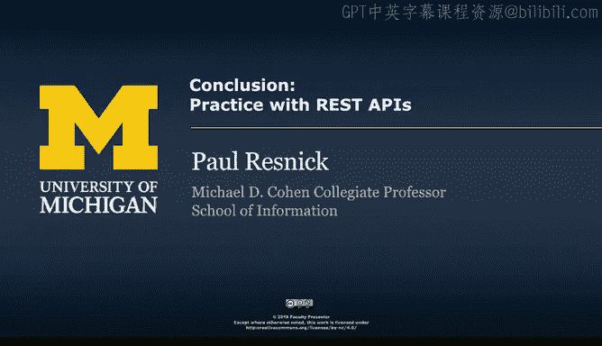

# 密歇根大学《Python3编程（课程3、4、5）》｜Python 3 Programming（Python for everyone进阶）（中英字幕） - P51：50_04_04_REST API实践总结.zh_en - GPT中英字幕课程资源 - BV1gj41177yd

Hi， welcome back。Hopefully by now， you've seen enough examples of API documentation and constructing calls to request ga or request with caching dot cat that you'll be ready to try it on your own。

There's nothing like practice and repetition for building fluency。

Which reminds me of one of my favourite old jokes。A young tourist from a small town in Michigan is wandering around midtown Manhattan。

He looks at his watch and realizes that he has tickets to a symphony orchestra concert at Carnegie Hall。

 starting in half an hour， but he's not quite sure where Carnegie Hall is。

So he sees an older woman carrying a violin and figures she must know。 And he asks her， excuse me。

 Can you tell me how to get to Carnegie Hall。She looks at him slowly and says， young man。Practice。

 practice， practice。I'll see you next time。