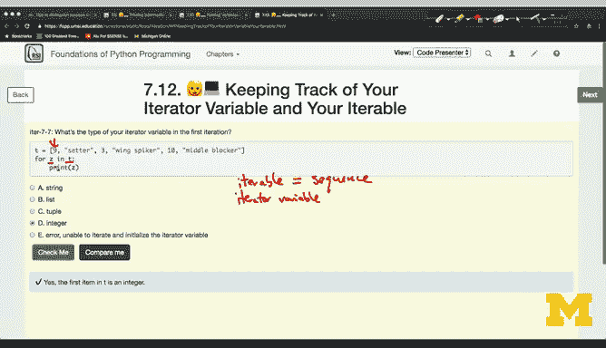

# 密歇根大学《Python3编程（课程1、2）》｜Python 3 Programming（Python for everyone进阶）（中英字幕） - P51：51_02_04_跟踪迭代变量与可迭代对象.zh_en - GPT中英字幕课程资源 - BV1CM411Z72u

Welcome back for another way of the programmer segment。

Students sometimes get confused with iteration about what's the iterator variable and what's the iterable。

So I want to just go through and give you a little practice。

So we have a series of questions that ask， what's the type of your iterable or what's the type of your iterator。

Here。😔，I have。A variable N。And I am iterating through it。 The iterable is the thing that we are。

Going to iterate through。 It goes after the word in。And in this case。It is a list。Hay。

 we got that one， right。Some of them may get a little trickier。Here， what's the type of our iterable。

Well， again， the iterable is after the word in， it's the variable T。

And I have deliberately for these exercises， given you variable names that don't give things away。

This is not good coding styles better to have meaningful names。

 but this is forcing you a reason about it。 T is going to be a string。Now。

 what will the type of my iterable be here， Again， iss the thing after the in。 It's the variable Y。

 whose value is 18。You might be tempted to say that it's an integer， but， of course。

 an integer is not a sequence at all。 You can't iterate through it。

So this one's going to be an error that we can't it over the object。

What's the type of my iterable here。Will， the open。Preheses， rather than the brackets。

Or an indicator。That this is a tuple rather than a list。

I'm going to go on to some that ask us about what the。The iterator variable。Yes。So now。

 what is the type of your iterator variable here it's not asking about the iterable。

 not the sequence， but the iterator variable。So Z， what kind of thing will Z be bound to when we get down to print Z on the third line。

Lzeb will be bound to one of the things that is in the iterable。 One of the things that's in tea。

So in this case， Z will be a string。What will be the type of my iterator variable on the first iteration。

So， Z will be bound。To 9 on the first iteration。 So Z will be an integer。

So I think you get the idea here， I'm really just trying to。Reinforce the vocabulary， the iterable。

Is the sequence。It's the thing that you iterate through， it's the thing that goes after the word in。

The iterator variable。Is the variable name between the word for and the word in。

And it will be bound each time to one item from the iterable， one item from the sequence。

So don't get confused。 The iterable is the thing that you iterate through， goes after the in。

 The iterator variable is the thing that's bound to each item in the sequence。

We'll see you next time。