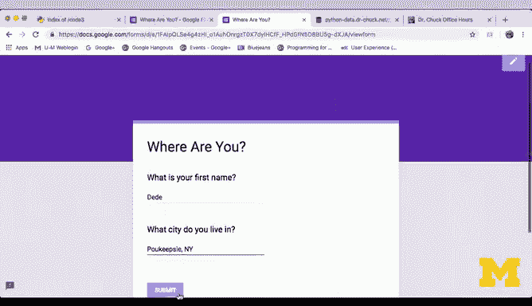
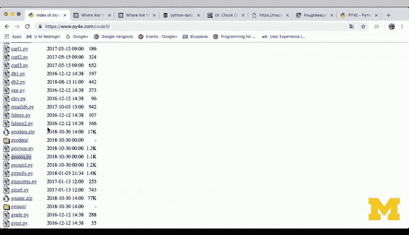

# 密歇根大学《Python3编程（课程3、4、5）》｜Python 3 Programming（Python for everyone进阶）（中英字幕） - P52：51_04_01_Google Places API趣味应用.zh_en - GPT中英字幕课程资源 - BV1gj41177yd

Hello， my name is Charles Severance。 I teach a Python course called Python for everybody that you may have already taken。

 and I'm excited to be doing this way of the programmer where I get to sort of wander a little bit and tell you something about something that I'm really enjoying。

 So I love this map。 This map is my office hours where I've met my M mooc students from around the world。

 And people love maps。 I mean， they're just so visual。 But the problem with maps is。

 and this happens to be I type it all in。 But let's say you're doing a survey。

 and you're going to ask people for the location。 Nobody wants to figure out what their latitude and longitude is。

 They want to tell you where they live。 But these maps need latitude and longitudes。

 So the focus of this is to figure out how to take user and data。😊。

And turn it into latitude and longitude using a Python program and an API on using Google。 Okay。

 so here's a little simple survey that I've got。This is a simple survey。

 people will send it round to lots of people and they will put in their name and their city。

And Deie lives in Poughkeepsie， New York。 Now， I could cheat here because it's telling me already that I've misspelled Poughkeepsie。

 I think Poughkeepsie might be the most misspelled place in the whole world。

 The problem is you can't force people to spell it right。 Now， I could fix it。

 but I'm not going to fix it。 Okay， And so as people enter this in open text fields。

 they're going to make mistakes。 They're going to forget the state or the city or something， right？

 And so your data that you're going to get。 So here's like our sample data。 We got some people。

F people and some people typed their locations correctly and some people didn't quite get it right and so we need to talk to an API and I'm going to show you some sample code and it's going to come from my Python for everybody class and you go down on this PY3。

com/ code 3 and you scroll down there's lots and lots of things。Okay。And I'm going to go to。

G ORq dot py。And I'm going to save this as。And then， I am going to。Come on， save this as save， oh。

 there we go。Say this as and I'll just put it on my desktop。Grec do py。And so now I have a terminal。

And I am in my desktop。If I look at the files， I see Geect Py。

 and I'm going to use an old school text editor。 I know you don't want to use it。

 It's from the 1960s actually called V， but it's a classic someday I want to teach a MOO on how to use V Vim is another another thing that you have here。

 So basically this is the code and I'll walk through all this code but I first want to show you about the Google APIs。

 so there are these Google APIs。 And if we go to this Google API right here。

 I'll copy this and show you what happens。This Google API used to be free and wide open。

 that was kind of fun。 And then I let everyone。 we had everyone use it。

 And then Google sort of locked it up with an API key。 And that's basically。It's the way of APIs。

 sometimes you need a key， sometimes you need an OA2 key in this one because it's really server to server as much as it's not in a browser。

 you don't need too fancy of a key， so but here if you just start hitting this without a key。

 it's not going to work so you can't hit this database， this API without a key。Okay， and so I。

Made it so that you don't have to go get a Google key， but it's not that hard。

 You just go to get a Google key。 You can turn it on。

 and it's free up to a certain number of requests。 But I have made。A copy of this。

 and you can call the exact same API， and I put it on my own server that's scalable。

 And don't use this for production。 This Python data Doctor Chuck。net Json address equals key equals。

 And if you don't put the key equals 42 on here。It's going to say you don't have a key。

And so you have to put the key parameter in。 And for those of you who have taken my class。

 it's not hard to guess what key I would pick if I was securing it。

 So everyone uses the same API key。 Now， if too many people figure this out。Then I'll change the key。

 and then you'll have to download a new copy of the sample code。

 and I'll always put the key in the sample code。 You can use this。

 It's not like it's not like you're going to hurt it by using it 100 or even 1 thousand times。

 But if you use it 10000 times， that will be a problem。 So I'm have to change this key。

 but but there you go。Okay， so basically this API。Adds get parameters。 And this is a URL。

 And then these after the question mark， there are these things called the get parameters。

 and then Ampersand separates parameters。 address equals and space Arbor comma plus M I。

 the plus in this is the way that in URL parameters， we encode space。 So that's an Arbberery。

 Michigan， comm， Michigan with spaces that are in there。 And then you can have more than one thing。

 And if you don't put the key in， of course， it doesn't work。 And so this is returning some Json。

 And Json， I don't know if you've covered Json yet in your class， but it's not all that hard。

 And I'll show you the Json needed to parse here。 And so Json ends up。Its it's based on JavaScript。

 but for all intent and purposes， it looks like dictionaries and lists。 And so this is a dictionary。

 if we think of it Python terms with a key of results that maps to an array of dictionaries with keys and etc cetera。

 And so you kind of have to dig through。It ends up being a dictionary within a list inside of a dictionary but the list thing itself are dictionaries。

 but then there might be more lists。 And so there's another thing， and there's modern list。

 So it's all this nested stuff， right， And it sometimes takes a little while to parse this。

 And I give you all the code。 I'll show you all the code to parse it and we'll take a look at this。

 okay。But now I want to just kind of show you how you'd write a Python program now normally you would write a Python program where you would take this data right here and you'd say。

 you know what I want to download this is maybe a CSV file， download all the responses as a CSV。

And they put it in a zip。Show and finder。ち。I hope that's in my downloads。 It is in my downloads。

 Okay， so if I can open this with， let's see， can I open this with notepad。Or text edit。Al got that。

嗯。Open with text， edit， That's what I want to do。So this gives me my data right。

 and so you could write a little Python。 I'm not going to write this Python。

 but you get two strings properly。 you could use the CSV library as well。

 but ultimately you're going to get this Holt， Michigan， South Bend， Indiana or pookeepsy。

 which is a misspelled version of Poughkeeppsie。 So that's the data that you would get and you probably turn this into a loop because you gathered all this data。

 but I'm going to just show you the part of the code that actually calls the API。

 So let's remember that the API is just a URL that you hit of a same particular name with a particular set of parameters。

 So let's take a look at the code of this。Let me make this a little smaller so more of it fits on the screen。

ちょちょちちょ。Okay。So。We start out。 it's a Python program。 We're going to have some import statements。

 I'm going to import the requests， actually this。SSL。Doesn't need to be there。

 That was for an older version of the program。 So now that when you see it， you'll see it correctly。

 I import requests， which is the utility that we use to do H TtP requests from within Python。

 And I import the Json library so we can parse the Json that we get back。 Now。

 I mentioned that Google demands that use their API with an API key。

 And so it's a long string a little longer than this。 But if you go to Google and you get your own。

 you just uncomment this and put your API key in there。

 And then it will actually talk to the real Google data， then you can do a million if you want。

 if you want to pay for it。 or you can just talk to my sort of copy of it。

So that service URL is the place that we're going to hit。

And you'll see that we're going to augment that URL to talk to it。

So I have a little while loop while true。 This is sort of an infinite loop。

 And then I'm going to ask for you to type the address。 And that's like Holtcoma。

 Michigan or Poughkeepsie， New York。 And if you hit enter， then we're going to break out of the loop。

 So this is just loop is going to repeat until we finish。

 And then we have to make a dictionary payload， and the payload is how we represent these two parameters。

 We represent the payload， the key value pairs that we're going to go on the URL as just a dictionary of key value pairs。

 And so you see， I take the address that you entered。 I put it in it under the key address。

 and then I take the key。 The API key， and I put it under the key。 So that's。Adddres equals T equals。

 okay？So now I just call request。get， which is something I hope you've already seen。

 I give it this URL， which is either the Google URL or the Dr。 Chuck URL。

 and then I send the two parameters in。And that retrieves it。 I just echo what the URLs we get。

 I pull the data out with R dot text because we've got ourselves a nice object back and then we say how many characters we've got。

 we print that out and then down here。Is where we're actually going to parse the data， okay？

And so JSsonN， again， is the imported JSsonN Library load S stands for load from string。

 This is a string that we read。 and we're going to do this in a try and accept。 And if this blows up。

 if you want to take the try and accept out， it might blow up as long as everything's working。

 it's not going to blow up because you're going to get valid JSson。

 you're going to get this kind of JSson back from Google or back from my API。

And then you'll see that there's this status value somewhere in here， Com status， yep， status OK。

 so we're looking for the status value and the outer part of this Json is a dictionary。

 and so we get this back。If status is not in the J S。

 that's the dictionary that we get or J S subtus， not equal O。

 So this J S subtus is actually extracting this little string right there。

 And then we check to see if it's not okay。 And then we complain and we print out the actual data retrieved。

 and then continue。 The next thing we do then is print this back out because the Json isn't always pretty。

 In this case， it is pretty。 But。It might be all run together because the JSsonN as returned from servers can be all run together。

 so I'm doing some pretty printing right so I'm dump JSsonN， which is the library。

 Dump S is a utility in the library dump us two string and then JS is the internal object that is that dictionary and then with an indent equals4。

 so I see four spaces and it goes in four spaces just so I can read it otherwise the stuff is extremely unreadable。

 And so this is like a debug print that I have。And so this is the part where I'm going to pull out the latitude and longitude。

 and you might want to put this bit here in a tri and accept if the shape of this Json isn't quite right in this one because I'm doing print。

 you know it's not that critical， but if you were doing a loop。

 you might put this in a try and accept in case one of these things is not right。

Don't feel bad that it might take you a few minutes to look at this Json and come up with this expression。

 And so I tend to build these expressions like this。 First， I get that part right， print that out。

 then I print this out， then I print this out。 right So you build these up one at a time。

 The fact that I have this， I didn't exactly look at it。 all。 You can kind of figure it out。 right。

 So we start from the outside。Zun。The outer thing has a key of results。

 And so it's a dictionary with the key results。 That is an array of multiple results。

 each of which is a result。 This is that result。 So this part here。Starting here is。JS subres sub0。

Okay。And that's this thing here。 And then within that。I'm going to grab geometry。

 so you see geometry， so you see sub geometrytry。 So that's a dictionary。

 It was an array of dictionaries， and then this itself is a dictionary。We scroll down here。

This itself is a dictionary， see these things。It just take you a while to figure out。

This dictionary goes， I think come on。This dictionary goes from here。

Geometry goes from there to there。 So that's the start of geometry。 That's the end of geometry。

 That is a dictionary inside of Python。And then we are looking for within geometry location。

And la and long。 So I am pulling these two little numbers。 And you might， in different Apis。

 you might decide this。 It's giving the bounds as if it were a square。 It's giving you， you know。

 the view， the northeast。I mean， I just decided that this was what I wanted。

 and so I built this cute little expression to grab out the latitude and longitude。

And then I just print them out。And here's the interesting thing。 It also tells you。

 where is that formatted address right here。 This tells you a formatted address。

 And what this is it actually this service that we're using is。

Not only giving you latitude and longitude of the thing you type， but what you should have type。

 So it's kind of doing approximate fixing， right， And so that I'm printing out the this is the actual well spelled name。

 So， you know， sometimes when you're typing in an address and it says， oh， you type in the address。

 This is the canonical address。 Do you like it。 That's kind of what's going on here。 It's like。

 you type poughkeepie wrong and here's Poughkeepi， correct， and then I print that location out。Okay。

 so it's not all that hard。 it's a lot of fun。 Probably you're going to be doing this with data rather than typing it manually。

 but there we go， so let's go ahead and run this Okay。

 so I'm in the same I'm in the same folder and I'm going to run Python 3 georequest Py and again。

 you'd probably write a little more sophisticated thing where you got to go while loop that's going to read through all of them。

 but all it。Would help if I knew how to type Python 3。So it's going to ask for an address。

And I will first I'll do Ann Arbor， Michigan。Oops， I'm making a mistake。Rightright。I'll do it right。

First I'll do it right I'm to make I'll make a mistake later on purpose。

 so if we scroll through here， I typed Ann Arbor， Michigan。

And because I'm not using a Google API key， it's using this。

 And you see that it's that comma is turned into a percent2 c， which is okay。

 The comma or the 2 c would work。 So you see that it's talking to this exact address。

 the comm is the only thing that's different there， but basically that is the URL。

 that's the request library hit The text response that it got is exactly the same text response as your browser。

 and that's one fun thing about some Apis， especially the time of the key can be on the URL as as a URL parameter like this key equals 42 because then you can test it in the browser。

 You just got to not reveal that key to people who you don't want to be able to use your server。

 right。And so the next thing it does inside the program is it prints out the text。

Pris out how many character come back。It prints out how many characters it is。Reevd it。

 prints out the URL， prints out how many characters， and then it prints out a pretty printed i。

e indented by four characters version of the JSON then we already kind of went through that JSON so I won't go through it again。

So here's the JsonN。And then it pulls out the latitude and prints it and the longitude and then prints it。

So again， the latitude and the longitude are the numbers that you need to put a pin on a map。

 so that's the numbers that you need， and then it also gave us this canonical name the right way we should have said it okay so。

I'll clear my screen。So let's play with Poughkeepie， New York， right， P O U， G， K， E， P， S， I。e。

 New York， Pugkeeppsie， That's not right。 So part of it is the humans who are typing the data in are making mistakes。

 So here we go。So it finds us the latitude and longitude， no matter how bad we typed it。

 this is part of the value because it's kind of this。

 so let me let me do this if I went into Google Maps。Let me copy this。If I went into Google Maps。

Maps。google。com let's just go to mapps。And if I was to type pougkeepie badly， it's cleaning it up。

 And so I would just click on that。 And I would get to actually real pkeepie。

 But what's going on in this program is I type it wrong。 It still gets the right thing。

 And then it tells me the latitude and longitude。 And then he tells me。

Cause it's doing sort of a soft， fuzzy match using all the Google magic， right， You have Googles。

 brains， all the Google technology and。😊，You know， all theirre smart developers that makes it so you can type Pokeyepie。

The team messes it up， no matter how bad you type well。Within reason。

 no matter how bad you type Poughkeeppsie， that Google API is going to solve the problem for you as well so that when your users are typing in their data。

You know， on a form that you have created， you then can do correction， not while they' typing it in。

 but in the Python program that you run after the fact。

And so that's how you can produce really cool maps。 And maps are really impressive。

 especially if there is a geographic element to the data that you're working with。

 whether it's your students， which is what originally got me going on that stuff as I was。

 I was teaching my first MOO in 2012 and like， where's everybody from？ And of course。

 you just got pins everywhere because we had thousands and thousands of students pretty much all over the world。

😊，But it was fun。 I it turns out I had this student。

 there's a little island here in the middle of the Indian Ocean。 and I most of my classes。

 I get this one student who puts themselves on every one of my maps。 So， so that's really cool。

 So I've got some code here。 this geore do P Y at Python for everybodybody dot com slash code 3。

 But they actually are a whole other things。 There's a whole big application that uses a database in my textbook。

 which is。😊，Which you may have already run across in that book in the textbook in chapter 16 of this textbook。

 I cover。A lot more about how the geocoding is done。 So again， I thank you for your time。

 and I hope you found this particular way of the programmer useful cheers。

