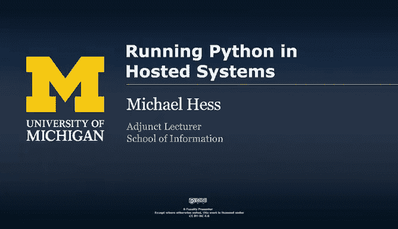
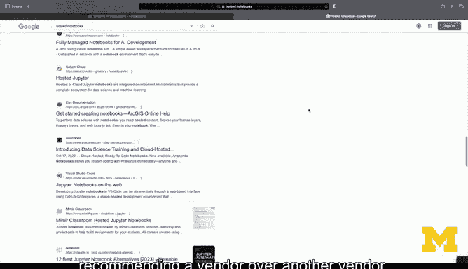
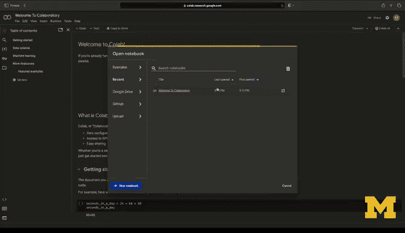
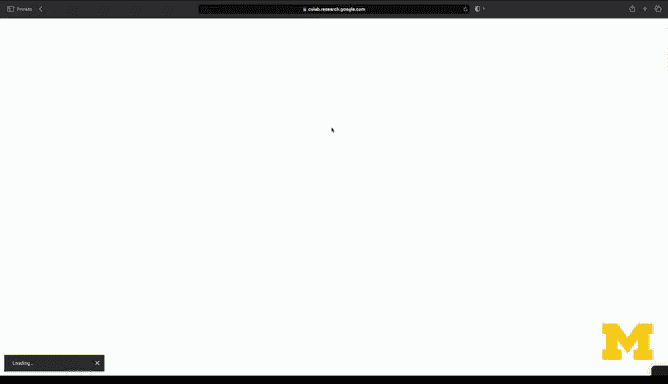
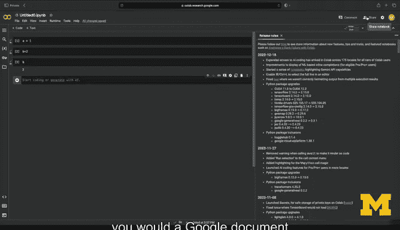

# 密歇根大学《Python3编程（课程3、4、5）》｜Python 3 Programming（Python for everyone进阶）（中英字幕） - P53：52_04_02_在托管系统中运行Python.zh_en - GPT中英字幕课程资源 - BV1gj41177yd

So you've been using runestone， Jupyter notebooks， we've talked about running code locally。

 we've talked about running code in the cloud。 I'd like to take a little bit of time and talk about you know how do you do Python and specifically notebooks outside of Coursera and outside of your local computer and outside of the cloud Now I should say that every cloud vendor has a way to do this but that's often a lot of work to get into just running a notebook you know spinning up an entire cloud account。

 So you know if you do a Google searchbook for hosted notebooks。

 you're gonna get a ton of different results here and I'm not going to spend time going through these。

 I want to be clear that I'm not recommending a vendor over another vendor I'm kind of doing what I'm showing off of popularity and I want to spend a little bit of time talking about Google coabab。

 it's probably one of the most wellus platforms for running notebooks outside of。

You know， one of the cloud services， this isn't really like a real cloud service， Yes， it's Google。

 it's a little bit like an extension to Google Docs。

 it's built and supported by Google And so you can come in here and you can say hey。

 create a new notebook and it's not really Jupiter In class we've used a lot of Jupiter notebook specifically This isn't really Jupiter。

 it's very similar to Jupiter。

It's kind of based off of Jupiter， but it is its own Google product separate from the Jupiter project itself。

 it works in the same way and that you can create， you know a variable a equals one。

You can run the variable， you can do B equals2， you can run it and then you can print out B and it will display the value of that cell as you go you get access to a bunch of Google things as part of this you can get to a terminal for example。

 one of the nice things about this is you actually have the ability to share it like you would a Google document and you can have people working on it together it's a wonderful quick way if you've got you know a small set of data to get in and actually start playing with it near instantly within Google environments Thank you。

