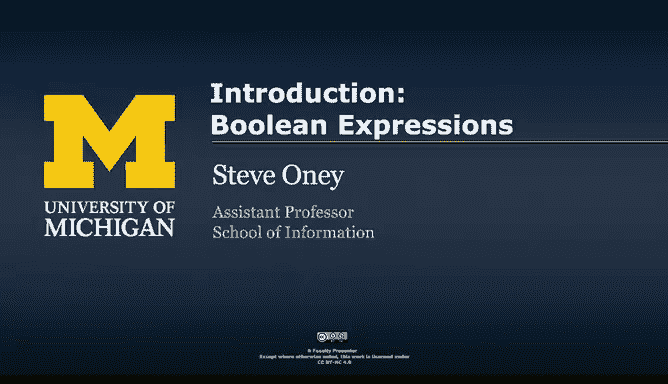

# 密歇根大学《Python3编程（课程1、2）》｜Python 3 Programming（Python for everyone进阶）（中英字幕） - P53：53_03_01_布尔表达式导论.zh_en - GPT中英字幕课程资源 - BV1CM411Z72u

In this lesson， we're going to introduce a new Python type， Booleions。

Bulls are how we express whether something is true or false。For example。

 we might have a Boolean to represent if a string is longer than 10 characters， so either true。

 the string is longer than 10 characters or false， it is not。

We might have Booles to represent if a string starts with M and ends with n。

 if a user is over 16 years old， if a number is an even number and pretty much anything else that we can reduce down either true or false。

We'll learn how to write expressions to represent Booleance for all sorts of conditions。Now。

 I want to note at the outset that Booleans might not seem like the most interesting or useful thing on their own since we just get a value that's either true or false。

 but really things will get interesting when we combine this lesson on how to write Boolean expressions with the next lesson on something called conditional execution where we can make decisions on which code to run based on a Boolean's value。

 So please bear with me and think of this lesson as maybe a necessary prerequisite for the powerful concepts that we're going to learn next。

 See you at the end。