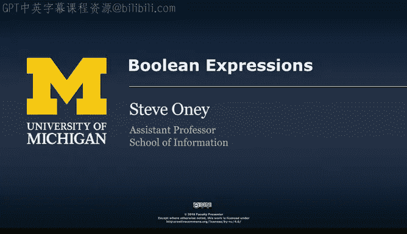
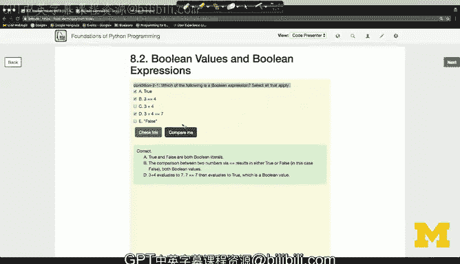

# 密歇根大学《Python3编程（课程1、2）》｜Python 3 Programming（Python for everyone进阶）（中英字幕） - P54：54_03_02_布尔表达式详解.zh_en - GPT中英字幕课程资源 - BV1CM411Z72u

Welcome back。 It's time for us to learn about a new Python type。So far。

 we've seen integers which are good for storing round numbers， floats。

 which are good for storing decimal numbers， strings。

 which are good for storing sequences of characters like words in lists and tuples。

 which are good for storing sequences of other items。In this lesson。

 we're going to learn about a new Python type called Booleions。

Boollions are good for restoring truth values， and that is whether something is true or false。

 In fact， there are only two possible values for Booles， Tru and false。

 And this is in contrast with pretty much every other type。

 So an integer might be negative 105 or one of any infinite number of values。

 but Booles are always either true or false。As a result， we almost never write a Boolean literal。

 instead we typically write expressions that compute values of Booleions。So again。

 Booleans can only have one of two values， true or false。

We can write a Boolean literal by saying capital F false for false or capital T true for true。

So if I print out the value of false。And you can see that。 I get false。

If I print out the value capital T， true。Can I get true。Now。

 just to be sure that these are booles and not strings or any other type。

 then I can say print out the type of the expression。Chu。

And then print out the type of the expression， false。

So I should expect both of these to print out something like Boolean。 so when I run my code。

 then I can see that type of true is classas。 This is short for Boolean。

And type of false is also bo short for boolean。One thing to note about boolean literals is that they are entirely different from strings。

 So if I print out the type of this expression， capital T true。

 and then I print out the type of this expression， capital T true， but in quotation marks。

 then I should see that this。Is it Boolean。And this is a string。

 It's a string whose contents just so happened to be a bulloleying expression true。 But to Python。

 this is just a sequence of characters starting with capital T and then R， U E。So when I run my code。

 I can see that the type of this expression。Is it boolean？

And the type of this expression is a string。So again。

 we almost never actually write Boolean literal expressions like capital T true or capital F false。

 Instead， we write expressions whose values evaluate to be a Boolean。

So we're going to start with one kind of Boolean expression called a comparison operator。

A comparison operator compares one thing on the left。And then one thing on the right。So for example。

 the first comparison operator that we learn is equal to operator。

So the value of this overall expression is going to be true。If。The thing on the left。Is equal to。

The thing on the right。But it's going to be false， otherwise。So let's see this in action。

So on line 1， I print out， is the value of 5 equal to the value of 5。 So the thing on the left is 5。

 The thing on the right is 5。 And so I should expect the value of this overall expression to be true because 5 is equal to 5。

Here on line 2， I print out is the value of 5 equal to the value of 6。

 So I should expect the value of this overall expression to be false。

 And let's see if that's the case。There are other comparison operators that we can use。

So in addition to equals equals， there's the opposite， which is not equal。 we write not equal。

With an exclamation point equals。 so that's true if L is not equal to。Sou。

If the value of L is not equal to the value of r， then the value of this expression is going to be true。

So if I write is5 not equal to6， then I should expect this to be true。

And I can see when I run my code， that it is。In addition to equals equals and not equal to。

 there is less than。Less than or equal to。Greater than。In greater than or equal to。

In all of these expressions， expect one thing on the left。In one thing on the right。

So let's write out a few more Boolean expressions。So I can say print out is the value of the expression 3 less than the value of 4。

I should expect that to be true。I can print out is the value of4 less than or equal to the value of4。

I expect this to be true because4 is equal to4。I can print out。

Is the value of5 greater than the value of 6。I should expect this to be false。

 and if I print out is the value of7 greater than or equal to the value of 8。

 I should expect this to be false as well。So you can see that these are the most common types of comparison operators that we have equal to。

 not equal to， less than less than or equal to， greater than， greater than or equal to。

 and they compare the thing on the left。With the thing on the right in the value of the overall expression is going to be a boolean。

 again， either true or false。So let's answer our multiple choice question。

Which of the following is a balloonan expression。 Select all that apply。

So the value of this expression true is a boolean literal expression。

 so I should say this is a boolean。The value of this expression3 equals equals4 is true if 3 is equal to4。

 but because those two aren't equal， it's going to be false， but this is still a boolean expression。

 So I'm going to say， yes， this is a boolean expression。

This addition between 3 and 4 has the value 7。 that's not a boolean。 that's an integer。

 so this is not a boolean expression。The value of this expression，3 plus 4 equals equals 7。

Is a Boolean expression？And the value of this expression is the string false。

 and so this is not a bullolean expression。So I'm going to say a。Bi。

And D are all bullyan expressions。One thing that I want to note really quickly with this equals equals willan expression is that this is entirely different than saying something like x equals 3。

So if I say x equals 3， this is an assignment。That assigns x to3 if I say x equals 3。

Then this is a comparison。And the value of this overall expression is going to be a boolean。

And if x is equal to 3， its value is going to be true。 If x is not equal to 3。

 then it's going to be false。 But again， the way that we distinguish between assignment and comparison is assignment uses one equals。

 comparisonarison uses two equals。

That's all for now， Until next time。