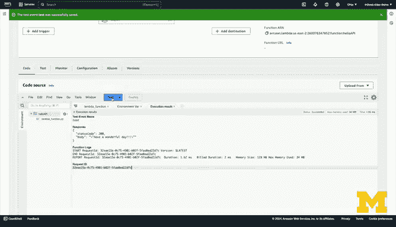
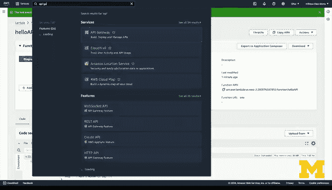
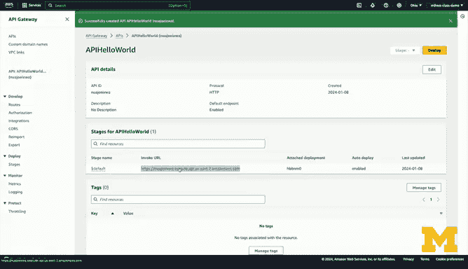
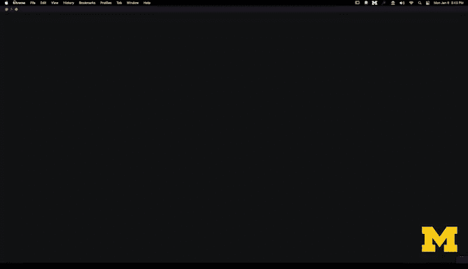
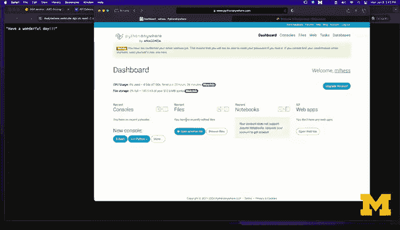
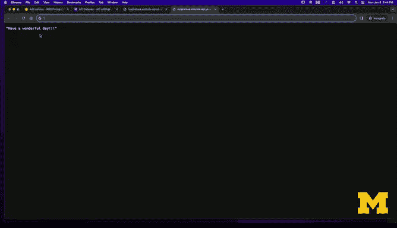
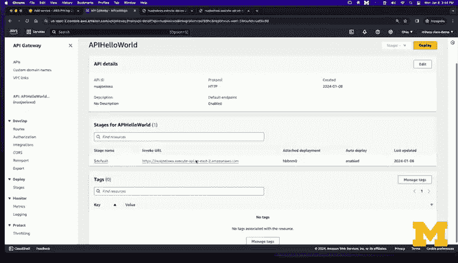
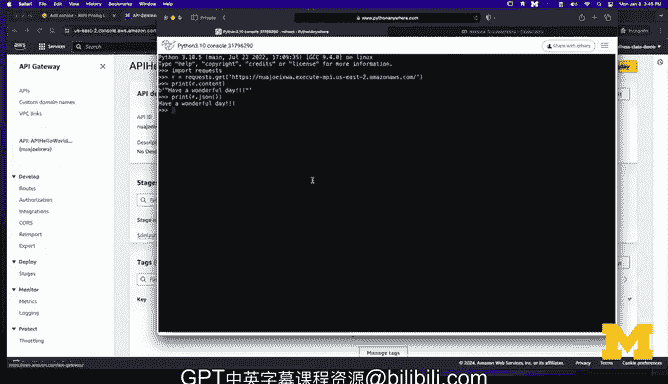

# 密歇根大学《Python3编程（课程3、4、5）》｜Python 3 Programming（Python for everyone进阶）（中英字幕） - P55：54_04_04_自建API第二部分.zh_en - GPT中英字幕课程资源 - BV1gj41177yd

Good afternoon， Good morning， Good evening。 So let's start by building the Python function behind our API。

 Now we've already learned how Lambda works。 This is going to be pretty straightforward in Lambda。

 I'm going to just call this hello API。😊，And we'll say that this is going to be Python。

And we'll just come here。And we'll have it create our function。And for now。

 we're just going to have it say。This is the Have a wonderful day API， have a wonderful day。

So now if you were doing this for real you would actually put code in here you might import the libraries you need and you would actually write your Python code here This is kind of showing you how you would tie different services from Amazon together so I'm less interested in like actually writing the Python code and more of showing how all this interconnects so I'm going go and deploy my function to start with。

And now I've actually got my API， this works， we can create a test harness for this like we did in the previous video。

And we can actually look at。This running and showing our Have a wonderful day API but this is not useful in order to execute this code。

 an end user would have to log in to our Amazon account and press this test button。

That's not really something you can distribute to customers and in fact。

 logging into our AWS account would give them access to do everything in here。

 including delete the function， we need to make this Python function。

 this Lambda function available over a web end point and there's a service in here called API gateway that does just that。

So as you can see there's multiple types of APIs you can create from HP APIs， web soet APIs， RE APIs。

 all sorts of different APIs， we're going to take the quick approach here into do an HP API。

 these are APIs that you could access in Python least with the request library。

And we're going to call this API Hello world。And we're going to basically tell this that this API itself integrates with Lambda。

And。Specifically， the Lambda function we previously wrote， Hello API。And we'll go ahead and say next。

And we're going to say our routes。 So this is a fancy word for basically mapping the URL onto the Python function。

 And so you know， in an actual example， you might have several different URLs available。

 I'm going to actually just get rid of this resource path and just make it a forward slash。

I'll go ahead and say next， go ahead and say next。And great。And when this is done。

 we will get a URL that we can use to communicate with that Lambda function。

And so here is our Hello world API， and as you can see in here。

 we have some different options that are available to us。嗯。😊。

And that you'll see that our slash is linking to our integration that links us to the Hello API。

And if we click here， we can see kind of all the overview of this。

 and one of the things you'll see here is this invoke URL。

And this invoke URL lets us call this from our Python code。

 and so we can actually use this in our Python code since this is a very basic API。

 we can actually just click on this URL。

And you'll see that it comes up and says， have a wonderful day。That's executing that code。

So running this in the browser is great， but we actually want to execute our API using a programming language like Python。

 so I'm going to go ahead and exit out of here。

This full screen mode， and I'm going to open up my Python Any interface。

And。This is a way to just run Python on the command line。

And so we're just going to say import requests。And we can say R equals request do get。

And we'll give it the URL to our API。😡，Yeah。And if we do a print r do content。

We can see that we are getting a response back from our API now you'll notice this looks a little weird。

Doesn't quite look like。Doesn't quite look like it's a string， it's got this be in front of it。

 that's because this is actually returning JSON and so what we really want is print R dot JSON。

And that looks a little bit more realistic。And so you can see that we started over here。

 we built our Lambda function。

We tied that Lambda function to our API gateway， we're then able to execute that API and get data back in Python and we've done this without worrying about any of the infrastructure code behind it。

 the only code we've written is code in Python， we haven't written code to start and stop services to run servers。

 any of that， all of this exists solely in the cloud。

