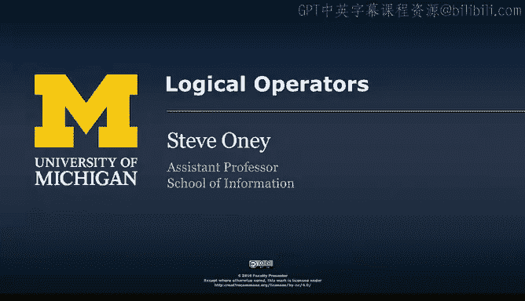
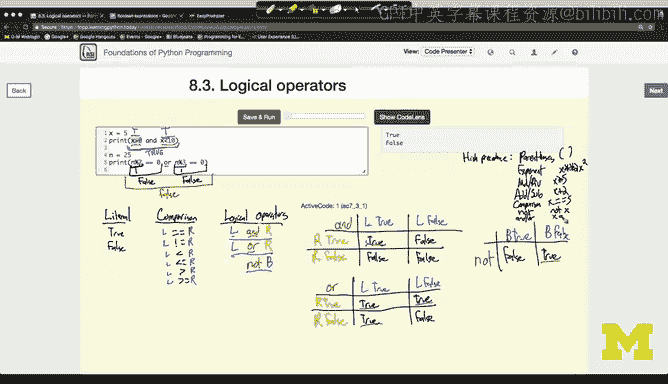

# 密歇根大学《Python3编程（课程1、2）》｜Python 3 Programming（Python for everyone进阶）（中英字幕） - P55：55_03_03_逻辑运算符.zh_en - GPT中英字幕课程资源 - BV1CM411Z72u

So so far we've seen two ways of creating Booleance， we've seen literal expressions。That' sorry。

 they're true。Or false。We've seen comparison operators。That compare two values。

 So there' is equal to not equal to less than less than or equal to greater than greater than or equal to。

 And all of these compare one thing on the left。With one thing on the right。

And the value of the overall expression is going to be true or false。 Again， a boolean。Now。

 there's another way to create Booles， which are logical operators。So like comparison operators。

 logical operators expect one thing on the left and one thing on the right。

So the logical operators that we'll cover and。Or in not。So and and or。

 just like comparison operators， expect one thing on the left。In one thing on the right。

Not only expects one thing。That I'll call B short for boolean。

Unlike comparison operators where the thing on the left and the thing on the right can be an integer or string or pretty much any type。

 logical operators expect the thing on the left and the thing on the right to be Booleing expressions。

So the value of L and R is going to be true if both L and R are true。

The value of L or R is going to be true if either L is true or R is true or both are true。

 and the value of not B is going to be true only if B is false。

In order to make it clear how these logical operators work。

 I'm going to draw what's called a truth table， so I'll start by drawing the truth table for and。

So remember that LNR are both Booles。And so。L is either going to be true or false。

 So I'm going to represent whether L is true or false in columns。

 So here the first column is going to represent L being true。

And the second column is going to represent l being false。

I'm going to represent the value of r and rows。 So R being true。Is the first row。In are being false。

Is the second row。So every cell represents the combination between L and R values represented by that row and column。

 so here this cell represents L is true and R is true。This represents L is true and R is false。

 This represents L is false and R is true， and this represents L is false， and R is false。

I'm going to write the value of L and r in each cell。So here， if L is true and R is true。

 then L and R is true。If r is false， but L is still true。

 then the value of L and r is going to be false。And if the reverse were true。 So if L were false。

 but R was true， then the value of L and R is going to be false。And if both are false。

 the value of L and R。Is going to be false。So you can see that L and R is true only if L is true and if R is true。

Let's write out the truth table for or。So just like and we have l and r，So。We have L true。E falls。

And we have our true。Are false。So if the value of both of these is true。

 then the value of L or R is going to be true。If L is true and R is false， then L or R is true。

sme thing with if our is true but al is false，The only way that l or r is going to be false is if l is false and r is false。

So you can see L or R is going to be true if either L is true or R is true。

And then the table for not is a little simpler。So if B is true。If B is true。

 then the value of not B is going to be false。If B is false， the value of not B is going to be true。

So you can see that not B is only true if B is false。So when we write out logical operators。

 you don't need to write out these truth tables entirely。

 but I use these truth tables as a way to understand systematically how and or and not work。

So let's look at some code。In this code， we assign the variable x to have the value 5。

 and we print out x greater than 0 and x less than 10。So here on the left。

 we have one Boolean expression。And we have another boolean expression here on the right。

What that means is that the value of this overall boolean expression is going to be true only if this expression is true and this expression is true。

So we can check， is x greater than 0， Well x is equal to 5， and so yes，5 is greater than 0。

 so this is true。Is x less than 10。Well， I see that x is 5， and yes，5 is less than 10。

 so this is true。And what that means is that if this is true and this is true。

Then we're here in our truth table， meaning that the value of this overall expression is true。

On line4 we assign a variable n to have the value 25。And we print n modulo 2 equals 0。 Now。

 remember that modulo means remainder。 So what this is saying is what's the remainder of when we divide n by 2。

So when we take modulo 2， we're either going to get0 if it's an even number or one if it's an odd number。

 because even numbers will divide by  two and have no remainder。

 odd numbers will divide by  two and have a remainder of1。Here we see the n is twenty5。

 which is an odd number。 So n modular two is going to be one。If we take n modular 3， Matt's asking。

 is there a remainder when we divide by 3。And we should actually have a remainder of one when we divide by 3。

And so what that means is that this expression n modulo 3 equals equals 0。

 the value of this expression is going to be false because it's comparing one with0 and checking if they're equal。

In n matulo 3 equals equals 0， the value of this overall expression is also going to be false。

Because one is not equal to0。And so when we ask。False or false。 Then we fall here in the truth table。

 and false or false is going to be false。So I'm printing out true， and then I'm printing out false。

Let's check our work。So you can see we get true。In then false。

So if you recall from a previous lecture， Python has a notion of operator precedence。

So at the highest precedence。Is when we have parentheses？And then just below that is exponentiation。

That's when we say something like x star star2， which stands for x squared。Below that。

 we have multiplication in division。So that's x times 5 or x divided by 5。 Then we have addition。

In subtraction。X plus2。And so our comparison in logical operators do fall in this order of precedence。

In fact， comparison operators fall just under addition and subtraction。 So here we have comparison。

Like equals equals。Then below that， we have the not operator。Like， not。X， and then below that。

 we have and in or。So， that's like x and y。

What that means is that if we have an expression like x greater than 5。And why less than2。

Then Python is first going to evaluate this expression because this comparison between x and 5 has a higher precedence than the and。

And then it's going to evaluate this overall expression。That's all for now， Until next time。

