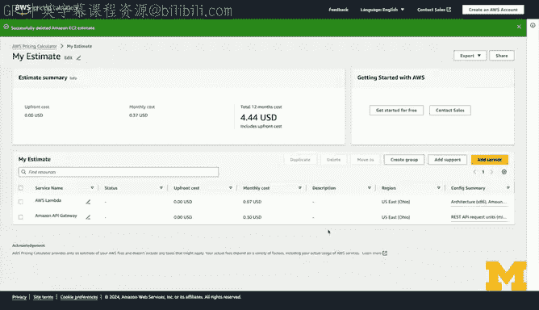

# 密歇根大学《Python3编程（课程3、4、5）》｜Python 3 Programming（Python for everyone进阶）（中英字幕） - P56：55_04_05_自建API第三部分.zh_en - GPT中英字幕课程资源 - BV1gj41177yd

So we've built our API， we've called it from Python the next thing you should be worried about is the cost of your API I said there were going to be 10。

000 calls to this API per day。And so you know there's kind of a different two different ways of pricing this out。

 you know， we have two AWS services involved here and the website in front of me is the tool set that Amazon provides for calculating costs every cloud provider has one of these and so let's look at what it would cost us to just run this so Lambda is the first service we have。

And there's some guessing that we're going to have to do as we fill this out。

But you'll give you a basic idea， so I said there's going to be 10000 requests per day。

 you can see that the the metrics on here get get increasingly more frequent， but we'll say per day。

And how many milliseconds does each request run？It's not going to take a full second to run each of those because it's just saying hello world。

 it's probably measured in like， you know， less than 100 milliseconds。

 but let's just say it's going to take a full second to run it。And how much memory， well。

 minimum Python or lambmbda has is 128 megs of Ram， so we'll just set that。

And what is this actually going to cost us Well， there's some math in here and you'll notice that there's a free tier in AWS AWS as well as every other cloud service provider has this free tier。

We'll go ahead and turn that off so that we can see the cost without the free tier。And so our costs。

It's going to make me fill this out again， our costs。For this service。Thous0 requests。

So our cost for the service is 7 cents per month now， as I said， there's two services involved here。

 Lambda the first service， the second service is the API gateway itself。

 so let's go ahead and add this to our be。And we will go to the API gateateway。

And we are using an HTTP API。And we're going to say exact number here， we've got 10。

000 requests per not hour per day。And the average size， it's really about a kilobyte per request。

And that's going to run us 30 cents a month， so we'll ahead to add that to our budget。

And our entire 12 monthth cost on this， if we were to run this service at $10。

000 request every month would be $444 with our monthly cost being around 37 and we have zero upfront cost on this platform。

 you can see it's pretty cheap to run this。 even if we get in here and we start making changes to the way this works。

 Let's just， you know， let's make this fun。 let's say it's per hour。

 we're gonna do 10000 requests per hour。Well， that's only 167 per month when we make that change。

 It's really affordable to run API gateways and Lambda functions。 It is a， you know。

 wonderful way to start in this space if you're a business to get up and running quickly and efficiently Now I mentioned that this is the cloud and there's different ways to do this in the cloud。

 if we were to think about this in the old way of doing things。

 If we were to spin up a dedicated server to run our Pth on well。

 the cloud actually does support that， they call it EC2。😊，And we can go through and just say。

 you know， what is this going to look like， we can say this is a constant usage will' take， you know。

 one of their smaller instances here。嗯。😊，And just you know， that service。

 and I click through it a little quickly， but that service runs $3。80 per month。

And we are now responsible for standing up the servers， dealing with the firewall。

 all sorts of different things to make that working。 whereas between Lambda and the API gateway。

 all we have to do is click in the interface。 So we're going to take this off of our cost calculator。

And if I were starting something new today， I would be using AWS Lambda and API Gateway or one of the other cloud providers similar functionality。

 Thank you。

