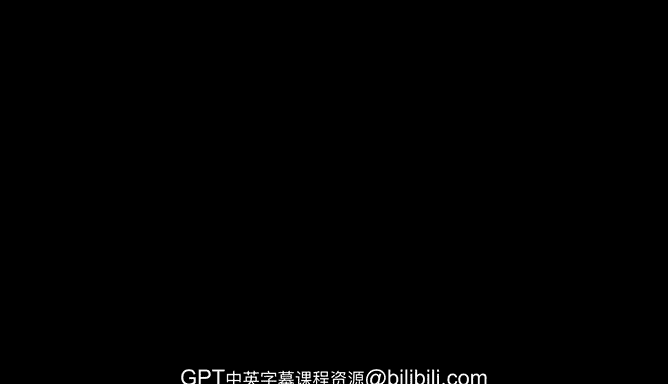
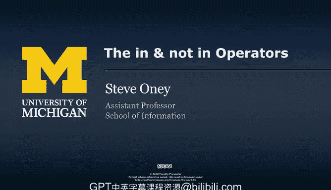
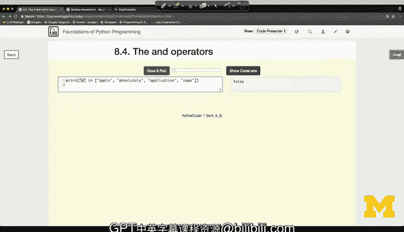

# 密歇根大学《Python3编程（课程1、2）》｜Python 3 Programming（Python for everyone进阶）（中英字幕） - P56：56_03_04_in与not-in运算符.zh_en - GPT中英字幕课程资源 - BV1CM411Z72u

So there are two more useful operators for producing boolean values。First， we're going to go over in。

 and then we're going to go over its opposite， not in。

So in checks to see if the thing on the left is a member of the thing on the right。 So， for example。

 here， suppose that we have a string apple， and we want to check if some substr is contained in that string。

So the value of this expression is going to be true because the character P is an apple。

The value of this expression is going to be false because the character I is not an apple。

The value of this expression is going to be true because the substring AP is an Apple。

In the value of this expression is going to be false because PA is not an apple。

 so I should get true。False， true， false。So if I print out is a in the string a。

 then I should get true because， yes， even though these two things are the same， technically。

 this is inside of this。Same thing with if I spell out Apple。

 So the value of both of these expressions will be true。Somewhat weirdly。

 if I check to see if an empty string is contained in any other string， then I'm going to get true。

 So is this empty string inside of the string A， it's kind of debatable what the answer should be。

 But the way that Python evaluates this expression， I get true。

So if I check to see if this empty string is in the string Apple。

 I'm going to get true for this as well。Now， the opposite of in is not in。

So if I check to see if something is not in another string。

 then I'm going to get true if it's not in that string， so X is not in Apple。

And so the value of this overall expression is going to be true because the string apple doesn't contain the character X。

So somewhat confusingly， this knot has the same spelling as something like not。Booolean expression。

But these are entirely different things。 They kind of have the same function。

 which is reversing the value of a Boolean expression。

 So I'm saying not B is going to be true if B is false and not in is going to be true if this is not in it。

 But to Python， they are different kinds of expressions。

So I just want to also illustrate that in also works with lists。 So here。

 if I check to see if this item is in this list。I'm going to get the value false because it's checking to see。

 is there an item in this list。Whose value is just the string a。

Even though I have some strings that happen to contain A's。

 there is no item whose value is equal to a。 so I get false for this expression。That's all for now。

 Until next time。

