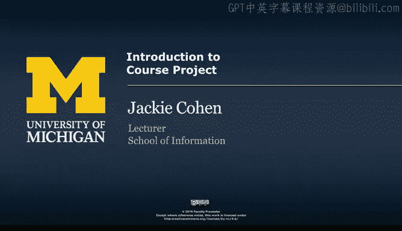

# 密歇根大学《Python3编程（课程3、4、5）》｜Python 3 Programming（Python for everyone进阶）（中英字幕） - P57：56_04_01_最终课程项目简介.zh_en - GPT中英字幕课程资源 - BV1gj41177yd

Hello and welcome to the project for course 3 In this project you'll be making what's called an API Mashup。

 you'll be getting and using data from two different APIs。 So ultimately， in this project。

 you will get data from two different places on the Internet。

 process all of that data in a step by step way and achieve a new result that comes from getting the data from two different places。

 Just like other APIs you've examined before in this course you will need to read and understand the documentation that goes with each of these APIs and your goal with reading and understanding that documentation will be to pull out the information from the documentation that you need in order to make a request to each API。

 So you might need to read through some stuff that's complicated or includes things that you don't necessarily need or words that you haven't heard before。

 just to find those pieces of information that you really want to find like， for example。

 the base URL for the API request。You'll want to keep in mind as you work on this project what you know already about building functions。

 because that's something else that you'll do throughout this process of building a result and processing data。

😡，You'll want to remember that as you work on this project。

 you'll be using the special tools that we've built in this specialization to allow you to get and cache data from the internet and retrieve data from the cache。

As you work through each step， make sure to take each slowly。

 think carefully about what exactly it is you want to achieve at a given moment。

Make your plan in words。 You've probably heard me say this before and then translate those words into code。

 And that will make the process of building up a result from these brand new APIs much easier and make it seem much more like the other things that you have already done in code before。

This is a type of program getting data from two different places and doing something new with it that is useful in all kinds of situations。

 in all kinds of work and all kinds of different disciplines。 I wish you a lot of luck。

 and I hope you have fun。