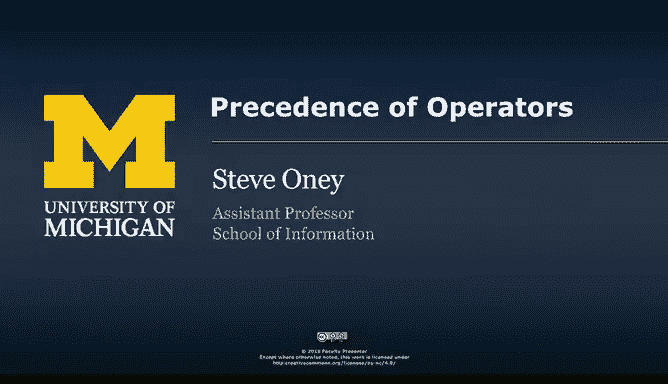
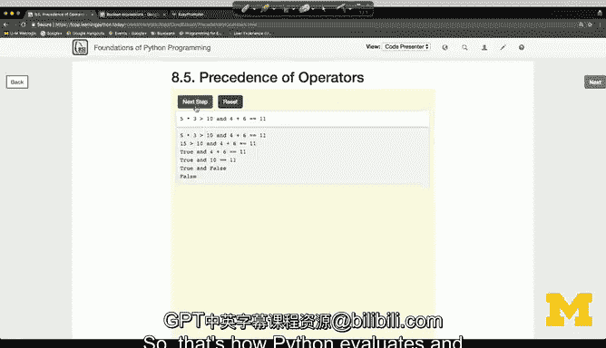
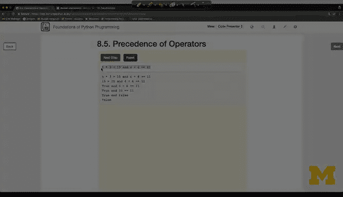

# 密歇根大学《Python3编程（课程1、2）》｜Python 3 Programming（Python for everyone进阶）（中英字幕） - P57：57_03_05_运算符优先级.zh_en - GPT中英字幕课程资源 - BV1CM411Z72u

In this question， we ask which of the following properly expresses the precedence of operators using parentheses of the following expression。

 And here we have this expression。So I know that and is going to be the lowest precedence operator。

 So this thing on the left is going to be evaluated。

 and then this thing on the right is going to be evaluated。 So now the question is。

 within these expressions， what gets evaluated first。

So multiplication has a higher precedence than comparison。

 So this is going to be evaluated first so I should know that their parentheses around five times3。

And then we compare that to 10， five times 3 is greater than 10。

And I can add parentheses around this whole thing。Now on the left hand side。

Addition has a higher precedence than this comparison。 So I should say 4 plus 6。Is in parentheses？

And then， we compare that with。11。And this overall expression is in parentheses。

And so our result should look like this。And we can see that that's in a。

So let's see this example step by step the way that Python would evaluate it。

 So here we have the exact same expression，5 times 3 greater than 10 and 4 plus 6 equals 11。

So Python sees this overall expression， and the first thing that it evaluates is 5 times 3 and it gets 15。

And then it's going to check， is 15 greater than 10。 That gets true。

And then it's going to check the value of 4 plus 6， so it gets 10。And then it's going to ask。

 is 10 equal to 11， and that's going to be false。And then it's going to take the value of true and false and get false。

So that's how Python evaluates and breaks down this complex expression。

