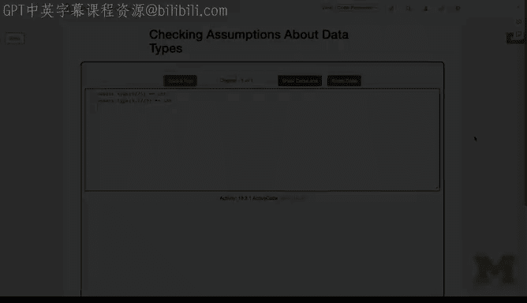
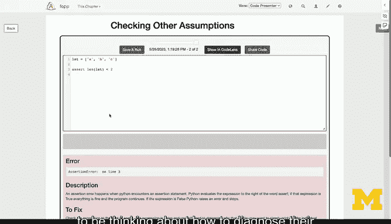

# 密歇根大学《Python3编程（课程1、2）》｜Python 3 Programming（Python for everyone进阶）（中英字幕） - P58：58_03_06_使用assert进行自动化测试.zh_en - GPT中英字幕课程资源 - BV1CM411Z72u

Now that you know about the idea of a Boolean value， something that's either true or false。

 we can introduce the idea of automated tests for computer programs。

A test case expresses requirements for a program in a way that can be checked automatically。

 it expresses what some object's value should be at a specific spot in the program execution。

Python has the assert statement for writing automated tests， it works like this。After the wordas。

 you have some Boolean expression。That is an expression that evaluates to either true or false。

Typically， you check that a variable has a particular value or that it has a value greater or less than some other value。

When the assert statement is executed， the interpreter just checks whether the expression evaluates to the value true。

If it's true， the interpreter goes on to the next line of code， if it's not true。

 the interpreter raises a runtime error which stops the execution。

this code illustrates the mechanics， the first line asserts that 9/lash/lash5 is an integer。

Slash slash， applied to two integers， always yields an integer， truncates the result。

So just to remind you。If I print。9ine slash slash5。And run it。Without any of these type assertions。

It says it's one。So it's actually whatever 1。8， and we truncate that and we get one。

So going back to the。Aer statements。The type of9/lash slash5， note1 is going to be an integer。

So when I assert。That that whole expression evaluates to true and the assert statement。I's just fine。

 we say that we've passed the test and it goes on to line two。But when it gets to the second line。

 when it asserts that 9。0 slash slash5 is an integer。That won't be true because it's 9。

05 is actually a floating point。So we get an assertion error online too。

The thing that was supposed to be true。Is actually false。Now， why is it useful。

 you might ask yourself to write these assert statements。I mean， nothing good can happen。

 all you can do is go on to the next line of code。And not get an error， or you could get an error。

But it never sort of advances the。The thing that your code was supposed to do。Well。

 there are a couple reasons why it's a good idea。First。

 writing down test cases forces you to be more concrete about what the program should do。

It's hard to correctly implement a program if you're not completely clear in your own mind about what the program ought to be doing。

Second， test cases can give you feedback as you're writing the code actually。

 you've already experienced that with the autograders that gave you feedback in some of the active code windows。

Those autograders are just test cases that were hidden， where you didn't see them。

 but they were running in the background。With assert statements， you now get to write your own。3。

Writing test cases is a good preview of the unit testing practice that is used on pretty much all larger software projects。

When there's a lot of code and many people contributing。

 the project really needs to know when my code is breaking a function that somebody else wrote that's calling my code。

So big projects will have these tens of thousands of unit tests。

 and they all get run every time someone tries to contribute any change to any of the code。

And we've previously suggested that it's a good idea to first write down comments about what your code is supposed to do before actually writing the code。

 you can think of writing test cases as basically an extension of that advice。

 instead of just writing a human readable comment， you write a computer executable test case。

Let's see some others。This example iterates through a list。

 checking that all of the elements in the list have the same type。

It's actually worth looking at this one in code lens。So I'm setting the variable LST。

 which I'll just refer to as list。To be A， B， and C。

So we can see that reflected in the variable binding here。I'm setting the type of the first item。

To be that's my variable first type， to be the type of the first thing in the list。

And so now it's reporting that the first type is。String。

Now I'm going to iterate through all of the items in the list。And for each of them。

 I'm going to make an assertion。That they're all having their type。Is all the same as first type。So。

Item is now a， its type is string， and we check that it has the same type as first type。If it didn't。

I would get an error， but it does， so we're fine。And it goes through all of them。

 checking that they all have the same type。If I did the same thing with a different list。

Now I've got list two。It first type is。Also a string。

But now I'm going to go through all of the elements。And when I get。To when the item is 17。

 now I'm going to fail on this assertion。And we get。An assertion error。

So that was a way of checking that all of the items in a list have the same type。

 You don't always have to assert that two things are equal。Here we're asserting that the length。

The LST is less than 10， and it is。So we have no problem。

 but if we said that the length is less than2。We would have a problem。

 we would get an assertion error。Again， the point of these asserts is that we want to get an error。

When some assumption that we had about what the state of the execution should be at a certain point。

 when that assumption is violated， we'd like to know right then rather than have the program continue on with its wrong values that is with its values that don't match what the program or thought should be happening at that point in the program。

The whole purpose of these is to test things for us in an automatic way and tell us when something's wrong。

 It doesn't fix anything for us。 All it does is alert us about errors。

You're going to see what we're going to keep introducing more testing throughout the rest of this specialization。

 we think it's good even for novice programmers to be thinking about how to diagnose their code and to write these automated tests。

I'll see you next time。