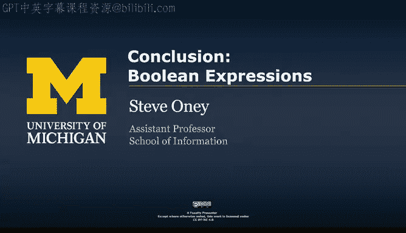

# 密歇根大学《Python3编程（课程1、2）》｜Python 3 Programming（Python for everyone进阶）（中英字幕） - P59：59_03_07_布尔表达式总结.zh_en - GPT中英字幕课程资源 - BV1CM411Z72u

So in this lesson， we learned about Booleions which represent whether something is true or false。

As I mentioned in the introduction for this lesson。

 Booles might seem a little bit strange when we look at them in isolation。

 but you'll see their value when we combine them with conditional execution in the next lesson。

Now normally this is where I would tell a joke about Booles。

 but I'm not going to do that here because the problem with Boolean jokes is that people never really listen to the joke。

 they just want to know if it's true or false。See you next time。

