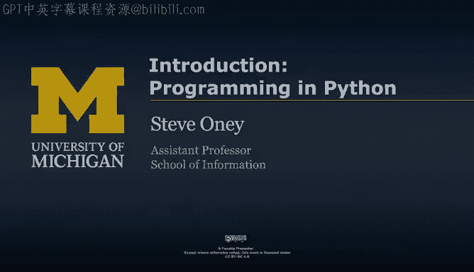

# 密歇根大学《Python3编程（课程1、2）》｜Python 3 Programming（Python for everyone进阶）（中英字幕） - P5：05_01_01_Python编程导论.zh_en - GPT中英字幕课程资源 - BV1CM411Z72u

In this lesson we're going to start learning how to use the Python programming language。

 I think Python is an excellent first language because of its readability and versatility Python is used in a wide variety of domains including data science。

 artificial intelligence and even art。Now when we write a program。

 we're giving the computer step by step instructions for how to perform some action or solve some problem by the end of this lesson。

 you should be able to write Python code that does some limited interaction with the user perform some computation and can present an output to the user see you at the end。

