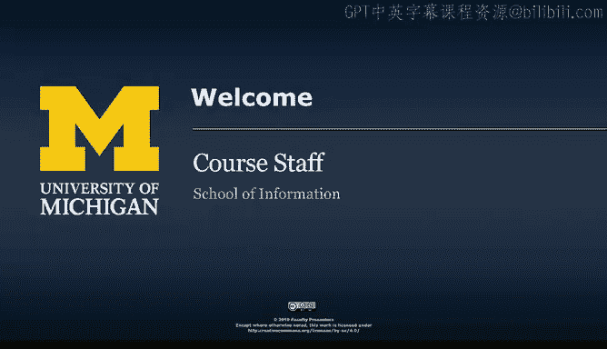
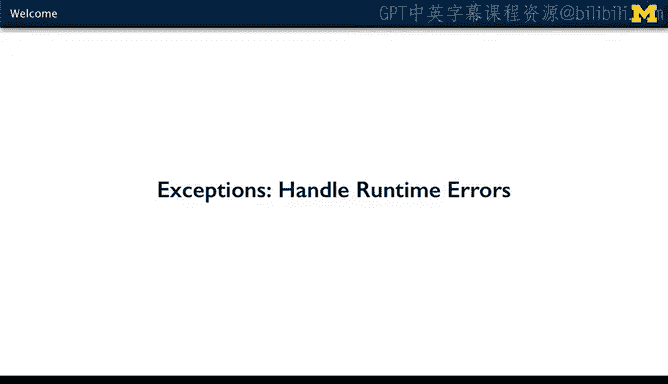
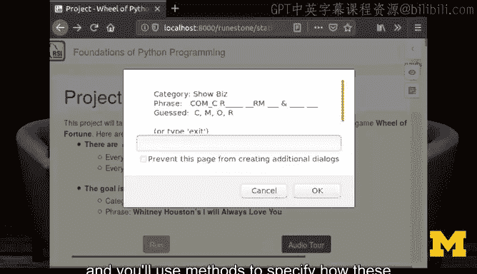

# 密歇根大学《Python3编程（课程3、4、5）》｜Python 3 Programming（Python for everyone进阶）（中英字幕） - P60：03_01_03_欢迎学习Python类与继承.zh_en - GPT中英字幕课程资源 - BV1gj41177yd

Welcome， if you're returning， we're delighted to have you。

And if you're just joining us for the first time， we're also glad that you're with us at this point。

 we're assuming that you're comfortable with functions， with dictionaries。

 you can extract data from nest to data structures and that you are comfortable with Python's list comprehensions。

If you're joining us for the first time， please make sure to look at the video on the Runestone environment because we'll still be using that for much of what we do here。

I'm Steve onlyney， I'm Paul Resnick。We're both faculty members at the University of Michigan School of Information in this course you'll learn about classes classes are nice because they allow you to combine the methods and data that are relevant to some problem into one nice easy to use package。

In fact， classes are so nice that some programming languages like Java require you to use classes in order to use the language at all。

Python makes classes optional， but as you'll find out in this course。

 they can make your code much easier to read and write。You also learn about class inheritance。

 class inheritance allows you to reuse code which can make your code a lot more concise and easier to read。

You'll also learn about test cases in this course。It's kind of an advanced topic for an intro programming sequence。

 but we think it's really valuable to get into the habit of writing test cases from the very beginning of your programming career。

A test case is a way of specifying what a function or a class should do。

If you write some test cases and then you implement your function， if it passes the test cases。

 you know that the function is implemented correctly， if it doesn't pass。

 you know you did something wrong with the function。And you'll also learn how to handle exceptions。

 so you've probably encountered runtime exceptions before。

 and whenever you encounter a runtime exception， so when you have a variable that doesn't exist when you try to divide by zero。

 whenever something like that happens， then Python just stops running your program and gives you an error message。

 so we'll learn how to actually handle these kinds of runtime exceptions and give you more control over how Python evaluates your code。

In the project for this course， you'll use what you learned and write a game of Whe of fortunetune。

 and you're going to use classes to represent the human player and the computer player。

 and you'll use methods to specify how these players can compete against each other。

Dr。 Chuck， Chuck Severance will make a cameo to show you how classes and inheritance make it easy to implement web programming using the Django framework。

Like previous courses， we'll mostly have screencasts with code examples。

 but will occasionally come on screen in order to introduce words of wisdom or to introduce topics。

I'll offer a few more dad jokes， but not too many this time goes this course is mostly steep。

So let's get started bye for now。